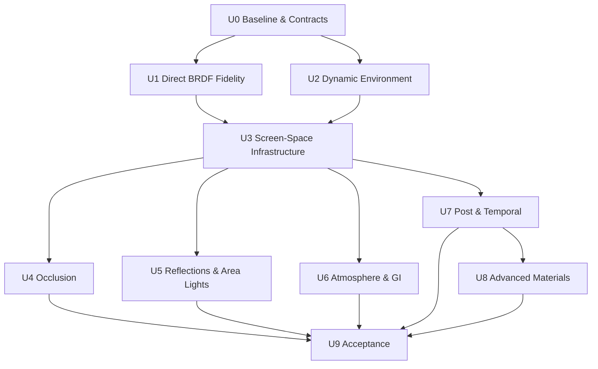
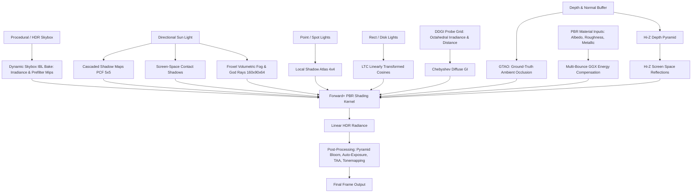

# Milestone 14 — Lighting and Material Fidelity Architecture

## 1. Target and Scope

Milestone 14 (Phase 44) elevates AxleEngine's lighting, shading, and material systems from foundational Cook-Torrance Forward+ PBR to cinematic-grade photorealism (AAA fidelity). The architecture is delivered through independently releasable Units so shader-only improvements, shared RHI infrastructure, authoring contracts, and experimental GI do not share one unbounded acceptance gate.

Supporting detailed roadmap reference: [docs/archive/design/deferred/ADVANCED_MATERIAL_FIDELITY_ROADMAP.md](../../archive/design/deferred/ADVANCED_MATERIAL_FIDELITY_ROADMAP.md).

---

## 2. Unit Architecture and Dependency Contracts

### 2.1. Unit Contracts

| Unit | Primary responsibility | Required exit evidence |
|---|---|---|
| U0 | Baseline audit, capability matrix, fallback diagnostics, fixture contract | Existing 44.1–44.3 tests remain green; no regression in OpenGL policy |
| U1 | Kulla-Conty GGX and solar angular-radius lighting | Numeric shader/LUT checks, native image parity, rough-metal fixture |
| U2 | Procedural sky capture and dynamic IBL generation | Six-face orientation, cache generation/lifetime, native sky/metal response |
| U3 | Depth/normal targets, UAV/storage views, compute recording, barriers, transient realization, history ownership | Resource lifetime/fault/retry tests, D3D12/Vulkan validation-clean compute fixture |
| U4 | GTAO and directional contact shadows | Off/on parity, occlusion grounding fixture, capability fallback |
| U5 | Hi-Z/SSR, reflection probes, LTC area lights | Screen-space miss fallback, probe blending, area-light material fixture |
| U6 | Froxel fog and opt-in DDGI | Bounded volume memory, temporal reset, no-light/leak fallback, DDGI diagnostic policy |
| U7 | Bloom, histogram exposure, TAA | Exposure adaptation, history invalidation, camera jitter, transparent/UI policy |
| U8 | Sheen, Beer-Lambert, SSS and any Material Graph extension | Built-in material serialization, shader parity, explicit graph support decision |
| U9 | Final quality/performance acceptance | Shared benchmark matrix, GPU timestamps, parity and scorecard evidence |

### 2.2. Production and Experimental Boundaries

- U0–U4 form the minimum grounded-lighting path. U7's stable bloom/exposure portion may join this core after measurement.
- U5, U6 fog, and U8 remain opt-in until their quality, lifetime, and performance evidence is complete.
- U6 DDGI is experimental and must fall back to IBL/ambient lighting without changing authored scene behavior.
- U9 consumes the benchmark and timestamp infrastructure owned by Milestone 18; Milestone 14 must not invent a competing measurement contract.

---

## 3. Architectural Layers and Algorithms

### 2.1. Energy-Conserving BRDF & Material Models
- **Multi-Bounce GGX (Kulla-Conty):** Standard single-scatter GGX loses 20% to 40% energy at high roughness. Phase 02 integrates the Kulla-Conty multi-scattering compensation term:
  $$f_{\text{add}} = \frac{(1 - E_{\text{ss}})(1 - E_{\text{ss}, v})}{\pi (1 - E_{\text{avg}})} \cdot \frac{F_{\text{avg}}}{1 - F_{\text{avg}} (1 - E_{\text{avg}})}$$
  restoring luster to rough metals (satin aluminum, rough gold, cast iron).
- **Subsurface Scattering (Screen-Space SSS):** Separable Gaussian diffusion profile for skin, wax, jade, and translucent plastics.
- **Cloth and Sheen BRDF (Charlie Model):** Simulates micro-fiber grazing retro-reflection for velvet, silk, and suede.
- **Volumetric Absorption (Beer-Lambert):** Physical light extinction $I = I_0 \cdot e^{-\sigma_a \cdot d}$ and Cauchy chromatic dispersion for thick colored glass and liquids.

### 2.2. Multi-Tier Reflection System
- **Tier 1 (Hi-Z Screen-Space Reflections):** Raymarching across hierarchical depth mip chains with roughness cone tracing, providing local reflections of floors, walls, and neighbor meshes.
- **Tier 2 (Parallax-Corrected Reflection Probes):** Local box/sphere cubemaps capturing interior environments, providing seamless fallback when SSR rays miss or leave screen bounds.
- **Tier 3 (Dynamic Atmospheric IBL):** Renders the procedural atmospheric sky dome to a dynamic $128 \times 128 \times 6$ cubemap, generating real-time Irradiance and Prefilter LODs so metallic materials naturally mirror the sky without requiring external HDR files.

### 2.3. Micro-Shadowing & Contact Occlusion
- **GTAO (Ground-Truth Ambient Occlusion):** Horizon-based hemispherical integration with edge-preserving spatial bilateral filtering, grounding geometry firmly to floors.
- **Screen-Space Contact Shadows:** Raymarching short depth screen rays toward the sun, eliminating shadow acne and Peter Panning at ground-contact seams.

### 2.4. Volumetric Atmosphere & Global Illumination
- **Froxel Volumetric Fog:** 3D Frustum Voxel Grid ($160 \times 90 \times 64$) accumulating participating media in-scattering and shadow extinction per froxel with Mie scattering and temporal reprojection.
- **DDGI Probes:** Real-time multi-bounce indirect diffuse lighting using axis-aligned probe lattices ($32 \times 16 \times 32$), dual octahedral texture atlases, and Chebyshev visibility to mathematically eliminate light leaking.

### 2.5. Realistic Area Lights (LTC)
- **Linearly Transformed Cosines:** Replaces idealized zero-dimension punctual lights with physical Rectangular and Disk area lights, producing authentic softbox studio reflections.
- **Sun Angular Diameter:** Muzzle expansion of direct directional sun specular lobes based on the actual solar angular size ($0.53^\circ$).

### 2.6. Cinematic Post-Processing Pipeline
- **Physically Based Pyramid Bloom:** Dual Kawase / Gaussian downsample-upsample pyramid producing natural lens flare and specular glow.
- **Histogram-Based Auto-Exposure:** Compute shader log-luminance histogram (64 to 256 bins) modeling human eye dark/light adaptation.
- **Temporal Anti-Aliasing (TAA):** Sub-pixel jittering with neighborhood clamping (YCoCg), completely eliminating specular flicker on metallic silhouettes.

---

## 4. Technology and Compatibility Limits

1. **RHI Ownership:** Direct3D 12 and Vulkan via NRI serve as the primary backends for advanced compute/graphics passes (GTAO, Hi-Z SSR, TAA, Froxel Fog, DDGI).
2. **OpenGL Fallback Policy:** OpenGL 4.5 retains functional compatibility via analytical ambient and punctual lights, explicitly reporting when compute-driven features (SSR, GTAO, DDGI) are bypassed.
3. **Hardware Independence:** High-end features remain scalable via quality presets (Low, Medium, High, Ultra).
4. **Shared Infrastructure First:** U3 must provide storage/UAV views, compute-pass ownership, resource barriers, transient realization, and history lifetime before dependent Units can publish production behavior.
5. **Authoring Boundary:** New lights, probes, material fields, and graph shading models require synchronized component, extraction, serialization, editor, and runtime contracts; shader-only support is not sufficient for authored features.
