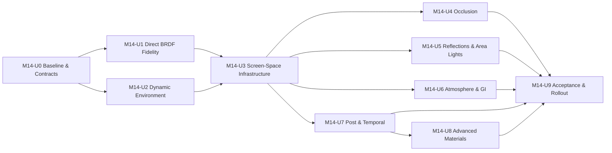

# Milestone 14 — Lighting and Material Fidelity Plan

**Status:** Phase 44 Baseline (formerly OPT-13 Baseline) completed and accepted; the remaining work is decomposed into independently releasable Units. No pending Unit is released by this planning document.
**Supporting Architectural Document:** [`ARCHITECTURE.md`](ARCHITECTURE.md).
**Supporting Detailed Plan:** [`docs/archive/design/deferred/ADVANCED_MATERIAL_FIDELITY_ROADMAP.md`](../../archive/design/deferred/ADVANCED_MATERIAL_FIDELITY_ROADMAP.md).

---

## 1. Executive Summary

Milestone 14 elevates AxleEngine's lighting, shading, and material systems from foundational Cook-Torrance Forward+ PBR to cinematic-grade photorealism (AAA fidelity). It builds upon the verified Phase 44 baseline (CSM, HDR/IBL, Local Shadows, and Viewport Fixture Grounding) and defines the roadmap for real-time global illumination (DDGI), volumetric atmosphere, contact occlusion, and physically based surface models.

---

## 2. Completed Work Packages (Phase 44 Baseline, formerly OPT-13)

- [x] **Phase 44.1: Cascaded Shadow Mapping (CSM)** — 4-cascade camera-space split, texel stabilization, depth bias, PCF 5x5 sampling across D3D12 and Vulkan, with OpenGL fallback (`C13-01`).
- [x] **Phase 44.2: HDR Environment & Split-Sum IBL** — Equirectangular HDR cubemap loading, irradiance convolution, prefilter roughness mip chain, and 2D split-sum BRDF LUT integration (`C13-02`).
- [x] **Phase 44.3: Local Shadows & Viewport Fixture Correction** — Point and Spot light shadow atlas, conservative bounds culling, corrected Sphere CCW winding order, grounded primitive creation ($Y=1.0$ for Sphere, $Y=0.0$ for Plane), and starter HDR scene connection (`Studio_Softbox.hdr`).
- *Evidence:* [`docs/reviews/OPT_13_C13_01_NATIVE_DELIVERY.md`](../../reviews/OPT_13_C13_01_NATIVE_DELIVERY.md), [`OPT_13_C13_02_DELIVERY.md`](../../reviews/OPT_13_C13_02_DELIVERY.md), [`OPT_13_LOCAL_SHADOWS_DELIVERY.md`](../../reviews/OPT_13_LOCAL_SHADOWS_DELIVERY.md).

---

## 3. Unit Decomposition and Dependency Order

The remaining phases are grouped by architectural ownership and risk. Each Unit is an execution boundary with its own implementation commits, Debug/Release checks, native D3D12/Vulkan evidence, OpenGL capability-policy coverage, and a separate delivery report. A Unit may contain multiple checkpoints; a checkpoint must leave the tree buildable and testable.

### 3.1. Unit Boundaries

- **M14-U0: Baseline & Contracts** — Reconfirm 44.1–44.3 behavior, capability diagnostics, fallback policy, and the native test fixture contract. This is an audit/checkpoint Unit, not a new lighting feature.
- **M14-U1: Direct BRDF Fidelity** — Phase 44.4 multi-bounce GGX compensation and Phase 44.6 sun angular-radius specular expansion. Keep this Unit shader/LUT focused.
- **M14-U2: Dynamic Environment** — Phase 44.5 procedural sky capture, cubemap generation, irradiance/prefilter baking, cache invalidation, and transactional native publication.
- **M14-U3: Screen-Space Infrastructure** — Shared depth/normal targets, storage/UAV views, compute-pass recording, barriers, transient realization, history ownership, and explicit fallback diagnostics. This Unit must precede GTAO, SSR, froxel fog, and TAA.
- **M14-U4: Occlusion** — Phase 44.7 GTAO followed by Phase 44.8 directional contact shadows.
- **M14-U5: Reflections & Area Lights** — Phase 44.9 Hi-Z/SSR, Phase 44.10 reflection probes, and Phase 44.11 LTC rectangular/disk lights. Reflection probes require component, serialization, extraction, and editor contracts.
- **M14-U6: Atmosphere & GI** — Phase 44.12 froxel fog first. Phase 44.13 DDGI remains opt-in/experimental until probe update, scene-visibility, memory, and fallback evidence exists.
- **M14-U7: Post & Temporal** — Phase 44.14 bloom and histogram exposure, followed by Phase 44.15 TAA with camera jitter, motion vectors, history invalidation, and YCoCg clamping.
- **M14-U8: Advanced Materials** — Phase 44.16 split into Charlie sheen, Beer-Lambert absorption, and SSS checkpoints. Material Graph support is a separate contract decision from built-in ForwardPBR support.
- **M14-U9: Acceptance & Rollout** — Phase 44.17 final quality/performance gate. GPU timestamp and benchmark infrastructure should be shared with Milestone 18 rather than duplicated here.

### 3.2. Release Classification

- **Core production path:** U0, U1, U2, U3, U4, and the stable portions of U7.
- **Opt-in extensions:** U5, U6 fog, and U8 advanced material models until cross-backend quality and performance evidence is complete.
- **Experimental:** U6 DDGI. It must not block acceptance of the core lighting path.
- **Cross-milestone gate:** U9 depends on the benchmark, image-parity, and GPU-timestamp contracts defined by Milestone 18.

---

## 4. Checklist (Fidelity Roadmap)

- [x] **Phase 44.4: Multi-Bounce GGX Energy Compensation** — Integrate Kulla-Conty 2D LUT / analytical energy compensation term into `ForwardPBR.hlsl` to eliminate darkening on rough metals.
- [ ] **Phase 44.5: Dynamic Procedural Skybox IBL** — Render `Procedural Atmospheric Skybox` to a dynamic $128 \times 128 \times 6$ cubemap and compute Irradiance + Prefilter mips so procedural skies provide real IBL reflections.
- [ ] **Phase 44.6: Sun Angular Radius Specular Expansion** — Expand Directional Light specular lobe based on actual solar angular size ($0.53^\circ$), softening the sun reflection hot spot.
- [ ] **Phase 44.7: GTAO (Ground-Truth Ambient Occlusion)** — Implement horizon-based hemispherical integration compute pass at half-resolution ($960 \times 540$) with bilateral spatial reconstruction denoiser.
- [ ] **Phase 44.8: Screen-Space Contact Shadows** — Implement short-range raymarched depth contact shadows for directional sun light, eliminating shadow acne and Peter Panning.
- [ ] **Phase 44.9: Hi-Z Depth Pyramid & Screen-Space Reflections (SSR)** — Hierarchical depth buffer generator pass computing min-depth mips for screen-space raymarching and roughness cone-tracing.
- [ ] **Phase 44.10: Parallax-Corrected Reflection Probes** — Local box and sphere reflection cubemaps with smooth falloff and seamless blending with SSR fallback.
- [ ] **Phase 44.11: LTC Area Lights** — Linearly Transformed Cosines evaluation for Rectangular and Disk studio area lights.
- [ ] **Phase 44.12: Volumetric Fog & God Rays (formerly C13-04)** — Frustum Voxel Grid (*Froxel* $160 \times 90 \times 64$) with in-scattering, Mie phase function, and temporal reprojection for cinematic sun shafts.
- [ ] **Phase 44.13: Dynamic Diffuse Global Illumination (DDGI Probes, formerly C13-05)** — 3D axis-aligned probe grid ($32 \times 16 \times 32$), dual octahedral texture atlases (irradiance $8 \times 8$ and distance/variance $16 \times 16$), Chebyshev visibility, and temporally staggered ray updates (25% probes/frame).
- [ ] **Phase 44.14: Film-Grade Post-Processing (formerly C13-06)** — 6-tier Kawase downsample/upsample physically based bloom, compute log-luminance histogram auto-exposure with smooth eye adaptation, and ACES Filmic tonemapping curve.
- [ ] **Phase 44.15: Temporal Anti-Aliasing (TAA)** — Halton sub-pixel jittering, history reprojection, and YCoCg neighborhood clamping to eliminate specular shimmer.
- [ ] **Phase 44.16: Complex Shading Models** — Screen-Space Subsurface Scattering (SSS) with separable Gaussian diffusion profile, Charlie micro-fiber retro-reflection model for cloth/velvet/suede, and Beer-Lambert volumetric absorption with Cauchy chromatic dispersion for thick glass and liquids.
- [ ] **Phase 44.17: Final Lighting Acceptance & Performance Budget Verification (formerly C13-07)** — Comprehensive budget verification maintaining $3.5 - 5.0\text{ ms}$ GPU lighting time on mainstream PC hardware (1080p/1440p @ 120-144+ FPS).

---

## 5. Unit-to-Phase Mapping and Review Gates

| Unit | Phases | Closure condition |
|---|---|---|
| M14-U0 | Baseline audit of 44.1–44.3 | Existing native/parity tests remain green and fallback diagnostics are documented. |
| M14-U1 | 44.4, 44.6 | Shader/LUT checks and native rough-metal/sun fixtures pass. |
| M14-U2 | 44.5 | Dynamic sky capture, cache generations, lifetime, and native environment response pass. |
| M14-U3 | Shared infrastructure | Compute, storage/UAV, depth/normal, barriers, transient, and history fixtures pass before dependent Units start. |
| M14-U4 | 44.7, 44.8 | Occlusion off/on parity, grounding fixture, and fallback policy pass. |
| M14-U5 | 44.9–44.11 | SSR miss fallback, probe/authoring contracts, and LTC fixture pass. |
| M14-U6 | 44.12, 44.13 | Froxel bounded-memory/reprojection checks pass; DDGI remains explicitly opt-in. |
| M14-U7 | 44.14, 44.15 | Bloom/exposure, history invalidation, jitter, and temporal parity pass. |
| M14-U8 | 44.16 | Built-in material checkpoints pass and Material Graph scope is explicitly accepted or deferred. |
| M14-U9 | 44.17 | Shared Milestone 18 benchmark/timestamp/parity scorecard is available and complete. |

1. **Physical GPU Verification:** Native D3D12 and Vulkan rendering must be verified on hardware adapters with zero validation layer errors.
2. **Parity Testing:** Each new shading pass must maintain automated regression tests comparing off/on states.
3. **Explicit Fallbacks:** When running on unsupported hardware or OpenGL, features must degrade gracefully with diagnostics rather than crashing.
4. **Unit Closure:** A Unit is complete only when its affected products build in Debug and Release, focused CPU tests pass, applicable native tests pass, source review is complete, and open limitations are recorded.
5. **Dependency Discipline:** U3 must close before GTAO, SSR, froxel fog, or TAA work is accepted; DDGI and the final performance gate remain non-blocking until their external prerequisites are met.

<!-- The phase checklist above remains the canonical feature list; this table supplies execution ownership. -->

1. **Physical GPU Verification:** Native D3D12 and Vulkan rendering must be verified on hardware adapters with zero validation layer errors.
2. **Parity Testing:** Each new shading pass must maintain automated regression tests comparing off/on states.
3. **Explicit Fallbacks:** When running on unsupported hardware or OpenGL, features must degrade gracefully with diagnostics rather than crashing.
