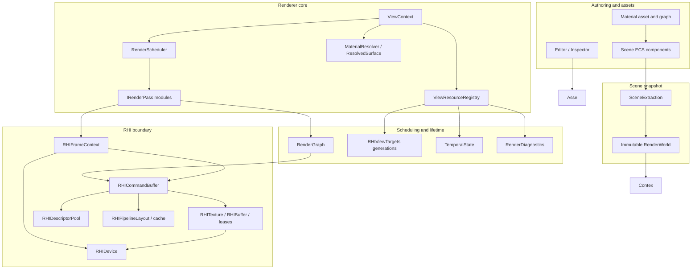
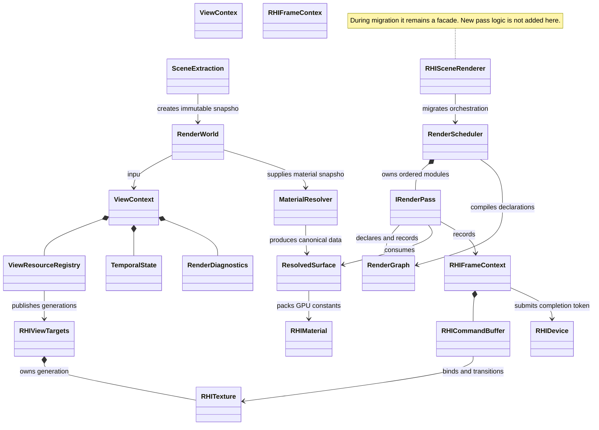
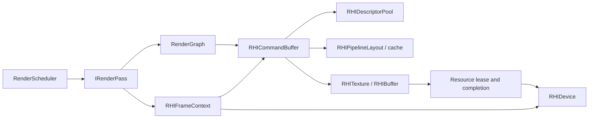
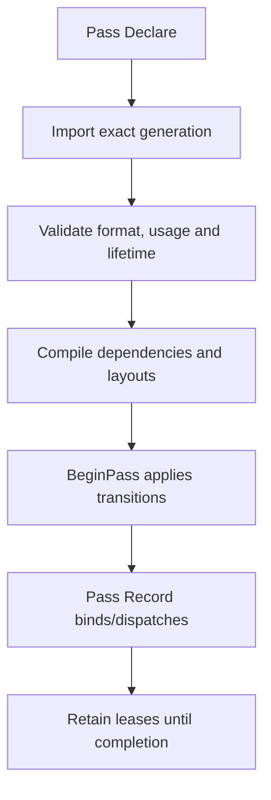
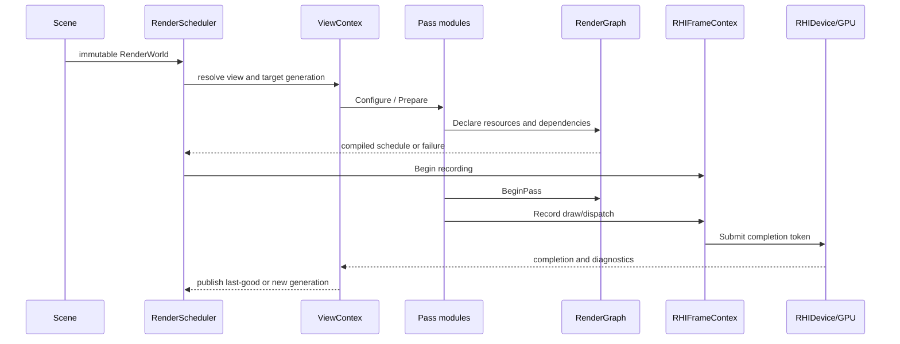

# Milestone 14 - Render Architecture Refactor

**Status:** `PROPOSED - target architecture and migration contract.`
**Companion plan:** [PLAN.md](PLAN.md)
**Purpose:** provide a stable, modular rendering and material foundation for M15 Lighting and Material Fidelity.

This document describes the target architecture and the migration boundary from the current code. It does not claim that M15 lighting features are implemented.

## 1. Design goals

- Keep scene extraction immutable and independent from GPU recording.
- Make one render view own its camera, targets, temporal state, diagnostics and completion lifetime.
- Make passes independently testable and capability-aware.
- Make `RenderGraph` the single authority for declared resource dependencies and transitions.
- Make built-in PBR, Material Graph, preview and screen-space consumers share one resolved surface contract.
- Keep RHI resource ownership, backend selection and native synchronization below the renderer pass layer.
- Preserve explicit fallbacks for unsupported compute, formats, timestamps and ray-tracing capabilities.

## 2. Target layer architecture



The target direction is intentionally one-way. Authoring data is resolved into a snapshot, the snapshot is resolved into a view context, passes declare work against the graph, and the frame context records and submits through RHI. No pass reads ECS state directly.

## 3. Current-to-target class map



During migration, `RHISceneRenderer` remains the public facade used by Editor, Runtime and tests. Internally it delegates to `RenderScheduler` and pass modules. This preserves callers while changing ownership underneath.

## 4. Core contracts

### 4.1 `RenderWorld`

`RenderWorld` is an immutable view snapshot containing camera data, mesh instances, material snapshot data, lights, reflection probes, sky, fog and optional DDGI configuration. It may contain shared immutable asset/runtime handles, but it must not contain mutable ECS references or command recording state.

Required invariants:

- stable entity/UUID identity for diagnostics and material feedback;
- scene revision and material generation identifiers;
- native mesh/view handles retained for the view lifetime;
- no direct access to `Scene` from a pass.

### 4.2 `ViewContext`

`ViewContext` owns all state that changes per render view:

```tex
ViewId and scene revision
Camera and viewpor
Feature/capability policy
RHIViewTargets generation
TemporalState and history generations
Exposure and jitter
RHIFrameContext and completion token
RenderDiagnostics
```

The U6 services make these ownership boundaries concrete:

- `TemporalService` owns history read/write slot selection, previous view-projection and jitter, motion/disocclusion validity, and commit-time flipping. A reset reason invalidates history before a new frame can sample it.
- `PostProcessService` owns the view-local exposure adaptation state and the immutable per-frame policy for HDR/SDR output, tone mapping, bloom, and AA selection. It does not own persistent RHI targets.
- `RenderDiagnostics` owns pass records, frame counters, fallback/error reasons, target generation and GPU timing validity. A zero timestamp delta is `Unknown`; it is never treated as a valid zero-cost measurement.

`RHISceneRenderer` remains the facade and low-level RHI recorder. It borrows these services through `ViewContext`; it no longer owns temporal history indices, previous-frame matrices, or adapted exposure state.

Reset reasons are explicit: resize, view switch, camera cut, scene/material generation change, feature or format change, and RHI device epoch change.

### 4.3 `IRenderPass`

Every pass implements the same lifecycle:

```tex
Configure(ViewContext, capabilities)
Declare(RenderGraphBuilder)
Prepare(RenderWorld, ViewContext)
Record(RenderPassContext)
Finalize(RenderDiagnostics)
```

`Declare` is the only place where resource reads, writes, load/store policy and ordering dependencies are added. `Record` may bind and dispatch only resources declared by the pass.

Passes return a structured result:

```tex
Supported / Disabled / Fallback / Failed
reason code
resource generation used
draw and dispatch counts
timing validity
```

### 4.4 `ResolvedSurface`

`ResolvedSurface` is the canonical material output consumed by all lighting and visibility code:

```tex
BaseColor (linear)
Metallic, Roughness, AO
GeometricNormal, ShadingNormal
Tangent and handedness
Emission
Clearcoat and anisotropy
Sheen
Subsurface profile
Absorption, IOR and dispersion
Reflection enable/F0/validity flags
Motion and material-generation data
```

The conversion chain is:

```tex
Material asset / graph
    -> MaterialInstance or component state
    -> RenderMaterialData snapsho
    -> MaterialResolver
    -> ResolvedSurface
    -> RHIMaterial constants and texture descriptors
```

`RHIMaterial` is a GPU/runtime representation, not an independent authoring model. `MaterialResolver` is the canonical conversion boundary used by built-in draws and shadow depth. Any field that cannot be represented by a path must be reported as unsupported instead of silently dropped; Material Graph currently uses neutral defaults plus an explicit feature mask for advanced fields that M15 has not authored yet.

## 5. Renderer and RHI ownership

The current migration checkpoint uses `RenderPassScheduler` and `CallbackRenderPass` as an explicit legacy adapter. This keeps the existing renderer body stable while making pass order, lifecycle, capability results and failure propagation testable. Concrete shader, pipeline and descriptor ownership moves behind the named pass groups incrementally; new feature code cannot bypass the scheduler.



Ownership rules:

- `RenderScheduler` owns ordering, not native resources.
- Each pass owns its pipeline state and pass-local descriptors, subject to shared caches.
- `ViewResourceRegistry` owns candidate target generation construction and publication.
- `RHIViewTargets` owns the textures in one published generation.
- Each published `RHIViewTargets` carries a monotonic generation ID for diagnostics; native handles and leases remain the lifetime authority.
- `RHIFrameContext` owns per-frame upload/uniform arenas and command recording.
- `RHIDevice` owns queues, native device state, submission and completion.
- A resource generation remains alive until the completion token that used it retires.
- A descriptor set is immutable after binding in a submission.

## 6. RenderGraph authority

The graph is a sequential logical journal over borrowed native resources:



The migration removes the current dual authority where graph declarations and direct renderer code can independently imply dependencies. Renderer execution uses strict graph compilation: every resource used by a pass must have a live physical generation lease before recording. A graph validation error is a render failure or named fallback, never a silent skip. Descriptor-set updates are rejected after the set has been bound in the active recording and resume only after completion/reset.

## 7. Service boundaries for M15

M14 defines interfaces; M15 implements fidelity features behind them.

| Service | Owns | M14 deliverable | M15 consumer |
|---|---|---|---|
| `LightingService` | light packing, units, shadow inputs | stable light/shadow contract | GGX, LTC and direct lighting |
| `ReflectionService` | authored/dynamic probe generations, scheduling | capture/prefilter/blend API and fallback | SSR, probes and mirror materials |
| `GIService` | DDGI state and visibility | experimental API and fallback policy | irradiance/visibility feedback |
| `TemporalService` | histories, jitter, motion validity | reset and ping-pong contract | TAA, fog and temporal reflection |
| `PostProcessService` | exposure, bloom, tone mapping, AA | color-space and ownership contract | final M15 post quality |

No service may reach directly into another service's mutable state. Shared data crosses through `ViewContext`, immutable snapshots or declared graph resources.

The M14 service seam is implemented by `LightingService`, `ReflectionService` and `GIService` in the Renderer layer. Their results are status/fallback metadata over immutable snapshots; they do not own RHI command recording. M15 may replace the authored-probe and experimental-DDGI implementations behind these interfaces without changing the material or pass contracts.

## 8. Frame lifecycle



The renderer facade returns a structured frame result containing success, fallback state, completion token, target generation and diagnostics. It must not report success merely because command recording did not throw an error.

## 9. Backend and fallback policy

| Capability | Preferred path | Fallback |
|---|---|---|
| Compute/UAV | native compute pass | disable optional pass and keep direct/IBL image |
| Hi-Z/SSR | graph-declared pyramid and compute | probe/sky IBL or neutral ambient |
| Dynamic probes | scheduled six-face capture and prefilter | authored probe, then sky IBL |
| DDGI | experimental service | IBL/ambient diffuse |
| GPU timestamps | scoped timestamp query | `unknown` timing state; never zero-as-valid |
| D3D12/Vulkan | full RHI path | explicit validation result |
| OpenGL | supported analytical subset | documented reduced feature set |
| Ray tracing | optional M15+ extension | raster reflection/probe path |

Fallback selection is part of the frame result and diagnostic report. It is not hidden from the editor or acceptance tests.

## 10. Migration map

| Current code | Target owner | Migration rule |
|---|---|---|
| `RHISceneRenderer::RenderWorldView` | `RenderScheduler` facade | preserve public entry point, delegate internally |
| renderer-wide pass fields | individual `IRenderPass` modules | move one pass group at a time |
| `m_ActiveViewTargets` and auxiliary pointers | `ViewResourceRegistry` in `ViewContext` | access through generation handles |
| material asset/component mirrors | `MaterialResolver` | keep serialization fields, remove duplicate resolution logic |
| raw graph plus direct dependency assumptions | `RenderGraph` declarations | reject undeclared resource use |
| global temporal/exposure state | `TemporalService` and `PostProcessService` | make state view-local and resettable |
| probe map in renderer | `ReflectionService` | preserve authored probe loading during migration |
| DDGI toggles/data in renderer | `GIService` | keep experimental and fallback-safe |

## 11. Architectural limits

- M14 does not promise final visual fidelity for features that belong to M15.
- A new shader or toggle is not a new architecture boundary.
- The RHI layer does not contain material policy or lighting algorithms.
- Pass modules may not mutate ECS, global material assets or another view's history.
- Resource lifetime may not depend on a raw pointer surviving a frame.
- Capability reporting may not be used as evidence of a working RT, DDGI or dynamic-capture implementation.

## 12. Acceptance evidence

M14 acceptance requires:

- a source map showing every pass, resource and material owner;
- Debug and Release builds of Editor, Runtime and focused renderer tests;
- architecture checker PASS;
- native D3D12 and Vulkan evidence plus OpenGL fallback evidence;
- view-generation, graph-dependency, material-parity, temporal-reset and failure-lifetime fixtures;
- no unowned mutable state in the frame path;
- an M15 handoff report that lists the final contracts and deferred feature work.

The architecture is accepted only when the migration is complete enough that M15 can add lighting/material features through pass and service interfaces without adding another monolithic branch to `RHISceneRenderer`.
