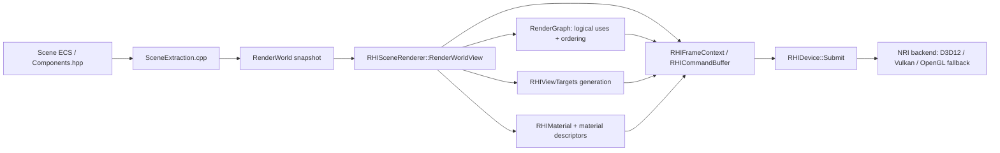
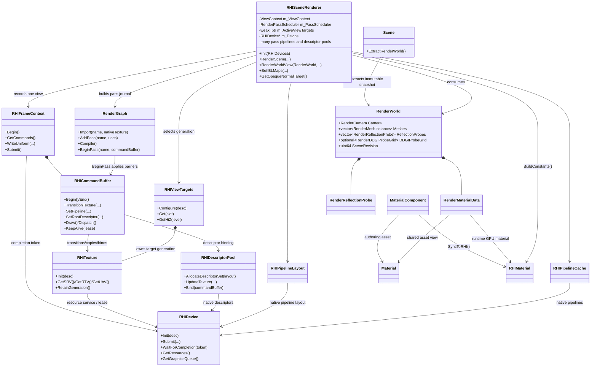
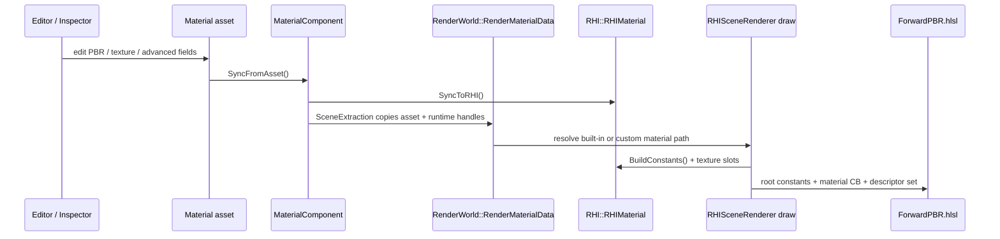
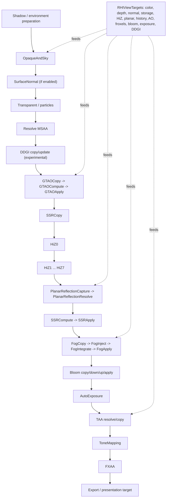

# Milestone 15 — Lighting and Material Fidelity Architecture

**Status:** `HOLD — authoritative technical contract; this document does not claim implementation completion.`
**Companion execution plan:** [PLAN.md](PLAN.md)

**M14 prerequisite source boundary:** `19ac2a1`; this document remains an M15 target contract and does not claim M15 implementation.

This architecture separates stable core lighting from opt-in and experimental features. It defines data ownership, pass dependencies, resource lifetime, fallbacks and evidence required for promotion.

## 0. Milestone hierarchy

```text
M15 Lighting and Material Fidelity
  └─ Phase 45 Lighting and Material Fidelity
      ├─ U0 Baseline and existing lighting
      ├─ U1 Direct BRDF fidelity
      ├─ U2 Dynamic environment
      ├─ U3 Screen-space infrastructure
      ├─ U4 Occlusion
      ├─ U5 Reflections and area lights
      ├─ U6 Atmosphere
      ├─ U7 Experimental DDGI
      ├─ U8 Post and temporal
      ├─ U9 Advanced materials
      ├─ U10 Authoring and pre-refactor baseline acceptance
      ├─ U11 Architecture refactor, frame pipelining and transient aliasing
      └─ U12 Material Graph Studio and advanced raster material parity
          └─ each Unit contains independently buildable/checkable SubUnits
              └─ high-risk SubUnits contain focused WorkItems with their own evidence
```

The architecture owns the Unit contracts. [PLAN.md](PLAN.md) owns the tickable SubUnit and WorkItem checklist/evidence. A WorkItem cannot bypass its SubUnit dependency; a SubUnit cannot bypass its Unit dependency or promote a later Phase.

## 1. Product boundaries

### Core production path

- Forward+ PBR with correct material inputs and smooth shading.
- HDR environment/direct lighting and shadows.
- Defined depth/normal/surface targets.
- GTAO/contact shadows with explicit composition policy.
- Hi-Z and material-aware raster SSR.
- Authored/dynamic local reflection captures with prefilter and blending.
- Planar reflection through an isolated mirrored capture view and explicit raster fallback.
- Stable exposure, bloom and TAA.

### Opt-in extensions

- LTC rectangle/disk lights.
- Froxel volumetric fog.
- Screen-space SSS.
- Advanced sheen/absorption/dispersion.

### Experimental/optional high-end extensions

- DDGI probe lighting.
- Hardware/software ray-traced reflections and GI.

An opt-in or experimental feature cannot silently change the core fallback image when disabled or unsupported.

## 2. Layer ownership

```text
Asset / Material Graph / Editor authoring
        ↓ serialization and current-format codecs
Scene ECS components and immutable RenderWorld snapshot
        ↓ extraction and resource resolution
Material and surface contract
        ↓ GPU constants, textures, depth/normal/motion targets
RHI resources, descriptor generations and RenderGraph
        ↓ explicit transitions and pass recording
Lighting and reflection passes
        ↓ HDR linear scene color
Post/temporal pipeline
        ↓ tonemapping and output
Editor/Runtime presentation
```

Rules:

- ECS state is never read directly while GPU commands are recorded; `RenderWorld` is immutable for a view.
- Native RHI generations are published transactionally and retained through submission completion.
- A descriptor set is immutable after it is bound in a submission.
- RenderGraph declarations enumerate every actual read/write; raw binding code cannot introduce undeclared dependencies.
- A view context owns target generation, completion, temporal histories, jitter, exposure and capture state.
- Failure retains a valid last-good generation or selects a named fallback; it never presents an uninitialized resource as success.

## 3A. Current code topology (verified source map)

The following map describes the code that exists today. It is a topology map, not a completion claim.



The ownership direction is one-way during a frame: ECS is extracted into an immutable `RenderWorld`; the renderer resolves materials, targets and passes; RHI records and submits native work. `RenderGraph` borrows resources and declares transitions, but it does not allocate them.

### Renderer and RHI class relationships



The important boundary is that `RHISceneRenderer` is currently both the pass scheduler and the owner of nearly every pass resource: ForwardPBR, sky, GTAO, SSR, Hi-Z, fog, bloom, exposure, DDGI, TAA, tone mapping and FXAA. This is functional, but it is a large orchestration object rather than a set of independent pass modules.

### Material data path



There are four material representations in the current path: serialized `Material`, component-local mirrors, snapshot `RenderMaterialData`, and GPU-facing `RHIMaterial`. This gives the editor and renderer clear responsibilities, but currently clones `Material` snapshots per entity per frame and routes built-in (`ForwardPBR.hlsl`) and graph (`MaterialSurface.hlsl`) lighting through separate duplicated shader loops. Under `U11` (`S11.1`), snapshot extraction switches to revision/generation-tracked immutable handles (zero per-frame cloning for unchanged materials) and both built-in and Material Graph surface evaluators share one canonical HLSL lighting kernel (`SurfaceLightingCommon.hlsli`) so feature behavior cannot diverge.

### Frame pass and resource flow



The pass names above are the current `RHISceneRendererPasses.cpp` scheduler groups. The graph validates declared texture uses and invokes RHI transitions, while the actual draw/dispatch and descriptor updates are still recorded directly by `RHISceneRenderer`.

### Current architectural assessment

**Sound foundations:** immutable scene extraction, explicit target generations, resource leases/completion tokens, a RenderGraph barrier journal, separate high-level asset and GPU material types, and a single RHI abstraction over native queues/resources.

**Structural risks:** `RHISceneRenderer` is a god-object; material state is duplicated across asset/component/snapshot/RHI forms; built-in ForwardPBR and custom graph materials can diverge in surface outputs; `ScreenNormal` is a separate producer and must stay consistent with deformed/custom geometry; RenderGraph declarations and raw command recording are two places where pass dependencies can drift; dynamic reflection capture and full DDGI feedback are not represented as independent renderer services yet.

**Interpretation:** the current architecture is a valid RHI-primary forward renderer, but it is not yet a fully modular material/lighting framework. The next clean refactor should extract pass objects around a shared `ViewContext` and a canonical `ResolvedSurface` contract, while retaining `RHIDevice`, `RHIFrameContext`, resource leases and `RHIViewTargets` as the lower-level ownership boundary.

### 3B. Target modular pass architecture & progressive extraction

To eliminate the monolithic callback adapter debt in `RHISceneRendererPasses.cpp`, M15 establishes a progressive extraction architecture:

1. **Dedicated Pass Modules**: Each render pass is authored as a standalone C++ class implementing the `Axle::IRenderPass` interface, located under:
   - Headers: `Engine/Renderer/include/Axle/Passes/<PassName>.hpp`
   - Implementations: `Engine/Renderer/src/Passes/<PassName>.cpp`
2. **Standard Pass Lifecycle**:
   - `Configure(context)`: Evaluates feature flags and device capabilities; returns `Supported` or `Disabled`.
   - `Declare(graph)`: Strictly declares all physical texture, buffer, and descriptor reads/writes into the `RenderGraph`.
   - `Prepare(context)`: Updates pass-specific uniform buffers, push constants, and descriptor sets.
   - `Record(context)`: Binds pipeline state and dispatches draw/compute commands.
   - `Finalize(context, result)`: Reports timing and diagnostics to `RenderDiagnostics`.
3. **Progressive Rollout Schedule across M15 Packages**:
   - `P3 (Occlusion)` $\rightarrow$ `GTAOPass`
   - `P4 (Hi-Z Foundation)` $\rightarrow$ `HiZGenerationPass`
   - `P6 (Reflections)` $\rightarrow$ `ScreenSpaceReflectionPass`
   - `S5.8 (Planar Reflection)` $\rightarrow$ `PlanarReflectionPass` with an isolated capture `ViewContext`
   - `P8 (Post & Temporal)` $\rightarrow$ `PostProcessPass` and `TAAPass`
   - `P9 (Atmosphere)` $\rightarrow$ `FroxelFogPass`
   - `U0/U1 (Shadows & Opaque)` $\rightarrow$ `CascadedShadowPass` and `ForwardOpaquePass`
4. **Renderer Role Transition**: `RHISceneRenderer` transitions into a lightweight facade that instantiates and registers these passes into `RenderPassScheduler` during initialization and dispatches execution via `m_PassScheduler.Execute(context)` per frame.

### 3C. Scope boundaries across M15, M16 and M21

U3-09.1–10.2 implementation checkpoint: the first pass contracts and graph declarations are under `Engine/Scene/src/Passes`, where the scene renderer currently owns their resources. GTAO and Hi-Z recording has moved there, but the existing scheduler adapter still invokes it. The `Engine/Renderer` paths and direct `IRenderPass` scheduler registration above remain the target for the later pass extraction/orchestration steps, not a claim about the current tree.

**U11 completion boundary (Phase 45.19 — Zero-Debt Refactor):** Once `U10` closes feature fidelity and freezes the pre-refactor 1080p/1440p baseline, `U11` eliminates remaining M15 structural and CPU/GPU pipeline debt prior to M16:
- Splits `RenderContracts` runtime ABI/policy cleanly from test-only CPU math oracles;
- Unifies built-in `ForwardPBR.hlsl` and graph `MaterialSurface.hlsl` onto one shared HLSL lighting kernel (`SurfaceLightingCommon.hlsli`) and replaces per-frame `Material` snapshot cloning, whole-`RenderWorld` redundant copies and byte-by-byte shader hashing with revision-tracked handles and mtime/revision-cached custom programs;
- Extracts both secondary `Passes::*` and core scene subsystems (`ShadowPass`, `GeometrySurfacePass`, `ForwardOpaquePass`, `TransparentAndRefractionPass`, `SkyboxAndResolvePass`, `SceneDrawListBuilder`, `CustomProgramCache`) into stateful `IRenderPass`/service modules (removing the 9 `friend class` declarations from `RHISceneRenderer.hpp`, dissolving `RecordFramePasses` lambdas, adding camera frustum culling + PSO/material sort + instancing readiness, and respecting `architecture_rules.json` module layering);
- Moves to per-frame-in-flight linear/ring descriptor allocation paired with multi-frame-in-flight synchronization (`device.WaitIdle()` removal from `RHISwapChain::BeginFrame()`, `N >= 2` frame contexts);
- Migrates short-lived intermediate targets onto cached `RenderTransientGraph` aliasing (`UAV`/HDR/depth/storage support) to eliminate redundant full-resolution `CopyTexture` passes.

To prevent scope creep and maintain milestone focus, technical responsibilities are split as follows:

- **Modular IRenderPass Extraction**: 100% owned by M15 through progressive pass replacement.
- **Hi-Z Depth Reduction**: 100% owned by M15 (U5/S5.1) for hierarchical SSR raymarching; reusable by M21 for GPU occlusion culling.
- **Denoising Strategy**:
  - *M15:* Pass-local filtering (Bilateral filter for GTAO, Roughness cone filtering for SSR, Variance clipping for TAA).
  - *M16:* Unified spatiotemporal denoising framework (SVGF) for RT shadows/reflections.
- **Clustered / Tiled Light Culling**:
  - Formally assigned to **Milestone 21** to align with GPU-driven geometry culling and high-throughput scalability ($100{,}000+$ instances, hundreds of dynamic lights).
  - M15 focuses strictly on lighting fidelity with bounded active light capacity managed by `LightingService`.
- **Bindless Material Graph**:
  - *M15:* RHI `Tier2Bindless` heap resource management and canonical surface parameter packing.
  - *M21:* Complete dynamic HLSL bindless array indexing (`g_Textures[index]`) to support GPU-driven indirect draw execution (`ExecuteIndirect` / Mesh Shaders).

## 4. Canonical material/surface contract

Every opaque material resolves these values in documented units/color space:

```text
BaseColor (linear), Metallic, Roughness
ShadingNormal, GeometricNormal, Tangent + handedness
AO, Emission, Clearcoat, Anisotropy, Sheen
Subsurface profile, Absorption, IOR/Dispersion
Reflection flags, material validity and motion data
```

The same resolved values are available to ForwardPBR, surface preparation, GTAO/contact, SSR, reflection resolve, fog/transparent policy, Material Graph, Preview and Runtime.

Normal rules:

- Vertex normals use inverse-transpose/cofactor transformation and smooth interpolation.
- Tangent normal maps use documented channel/handedness conventions.
- `ScreenNormal` is a producer output, never an assumed allocation.
- Background pixels carry a validity marker.
- Custom/deformed materials either produce the same surface contract or declare a supported fallback.

## 5. Resource and view-generation contract

A view generation may contain color/depth, opaque copies, `ScreenNormal`, motion/roughness/F0 validity, Hi-Z, GTAO/contact, HDR/bloom/exposure and temporal histories.

1. Resolve feature settings before allocation.
2. Allocate a complete candidate generation.
3. Validate views, formats, sample counts and usages.
4. Publish only after all resources are valid.
5. Declare all graph uses and compile before recording.
6. Retire old generations after completion.
7. Reset state on resize, view switch, camera cut, scene/material generation change, feature/format change and device epoch change.

## 6. Logical pass graph

```text
Shadow/environment/probe preparation
        ↓
Opaque depth + color + surface normal + material validity
        ↓
GTAO/contact visibility       Hi-Z depth pyramid
        ↓                              ↓
Forward+ direct/IBL lighting → SSR trace and reflection resolve
        ↓                              ↓
Local probe/sky fallback ← confidence/roughness/material blend
        ↓
Transparent/refraction policy
        ↓
Fog/froxel integration
        ↓
Exposure histogram → adapted exposure
        ↓
Bloom pyramid
        ↓
TAA/motion/disocclusion resolve
        ↓
Tonemap → optional FXAA → output/UI
```

An implementation may use copies for the current forward renderer, but the data dependencies above must remain true.

## 7. Reflection architecture

### Screen-space reflections

- Inputs: Hi-Z, opaque depth/color, shading normal, roughness, metallic/F0 and validity.
- Traversal: hierarchical cells, thickness and hit refinement.
- Filtering: roughness cone/footprint over HDR color mips.
- Output: reflection color plus confidence/miss metadata.
- Resolve: blend SSR, local probe and sky IBL under one material-energy policy.

### Reflection captures

Each probe owns a generation:

```text
Uninitialized → Capturing → Prefiltering → Ready
                         ↘ Failed → LastGood/InvalidFallback
```

Dynamic capture requires six 90-degree views, correct depth/color formats, capture mode with recursive effects disabled, correct face copies and completion-retained resources. Prefilter uses cubemap-aware roughness mips. Invalidation tracks probe transform, scene revision, geometry/material, light/shadow and asset generations. Scheduling bounds faces/probes per frame. Multi-probe blending uses continuous box/sphere influence and per-probe parallax correction before blending.

Fallback order is SSR confidence → valid local probe → sky IBL → neutral ambient.

### Planar reflection

Planar reflection is a raster reflection source owned by M15 for selected planes such as floors, mirrors and water surfaces. It must never call the parent view recursively. The renderer creates a separate capture `ViewContext` with its own camera matrices, jitter policy, history generation and target set.

The capture camera is mirrored across the authored plane and uses an oblique clip plane to exclude geometry behind the reflector. A dedicated `PlanarReflectionPass` declares color/depth reads and writes through `RenderGraph`, schedules completion-retained resources, and resolves a confidence value into the shared reflection-energy policy. Recursion is disabled during capture; SSR, local probes and sky IBL provide fallback when the planar target is invalid, clipped or unavailable.

The planar target is invalidated by plane, camera, scene, geometry, material, light, resize and device-epoch changes. The parent view history is never reused by the capture view, and a failed update retains a last-good target only for the declared generation or falls back explicitly.

S5.8 selects one valid front-side reflector per view, then uses distance to choose among valid candidates. Other surfaces retain the shared SSR/probe/sky fallback; the view does not promise simultaneous multi-plane resolve. Capture uses the component depth range and the lower of component resolution scale and the global view cap. A lower-resolution scratch image is resampled into a fresh publication at the view's allocated planar extent. Clip bias affects capture clipping once; receiver confidence uses the unbiased geometric plane and actual jittered main-view projection.

Publication replaces the native color generation only after candidate submission and completion succeed. The old image remains untouched on failure, including after resolution edits, and every receipt for a replaced slot is retired. Explicit captures into an exposed published target also retire its scheduled receipts. Transient failures retry on unchanged inputs; deterministic invalid-camera failures may wait for input changes. Manual/stale captures retain their captured projection while current intensity, extent, edge and roughness controls remain live at resolve. See the [consolidated Codex review](../../reviews/M15_U5_H_CODEX_REVIEW.md) for requirement evidence and open visual gates.

## 8. Lighting and visibility

- Directional/point/spot lights share units, shadows and BRDF inputs.
- GTAO affects indirect visibility under its declared composition policy.
- Contact shadows affect their directional contribution and do not double-apply other shadow maps.
- LTC rectangle/disk lights use validated tables and a separate shadow policy.
- Fog uses bounded 3D froxels, shadow visibility and temporal state.
- DDGI obtains spatial probe radiance, stores irradiance/distance variance, applies visibility and samples into diffuse lighting. It remains experimental until leak/bounce/budget fixtures pass.

## 9. Post and temporal ownership

Exposure is per-view with previous/current/target values, metering and reset reason. Histogram reduction is global; tonemapping consumes adapted exposure.

Bloom owns six levels and reconstructs additively. Threshold is applied at extraction; tint/intensity are applied once.

TAA owns current/previous transforms, jitter, motion policy, history validity/generation and rejection rules. Transparent/UI behavior is explicit; incompatible generations cannot reuse history.

## 10. Advanced materials

- Sheen, clearcoat and anisotropy use bounded energy with direct/IBL parity.
- Beer–Lambert uses documented thickness; dispersion is an explicit approximation or wavelength model.
- SSS diffuses separated diffuse/profile data with depth/normal boundaries and preserves specular.
- Material Graph emits the same advanced fields or reports explicit unsupported scope.
- Native asset/component/runtime/GPU/Inspector/Preview use matching defaults and clamps.

### U12 Material Graph Studio

The Studio is a Dear ImGui Editor workspace. The node canvas owns pointer input, view transforms, selection, layout and transaction boundaries. The material asset layer owns `MaterialGraphDocument`, the node registry, typed connections, stable identities and canonical serialization. It uses the native graph asset format shared with textual authoring. Layout changes update the document without changing the shader key. A drag commits one undoable edit. Canvas2D in M19 is the in-game UI system and has an independent runtime and asset format.

Keep the working revision private to the Studio. Semantic edits produce immutable validation/compile inputs. The existing IR, HLSL lowering, compiler and program cache serve native Preview and Scene. Each request captures the document identity, semantic revision, target and device generation. Publish a fully ready program only while the request is current. Finalize native bindings on the RHI owning thread and retain referenced generations through completion. An invalid revision retains the last compatible Preview, shows its diagnostics and leaves the committed asset intact. Save/Apply operates on a validated revision. Parameter value updates use the current program's binding interface where compatible.

The studio's material fixtures use the same `ResolvedSurface`, graph bindings and supported pass variants as Runtime. The graph schema and lowering carry real Clearcoat/Anisotropy values into the shared lighting evaluation. Preserve U9 Sheen and SSS behavior. Transparent refractive graphs use the existing opaque scene color/depth snapshot policy and refraction equations. The graph supplies surface inputs such as opacity, IOR, thickness and optical controls. The renderer owns pass routing, scene snapshot access, depth rejection and fallback. The Preview supplies a reference mesh, lighting and an appropriate opaque background through the published view policy.

Publish support by feature, surface class, view and backend. Report the effective route when compatible scene inputs, MSAA or backend support affect output. Validate the saved graph as an authored asset and include its actual transitive inputs in the existing export path. D3D12 and Vulkan native output is mandatory in U12. M16 adds traced material behavior against the accepted raster fixtures. M21 validates generated bindless routes against that same reference.

## 11. M16 ray-tracing handoff boundary

M15 supplies canonical `ResolvedSurface`, per-view `ViewContext`, capture/target lifetime and completion rules, material-energy resolve, denoising-history invalidation, raster fallbacks and Studio-authored reference materials. M16 owns capability policy, BLAS/TLAS, RT pipeline/SBT, RT shadows/reflections, unified denoising and optional RT GI.

Capability reporting alone is not implementation. Until M16 passes its backend and material-parity gates, RT remains disabled or falls back to planar reflection, SSR, local probes and sky IBL without changing authored scene data.

## 12. Fallback and compatibility policy

| Capability | Primary | Fallback |
|---|---|---|
| D3D12/Vulkan compute | GTAO, Hi-Z, SSR, fog, post | Explicit disable/diagnostic and stable direct/IBL path |
| OpenGL | Analytical direct/ambient and supported material path | Diagnose unsupported compute; no false parity claim |
| SSR miss | Local probe | Sky IBL, then neutral ambient |
| Planar target miss/failure | Last-good planar generation | SSR, local probe, then sky IBL |
| Probe failure | Last-good generation | Sky IBL/SSR policy |
| DDGI unavailable | IBL/ambient diffuse | No authored-scene change |
| RT unavailable | Planar/SSR/probes | Documented quality reduction |

## 13. Quality tiers

Every tier specifies resolution, samples, update budget and memory:

- **Low:** reduced AO/SSR/fog/post, no DDGI/RT, bounded probe updates.
- **Medium:** half-resolution AO, raster SSR/probes, reduced fog/post history.
- **High:** declared raster quality, dynamic probe scheduling and higher temporal quality.
- **Ultra:** optional DDGI in M15; RT quality tiers are defined and gated by M16.

No tier enables a feature whose data/fallback contract is incomplete.

## 14. Acceptance evidence

Every checkpoint supplies exact commit/source/configuration, Debug/Release builds, physical D3D12/Vulkan results, applicable OpenGL/fallback results, validation logs, deterministic images/readbacks, failure/lifetime behavior, hardware/driver/resolution measurements and known limitations.

U10/S10.5 closes the pre-refactor fidelity, authoring and 1080p/1440p baseline.
U11/S11.5 accepts the renderer architecture, pipelining, transient aliasing and
post-refactor A/B verification. U12/S12.5 accepts Studio, raster graph parity and
the detached product on the integrated U0–U12 baseline. Experimental DDGI may be
separately deferred. M16 tracks RT acceptance.

Use the [U10 acceptance procedure](U10_ACCEPTANCE_REVIEW.md) for the consolidated
feature, integration, lifecycle, Editor visual and cold/warm baseline audit prior
to U11, followed by U11's A/B performance/VRAM scorecard, parity, 1,000-frame soak
and independent source review/recheck gates in [PLAN.md](PLAN.md). Package
acceptance and architecture-script PASS remain evidence inputs. Full closure requires
all mandatory final gates on the corrected baseline. PLAN owns the checkbox state,
and the exchange owns the active release.

## 15. Material Studio gaps against Unreal Engine

The comparison assumes the planned U12 exit. It compares artist-facing and runtime capabilities using Epic's Unreal Engine 5 documentation. The items below are follow-up candidates. Existing Axle capabilities, such as graph parameters, custom shader assets and built-in optical materials, provide a starting point.

| Area | Capability gap after U12 | Axle evidence and Unreal reference |
|---|---|---|
| **UV animation and expression library** | Time, Panner/Rotator, vector composition and channel masks, procedural noise and broader coordinate/texture tools. An artist should be able to make a flowing water material with graph nodes. | The built-in graph registry has UV input, a small arithmetic set and texture/normal sampling. [Axle nodes](../../../Engine/Asset/src/BuiltinMaterialNodes.cpp) · [UE expressions](https://dev.epicgames.com/documentation/en-us/unreal-engine/unreal-engine-material-expressions-reference) · [UE UV animation](https://dev.epicgames.com/documentation/en-us/unreal-engine/animating-uv-coordinates-in-unreal-engine) |
| **Screen-space distortion** | Graph-controlled masked 2D offsets or a normal-offset mode for heat haze, shockwaves and water, with bounded scene-color/depth access and explicit view policy. U12 covers the declared IOR-based raster glass route. | [Axle refraction contract](REFRACTION_ABSORPTION_POLICY.md) · [UE refraction modes](https://dev.epicgames.com/documentation/en-us/unreal-engine/unreal-engine-material-properties) |
| **Height and deformation** | Height-map parallax/POM, Pixel Depth Offset and World Position Offset require distinct contracts. Parallax shifts texture sampling. Pixel Depth Offset changes the depth test. World Position Offset moves vertices and requires bounds plus consistent depth, shadow, motion and picking passes. | Axle's graph vertex and fragment entry points provide the current surface baseline. [Axle graph shader](../../../Engine/Resources/Shaders/MaterialSurface.hlsl) · [UE height-map offset reference](https://dev.epicgames.com/documentation/en-us/unreal-engine/using-bump-offset-in-unreal-engine) · [UE material inputs](https://dev.epicgames.com/documentation/unreal-engine/material-inputs-in-unreal-engine) |
| **Reusable graphs and layers** | Material Function assets with typed inputs/outputs and dependency revisioning, artist-authored layer/blend stacks and reusable shader-code nodes with declared bindings. Axle can build on its graph registry and custom shader path. | [UE Material Functions](https://dev.epicgames.com/documentation/en-us/unreal-engine/creating-and-using-material-functions-in-unreal-engine) · [UE Material Layers](https://dev.epicgames.com/documentation/en-us/unreal-engine/using-material-layers-in-unreal-engine) · [UE custom expressions](https://dev.epicgames.com/documentation/en-us/unreal-engine/unreal-engine-material-expressions-reference) |
| **Material instance workflows** | Parent/child material-instance assets and an override editor, grouped defaults and reset, gameplay-visible dynamic instances and shared parameter collections. U12 proves independent values through the existing graph instance binding. Static switches also require a permutation and cache policy. | [Axle graph instance](../../../Engine/Scene/include/Axle/MaterialGraphRuntime.hpp) · [UE instances](https://dev.epicgames.com/documentation/en-us/unreal-engine/instanced-materials-in-unreal-engine) · [UE parameter collections](https://dev.epicgames.com/documentation/en-us/unreal-engine/using-material-parameter-collections-in-unreal-engine) |
| **Studio tools and profiling** | Per-node preview, richer graph navigation/organization and refactoring, quality/feature-level preview and per-target shader stats, permutation inventory and compile diagnostics across an asset set. | [UE Material Editor UI](https://dev.epicgames.com/documentation/en-us/unreal-engine/unreal-engine-material-editor-ui) · [UE Material Analyzer](https://dev.epicgames.com/documentation/en-us/unreal-engine/unreal-engine-material-analyzer-tool) |
| **Rendering domains and resources** | Purpose-specific material outputs for decal, UI, post-process, volume or light-function passes. VFX and UI need their own compatible renderer contracts. Streaming and runtime virtual textures need sampler, cook and residency work. M23 already owns decal tooling. | [M23](../MILESTONE_23_MATERIAL_GRAPH_TOOLING/PLAN.md) · [UE material domains](https://dev.epicgames.com/documentation/en-us/unreal-engine/unreal-engine-material-properties) · [UE virtual texturing](https://dev.epicgames.com/documentation/en-us/unreal-engine/virtual-texturing-in-unreal-engine) |
| **Broader shading model composition** | Additional shading models and physically composed BSDF layers comparable to Substrate. This affects the material representation, evaluation and renderer passes beyond the fixed raster features in U12. | [UE Substrate](https://dev.epicgames.com/documentation/en-us/unreal-engine/overview-of-substrate-materials-in-unreal-engine) |

Prioritize UV animation, masked screen-space distortion and height-map parallax for the next surface authoring increment. Validate flowing texture, heat haze against an opaque grid and a wall viewed at grazing angle. Specify depth and multi-pass deformation independently before adding Pixel Depth Offset or World Position Offset. Group reusable functions, material instances and shader statistics by their asset and compiler dependencies.
