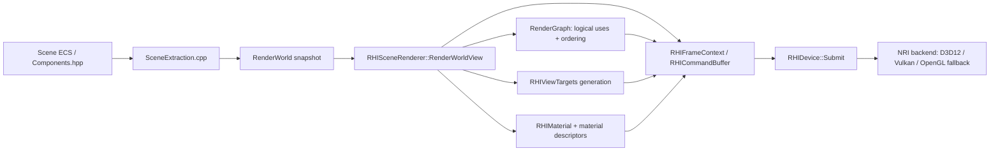
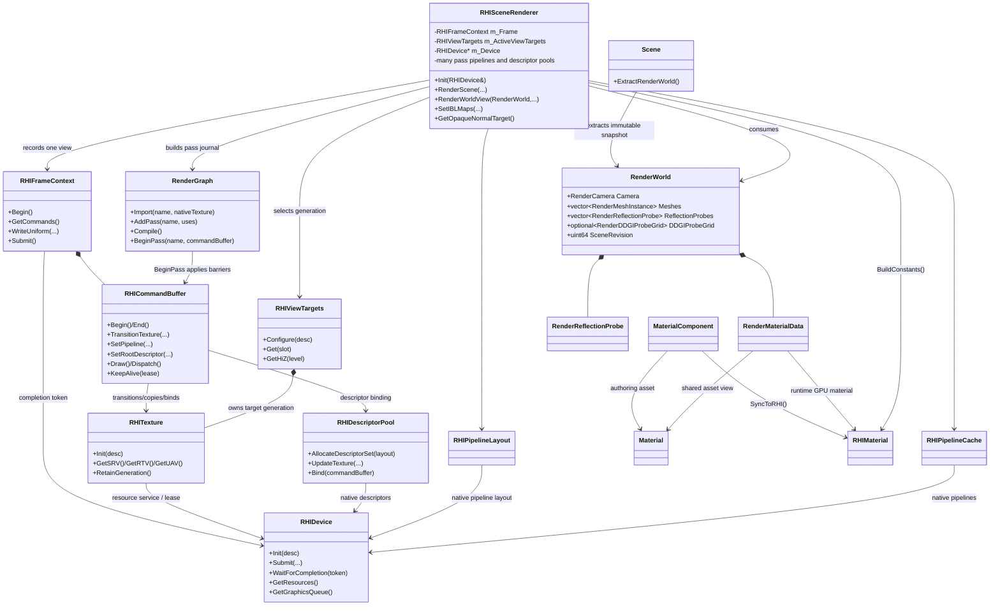
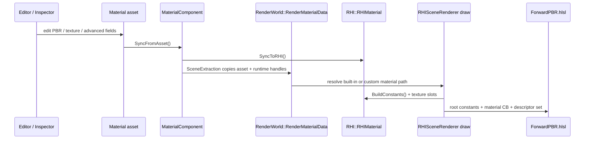
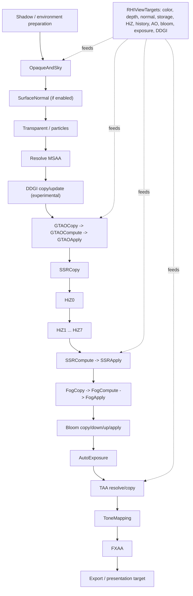

# Milestone 15 — Lighting and Material Fidelity Architecture

**Status:** `HOLD — authoritative technical contract; this document does not claim implementation completion.`
**Companion execution plan:** [PLAN.md](PLAN.md)

This architecture separates stable core lighting from opt-in and experimental features. It defines data ownership, pass dependencies, resource lifetime, fallbacks and evidence required for promotion.

## 0. Milestone hierarchy

```text
M15 Lighting and Material Fidelity
  └─ Phase 45 Lighting and Material Fidelity
      ├─ U0 Baseline and existing lighting
      ├─ U1 Direct BRDF fidelity
      ├─ U2 Dynamic environment
      ├─ U3 Screen-space infrastructure
      ├─ U4 Occlusion
      ├─ U5 Reflections and area lights
      ├─ U6 Atmosphere
      ├─ U7 Experimental DDGI
      ├─ U8 Post and temporal
      ├─ U9 Advanced materials
      ├─ U10 Authoring and acceptance
      └─ U11 Optional ray-traced extension
          └─ each Unit contains independently buildable/checkable SubUnits
              └─ high-risk SubUnits contain focused WorkItems with their own evidence
```

The architecture owns the Unit contracts. [PLAN.md](PLAN.md) owns the tickable SubUnit and WorkItem checklist/evidence. A WorkItem cannot bypass its SubUnit dependency; a SubUnit cannot bypass its Unit dependency or promote a later Phase.

## 1. Product boundaries

### Core production path

- Forward+ PBR with correct material inputs and smooth shading.
- HDR environment/direct lighting and shadows.
- Defined depth/normal/surface targets.
- GTAO/contact shadows with explicit composition policy.
- Hi-Z and material-aware raster SSR.
- Authored/dynamic local reflection captures with prefilter and blending.
- Stable exposure, bloom and TAA.

### Opt-in extensions

- LTC rectangle/disk lights.
- Froxel volumetric fog.
- Screen-space SSS.
- Advanced sheen/absorption/dispersion.

### Experimental/optional high-end extensions

- DDGI probe lighting.
- Hardware/software ray-traced reflections and GI.

An opt-in or experimental feature cannot silently change the core fallback image when disabled or unsupported.

## 2. Layer ownership

```text
Asset / Material Graph / Editor authoring
        ↓ serialization and current-format codecs
Scene ECS components and immutable RenderWorld snapshot
        ↓ extraction and resource resolution
Material and surface contract
        ↓ GPU constants, textures, depth/normal/motion targets
RHI resources, descriptor generations and RenderGraph
        ↓ explicit transitions and pass recording
Lighting and reflection passes
        ↓ HDR linear scene color
Post/temporal pipeline
        ↓ tonemapping and output
Editor/Runtime presentation
```

Rules:

- ECS state is never read directly while GPU commands are recorded; `RenderWorld` is immutable for a view.
- Native RHI generations are published transactionally and retained through submission completion.
- A descriptor set is immutable after it is bound in a submission.
- RenderGraph declarations enumerate every actual read/write; raw binding code cannot introduce undeclared dependencies.
- A view context owns target generation, completion, temporal histories, jitter, exposure and capture state.
- Failure retains a valid last-good generation or selects a named fallback; it never presents an uninitialized resource as success.

## 3A. Current code topology (verified source map)

The following map describes the code that exists today. It is a topology map, not a completion claim.



The ownership direction is one-way during a frame: ECS is extracted into an immutable `RenderWorld`; the renderer resolves materials, targets and passes; RHI records and submits native work. `RenderGraph` borrows resources and declares transitions, but it does not allocate them.

### Renderer and RHI class relationships



The important boundary is that `RHISceneRenderer` is currently both the pass scheduler and the owner of nearly every pass resource: ForwardPBR, sky, GTAO, SSR, Hi-Z, fog, bloom, exposure, DDGI, TAA, tone mapping and FXAA. This is functional, but it is a large orchestration object rather than a set of independent pass modules.

### Material data path



There are four material representations in the current path: serialized `Material`, component-local mirrors, snapshot `RenderMaterialData`, and GPU-facing `RHIMaterial`. This gives the editor and renderer clear responsibilities, but synchronization is duplicated and must remain a tracked invariant. The custom Material Graph path is a second shader route: `MaterialSurfaceShader`/`MaterialGraphHLSL` emits a surface function, while built-in materials use `ForwardPBR.hlsl` directly.

### Frame pass and resource flow



The pass names above are the current `RHISceneRenderer.cpp` graph declarations. The graph validates declared texture uses and invokes RHI transitions, while the actual draw/dispatch and descriptor updates are still recorded directly by `RHISceneRenderer`.

### Current architectural assessment

**Sound foundations:** immutable scene extraction, explicit target generations, resource leases/completion tokens, a RenderGraph barrier journal, separate high-level asset and GPU material types, and a single RHI abstraction over native queues/resources.

**Structural risks:** `RHISceneRenderer` is a god-object; material state is duplicated across asset/component/snapshot/RHI forms; built-in ForwardPBR and custom graph materials can diverge in surface outputs; `ScreenNormal` is a separate producer and must stay consistent with deformed/custom geometry; RenderGraph declarations and raw command recording are two places where pass dependencies can drift; dynamic reflection capture and full DDGI feedback are not represented as independent renderer services yet.

**Interpretation:** the current architecture is a valid RHI-primary forward renderer, but it is not yet a fully modular material/lighting framework. The next clean refactor should extract pass objects around a shared `ViewContext` and a canonical `ResolvedSurface` contract, while retaining `RHIDevice`, `RHIFrameContext`, resource leases and `RHIViewTargets` as the lower-level ownership boundary.

### 3B. Target modular pass architecture & progressive extraction

To eliminate the monolithic callback adapter debt in `RHISceneRendererPasses.cpp`, M15 establishes a progressive extraction architecture:

1. **Dedicated Pass Modules**: Each render pass is authored as a standalone C++ class implementing the `Axle::IRenderPass` interface, located under:
   - Headers: `Engine/Renderer/include/Axle/Passes/<PassName>.hpp`
   - Implementations: `Engine/Renderer/src/Passes/<PassName>.cpp`
2. **Standard Pass Lifecycle**:
   - `Configure(context)`: Evaluates feature flags and device capabilities; returns `Supported` or `Disabled`.
   - `Declare(graph)`: Strictly declares all physical texture, buffer, and descriptor reads/writes into the `RenderGraph`.
   - `Prepare(context)`: Updates pass-specific uniform buffers, push constants, and descriptor sets.
   - `Record(context)`: Binds pipeline state and dispatches draw/compute commands.
   - `Finalize(context, result)`: Reports timing and diagnostics to `RenderDiagnostics`.
3. **Progressive Rollout Schedule across M15 Packages**:
   - `P3 (Occlusion)` $\rightarrow$ `GTAOPass`
   - `P4 (Hi-Z Foundation)` $\rightarrow$ `HiZGenerationPass`
   - `P6 (Reflections)` $\rightarrow$ `ScreenSpaceReflectionPass`
   - `P8 (Post & Temporal)` $\rightarrow$ `PostProcessPass` and `TAAPass`
   - `P9 (Atmosphere)` $\rightarrow$ `FroxelFogPass`
   - `U0/U1 (Shadows & Opaque)` $\rightarrow$ `CascadedShadowPass` and `ForwardOpaquePass`
4. **Renderer Role Transition**: `RHISceneRenderer` transitions into a lightweight facade that instantiates and registers these passes into `RenderPassScheduler` during initialization and dispatches execution via `m_Scheduler.Execute(context)` per frame.

### 3C. Scope boundaries: Milestone 15 vs Milestone 16

To prevent scope creep and maintain milestone focus, technical responsibilities are split as follows:

- **Modular IRenderPass Extraction**: 100% owned by M15 through progressive pass replacement.
- **Hi-Z Depth Reduction**: 100% owned by M15 (U5/S5.1) for hierarchical SSR raymarching; reused in M16 for GPU occlusion culling.
- **Denoising Strategy**:
  - *M15:* Pass-local filtering (Bilateral filter for GTAO, Roughness cone filtering for SSR, Variance clipping for TAA).
  - *M16 / U11:* Unified spatiotemporal denoising framework (SVGF) if dynamic ray tracing is enabled.
- **Clustered / Tiled Light Culling**:
  - Formally assigned to **Milestone 16 (Phase 46.3)** to align with GPU-driven geometry culling and high-throughput scalability ($100{,}000+$ instances, hundreds of dynamic lights).
  - M15 focuses strictly on lighting fidelity with bounded active light capacity managed by `LightingService`.
- **Bindless Material Graph**:
  - *M15:* RHI `Tier2Bindless` heap resource management and canonical surface parameter packing.
  - *M16:* Complete dynamic HLSL bindless array indexing (`g_Textures[index]`) to support GPU-driven indirect draw execution (`ExecuteIndirect` / Mesh Shaders).

## 4. Canonical material/surface contract

Every opaque material resolves these values in documented units/color space:

```text
BaseColor (linear), Metallic, Roughness
ShadingNormal, GeometricNormal, Tangent + handedness
AO, Emission, Clearcoat, Anisotropy, Sheen
Subsurface profile, Absorption, IOR/Dispersion
Reflection flags, material validity and motion data
```

The same resolved values are available to ForwardPBR, surface preparation, GTAO/contact, SSR, reflection resolve, fog/transparent policy, Material Graph, Preview and Runtime.

Normal rules:

- Vertex normals use inverse-transpose/cofactor transformation and smooth interpolation.
- Tangent normal maps use documented channel/handedness conventions.
- `ScreenNormal` is a producer output, never an assumed allocation.
- Background pixels carry a validity marker.
- Custom/deformed materials either produce the same surface contract or declare a supported fallback.

## 5. Resource and view-generation contract

A view generation may contain color/depth, opaque copies, `ScreenNormal`, motion/roughness/F0 validity, Hi-Z, GTAO/contact, HDR/bloom/exposure and temporal histories.

1. Resolve feature settings before allocation.
2. Allocate a complete candidate generation.
3. Validate views, formats, sample counts and usages.
4. Publish only after all resources are valid.
5. Declare all graph uses and compile before recording.
6. Retire old generations after completion.
7. Reset state on resize, view switch, camera cut, scene/material generation change, feature/format change and device epoch change.

## 6. Logical pass graph

```text
Shadow/environment/probe preparation
        ↓
Opaque depth + color + surface normal + material validity
        ↓
GTAO/contact visibility       Hi-Z depth pyramid
        ↓                              ↓
Forward+ direct/IBL lighting → SSR trace and reflection resolve
        ↓                              ↓
Local probe/sky fallback ← confidence/roughness/material blend
        ↓
Transparent/refraction policy
        ↓
Fog/froxel integration
        ↓
Exposure histogram → adapted exposure
        ↓
Bloom pyramid
        ↓
TAA/motion/disocclusion resolve
        ↓
Tonemap → optional FXAA → output/UI
```

An implementation may use copies for the current forward renderer, but the data dependencies above must remain true.

## 7. Reflection architecture

### Screen-space reflections

- Inputs: Hi-Z, opaque depth/color, shading normal, roughness, metallic/F0 and validity.
- Traversal: hierarchical cells, thickness and hit refinement.
- Filtering: roughness cone/footprint over HDR color mips.
- Output: reflection color plus confidence/miss metadata.
- Resolve: blend SSR, local probe and sky IBL under one material-energy policy.

### Reflection captures

Each probe owns a generation:

```text
Uninitialized → Capturing → Prefiltering → Ready
                         ↘ Failed → LastGood/InvalidFallback
```

Dynamic capture requires six 90-degree views, correct depth/color formats, capture mode with recursive effects disabled, correct face copies and completion-retained resources. Prefilter uses cubemap-aware roughness mips. Invalidation tracks probe transform, scene revision, geometry/material, light/shadow and asset generations. Scheduling bounds faces/probes per frame. Multi-probe blending uses continuous box/sphere influence and per-probe parallax correction before blending.

Fallback order is SSR confidence → valid local probe → sky IBL → neutral ambient.

## 8. Lighting and visibility

- Directional/point/spot lights share units, shadows and BRDF inputs.
- GTAO affects indirect visibility under its declared composition policy.
- Contact shadows affect their directional contribution and do not double-apply other shadow maps.
- LTC rectangle/disk lights use validated tables and a separate shadow policy.
- Fog uses bounded 3D froxels, shadow visibility and temporal state.
- DDGI obtains spatial probe radiance, stores irradiance/distance variance, applies visibility and samples into diffuse lighting. It remains experimental until leak/bounce/budget fixtures pass.

## 9. Post and temporal ownership

Exposure is per-view with previous/current/target values, metering and reset reason. Histogram reduction is global; tonemapping consumes adapted exposure.

Bloom owns six levels and reconstructs additively. Threshold is applied at extraction; tint/intensity are applied once.

TAA owns current/previous transforms, jitter, motion policy, history validity/generation and rejection rules. Transparent/UI behavior is explicit; incompatible generations cannot reuse history.

## 10. Advanced materials

- Sheen, clearcoat and anisotropy use bounded energy with direct/IBL parity.
- Beer–Lambert uses documented thickness; dispersion is an explicit approximation or wavelength model.
- SSS diffuses separated diffuse/profile data with depth/normal boundaries and preserves specular.
- Material Graph emits the same advanced fields or reports explicit unsupported scope.
- Native asset/component/runtime/GPU/Inspector/Preview use matching defaults and clamps.

## 11. Ray-traced extension boundary

Capability reporting is not implementation. A real RT extension requires backend policy, BLAS/TLAS ownership/update, RT pipeline stages, ForwardPBR-compatible material evaluation, denoising, temporal rejection and shared geometry with DDGI. Until those exist, M15 promises raster SSR/probes only and labels exact off-screen dynamic mirror reflection deferred.

## 12. Fallback and compatibility policy

| Capability | Primary | Fallback |
|---|---|---|
| D3D12/Vulkan compute | GTAO, Hi-Z, SSR, fog, post | Explicit disable/diagnostic and stable direct/IBL path |
| OpenGL | Analytical direct/ambient and supported material path | Diagnose unsupported compute; no false parity claim |
| SSR miss | Local probe | Sky IBL, then neutral ambient |
| Probe failure | Last-good generation | Sky IBL/SSR policy |
| DDGI unavailable | IBL/ambient diffuse | No authored-scene change |
| RT unavailable | Raster SSR/probes | Documented quality reduction |

## 13. Quality tiers

Every tier specifies resolution, samples, update budget and memory:

- **Low:** reduced AO/SSR/fog/post, no DDGI/RT, bounded probe updates.
- **Medium:** half-resolution AO, raster SSR/probes, reduced fog/post history.
- **High:** declared raster quality, dynamic probe scheduling and higher temporal quality.
- **Ultra:** optional DDGI/RT only when capability and measured budget permit.

No tier enables a feature whose data/fallback contract is incomplete.

## 14. Acceptance evidence

Every checkpoint supplies exact commit/source/configuration, Debug/Release builds, physical D3D12/Vulkan results, applicable OpenGL/fallback results, validation logs, deterministic images/readbacks, failure/lifetime behavior, hardware/driver/resolution measurements and known limitations.

M15 is accepted only when [PLAN.md](PLAN.md) U10/S10.5 is complete. Experimental DDGI and optional RT may be separately deferred, but deferred items remain visibly unchecked and excluded from the completion claim.
