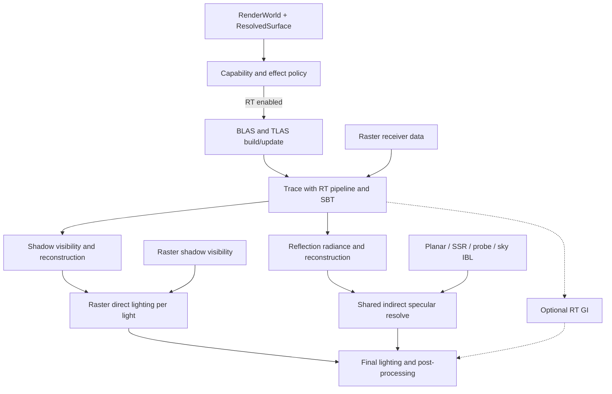

# Milestone 16 — Material Graph Studio and Ray Tracing Architecture

**Status** — Architecture for the packages and batches in [PLAN.md](PLAN.md).
**Inputs** — The accepted M15 U11 surface and lighting contracts, `ViewContext`, stateful `IRenderPass` scheduler, graph and transient targets, frame completion, reflection capture policy and raster fallback chain.
**Purpose** — Ship graph authoring and advanced raster material parity, then add hardware ray-traced shadows and reflections with capability-validated execution and raster fallback.

## 1. Product boundary

M16 accepts Material Graph Studio and the D3D12/Vulkan raster material reference at MAT-E. That reference includes authored assets, Preview and Scene renders, detached Runtime fixtures and effective routing diagnostics. The RT phase uses the accepted reference for material and fallback comparisons.

- D3D12/Vulkan ray-tracing capability discovery and backend policy.
- BLAS/TLAS ownership, build, refit, update, retirement and completion lifetimes.
- Ray-generation, miss, closest-hit and any-hit shader stages.
- RT shadows and RT reflections first; RT GI only after material and denoising gates pass.
- ForwardPBR-compatible material evaluation, including metallic, roughness, Fresnel, normal, clearcoat and transmission flags.
- Spatial/temporal denoising, history rejection and camera/scene/material invalidation.
- A single resolve policy with raster SSR, planar reflection, local probes and sky IBL as fallbacks.

M16 does not own meshlet generation or clustered light culling; those remain in M21. M16 does own the minimal coarse RT-proxy contract needed to build a bounded BLAS. M21 autoLOD may later produce a compatible proxy, but M16 startup cannot depend on a future M21 artifact. M15 owns planar reflection and the raster reflection contracts consumed here.

## Material Graph Studio

The Studio is a Dear ImGui Editor workspace. The node canvas owns pointer input, view transforms, selection, layout and transaction boundaries. The material asset layer owns `MaterialGraphDocument`, the node registry, typed connections, stable identities and canonical serialization. It uses the native graph asset format shared with textual authoring. Layout changes update the document without changing the shader key. A drag commits one undoable edit. Canvas2D in M19 is the in-game UI system and has an independent runtime and asset format.

Keep the working revision private to the Studio. Semantic edits produce immutable validation/compile inputs. The existing IR, HLSL lowering, compiler and program cache serve native Preview and Scene. Each request captures the document identity, semantic revision, target and device generation. Publish a fully ready program only while the request is current. Finalize native bindings on the RHI owning thread and retain referenced generations through completion. An invalid revision retains the last compatible Preview, shows its diagnostics and leaves the committed asset intact. Save/Apply operates on a validated revision. Parameter value updates use the current program's binding interface where compatible.

The studio's material fixtures use the same `ResolvedSurface`, graph bindings and supported pass variants as Runtime. The graph schema and lowering carry real Clearcoat/Anisotropy values into the shared lighting evaluation. Preserve M15 U9 Sheen and SSS behavior. Transparent refractive graphs use the existing opaque scene color/depth snapshot policy and refraction equations. The graph supplies surface inputs such as opacity, IOR, thickness and optical controls. The renderer owns pass routing, scene snapshot access, depth rejection and fallback. The Preview supplies a reference mesh, lighting and an appropriate opaque background through the published view policy.

Publish support by feature, surface class, view and backend. Report the effective route when compatible scene inputs, MSAA or backend support affect output. Validate the saved graph as an authored asset and include its actual transitive inputs in the existing export path. D3D12 and Vulkan native output is mandatory at MAT-E. The RT phase compares traced material behavior and raster fallbacks against those accepted fixtures. M21 validates generated bindless routes against that same reference.

## 2. Backend and pass topology

The scheduler registers `RayTracingASBuild`, `RayTracingShadow`, `RayTracingReflection`, `RayTracingDenoise`, `RayTracingResolve` and optional `RayTracingGI` as stateful `IRenderPass` instances.

AS build precedes trace. Receiver inputs must be available before tracing. Filtered shadow visibility must reach the matching light before its direct lighting is evaluated. Reflections feed the shared indirect-specular resolve before post-processing. Declare each edge in the graph. Probe and planar subcaptures have explicit effect policies that prevent recursive reflection sampling.

### 2.1 RT receiver inputs

Map receiver depth, the normals and surface terms needed by each effect, and temporal motion to their producers in the M15 view pipeline. Declare the required target formats, sample-count policy and graph order per supported view. Shadow visibility uses receiver data produced before direct lighting. Reflection tracing and resolve use the required surface and response data before their respective passes.

Allocate and populate these inputs from effective RT settings. RT Reflections can run with SSR and planar reflections disabled. RT temporal passes request velocity independently of TAA. A supported single-sample view with TAA disabled still supplies the motion needed by the denoiser.

## 3. Ownership and lifetime

- `RTAccelerationStructureService` owns engine RHI handles for BLAS/TLAS, scratch buffers, compaction state, build generations and deferred retirement. RHI owns the native objects and backend destruction.
- `RTShaderTableService` owns shader libraries, hit groups, RHI pipeline layouts and SBT generations. RHI owns their backend representation.
- `RTSceneBinding` maps immutable `RenderWorld` geometry/material identities to AS instances and descriptor indices.
- `ViewContext` owns per-view RT history, reset reasons, output targets and completion token. It does not own global BLAS/TLAS.
- Every submitted AS, SBT, target and transitive geometry, descriptor and material lease survives until frame completion. Build inputs and scratch also survive their consuming submission. Publish a replacement set only when its resources and bindings are valid and the consuming submission has the required build-to-read ordering.
- Failed rebuilds can use the last-good generation if its scene, device epoch and bindings remain compatible. A first-build failure or an incompatible replacement selects raster fallback for the affected effect. Device reset rebuilds GPU resources from retained source data in the new device epoch.

## 4. Resource and graph contracts

RT resources must be represented by explicit RHI types rather than raw API handles:

- `RHIAccelerationStructure` for BLAS/TLAS and build inputs.
- `RHIRayTracingPipeline` and `RHIShaderTable` for pipeline/SBT generations.
- `RHIViewTargets` additions for RT reflection, shadow and denoised history outputs, or a dedicated `RHIRayTracingTargets` owned by the view.
- RenderGraph access states for AS build/read, shader binding table reads, storage output writes and denoiser reads/writes.
- Backend policy exposes `RayTracing`, `RayTracingRefit`, `RayTracingInline`, `MaxASInstances` and budget diagnostics independently.

The graph must reject a pass that reads an unbuilt AS generation, mixes incompatible generations, or writes a history target with an incompatible view/material generation. History identity records the view, target, scene, compatible AS/material generation and device epoch. Distinguish slot rotation and compatible transform updates from a change that invalidates those identities. Routine object/camera motion uses reprojection and per-pixel rejection within a compatible history. The completion token and explicit graph dependencies protect the history across frames in flight.

Reflection history validates the secondary hit as well as the primary receiver. Use hit identity and distance with hit position or instance motion where needed. A stationary receiver can reflect a moving off-screen instance. Reject or reduce history for reflected samples whose hit changed or whose correspondence cannot be established. Preserve valid history for unaffected samples.

## 5. Geometry and material contract

M16 consumes M15's canonical `ResolvedSurface` values. The RT hit path must use the same base color, metallic, roughness, normal, F0, clearcoat, sheen, transmission and reflection flags as ForwardPBR. Unsupported custom graph fields produce a named fallback rather than silently diverging.

Geometry updates are classified as static build, transform update, same-topology deformation, topology rebuild or material-only update. TLAS consumes eligible extracted scene instances, including eligible off-screen geometry. The main-camera raster draw list is view-culled for raster. TLAS classification records opaque, cutout, blended/transmissive, two-sided and effect participation, with tested shadow and reflection masks. Capture and RT recursion policies explicitly disable recursive planar/probe/SSR sampling.

### 5.1 Coarse RT proxy contract

RT BLAS geometry is selected from a budgeted proxy generation, never from an unbounded Nanite micro-triangle stream. The proxy record carries a stable source-mesh UUID, proxy generation, primitive/material-slot mapping, alpha-test/two-sided classification, positions, normals and the UV/tangent data required by the hit material contract. Proxy triangle count is selected per asset and quality tier; the RFC's 10--20% ratio is a starting heuristic, not an invariant.

Static assets are cooked or generated into a retained proxy before BLAS build. Supported deforming assets publish whether they refit, rebuild or fall back to raster; topology changes always rebuild. Proxy generation, BLAS generation and TLAS generation are independently leaseable and retain the last-good generation on failure. Shadow and reflection masks may select different proxy budgets when silhouette or leak risk requires it.

### 5.2 TLAS coverage

Report when an effect's required geometry is missing because a proxy is unavailable, deformation is unsupported or a budget is exceeded. An instance intentionally excluded by its effect mask or material policy is outside that effect's required coverage.

Use a valid RT result only when the effect has adequate coverage for the sample. For known omissions, use the existing raster shadow visibility or reflection fallback for the affected scope. Scope the fallback to the affected light or region when its coverage is known. Otherwise fall back for that effect in the view. Carry a reason distinct from a geometric miss so omitted casters cannot yield valid unoccluded samples and incomplete reflection hits cannot replace valid raster contributions.

### 5.3 Lighting at a reflection hit

Produce scene-linear HDR radiance leaving the hit surface toward the receiver. Use the shared M15 surface and lighting evaluation for emissive, applicable direct lights with visibility at the hit, and environment terms covered by the M15 policy. Define valid shadow sources at the hit and the documented fallback outside their coverage, including off-screen hits. The hit shader evaluates the hit surface with the one-bounce policy. The resolve applies the receiver's indirect-specular response once and uses the existing reflection chain for misses and unavailable samples.

## 6. Quality tiers and fallback

- **RT Off:** raster direct lighting, planar reflection, SSR, local probe and sky IBL.
- **RT Shadows:** RT shadow visibility with raster lighting and raster reflections.
- **RT Reflections:** RT reflections with denoising and raster/probe fallback for misses.
- **RT GI:** experimental indirect lighting, gated by leak, stability and budget tests.

Resolve shadow and reflection availability independently. Shadows supply visibility for each selected light, with the existing raster visibility for unavailable RT samples or unselected lights. Reflections preserve a valid planar contribution on authored planar receivers, then use RT for the remaining confidence, followed by SSR, local probe and sky IBL as available. Resolve the receiver's indirect specular response once. The no-RT case preserves the M15 raster resolve.

Unsupported hardware, invalid AS generations, shader compilation failure or budget overflow select the applicable raster fallback and publish a diagnostic for the affected effect. Resolve the effective tier without changing authored settings. Publish the supported backends, view modes, presets and defaults with acceptance evidence.

## 7. Acceptance boundary

The [Studio evidence](PLAN.md#material-graph-studio) closes MAT-E before RT-01A. The [M16 acceptance matrix](PLAN.md#4-verification-and-evidence) defines the physical D3D12/Vulkan, fallback, lifetime, parity, Editor visual and performance evidence required for core acceptance at `RT-08D`. Optional RT GI has separate release and acceptance in `RT-09`.

## 8. Material Studio gaps against Unreal Engine

The comparison assumes the planned MAT-E acceptance. It compares artist-facing and runtime capabilities using Epic's Unreal Engine 5 documentation. The items below are follow-up candidates. Existing Axle capabilities, such as graph parameters, custom shader assets and built-in optical materials, provide a starting point.

| Area | Capability gap after MAT-E | Axle evidence and Unreal reference |
|---|---|---|
| **UV animation and expression library** | Time, Panner/Rotator, vector composition and channel masks, procedural noise and broader coordinate/texture tools. An artist should be able to make a flowing water material with graph nodes. | The built-in graph registry has UV input, a small arithmetic set and texture/normal sampling. [Axle nodes](../../../Engine/Asset/src/BuiltinMaterialNodes.cpp) · [UE expressions](https://dev.epicgames.com/documentation/en-us/unreal-engine/unreal-engine-material-expressions-reference) · [UE UV animation](https://dev.epicgames.com/documentation/en-us/unreal-engine/animating-uv-coordinates-in-unreal-engine) |
| **Screen-space distortion** | Graph-controlled masked 2D offsets or a normal-offset mode for heat haze, shockwaves and water, with bounded scene-color/depth access and explicit view policy. MAT covers the declared IOR-based raster glass route. | [Axle refraction contract](../MILESTONE_15_LIGHTING_MATERIALS/REFRACTION_ABSORPTION_POLICY.md) · [UE refraction modes](https://dev.epicgames.com/documentation/en-us/unreal-engine/unreal-engine-material-properties) |
| **Height and deformation** | Height-map parallax/POM, Pixel Depth Offset and World Position Offset require distinct contracts. Parallax shifts texture sampling. Pixel Depth Offset changes the depth test. World Position Offset moves vertices and requires bounds plus consistent depth, shadow, motion and picking passes. | Axle's graph vertex and fragment entry points provide the current surface baseline. [Axle graph shader](../../../Engine/Resources/Shaders/MaterialSurface.hlsl) · [UE height-map offset reference](https://dev.epicgames.com/documentation/en-us/unreal-engine/using-bump-offset-in-unreal-engine) · [UE material inputs](https://dev.epicgames.com/documentation/unreal-engine/material-inputs-in-unreal-engine) |
| **Reusable graphs and layers** | Material Function assets with typed inputs/outputs and dependency revisioning, artist-authored layer/blend stacks and reusable shader-code nodes with declared bindings. Axle can build on its graph registry and custom shader path. | [UE Material Functions](https://dev.epicgames.com/documentation/en-us/unreal-engine/creating-and-using-material-functions-in-unreal-engine) · [UE Material Layers](https://dev.epicgames.com/documentation/en-us/unreal-engine/using-material-layers-in-unreal-engine) · [UE custom expressions](https://dev.epicgames.com/documentation/en-us/unreal-engine/unreal-engine-material-expressions-reference) |
| **Material instance workflows** | Parent/child material-instance assets and an override editor, grouped defaults and reset, gameplay-visible dynamic instances and shared parameter collections. MAT proves independent values through the existing graph instance binding. Static switches also require a permutation and cache policy. | [Axle graph instance](../../../Engine/Scene/include/Axle/MaterialGraphRuntime.hpp) · [UE instances](https://dev.epicgames.com/documentation/en-us/unreal-engine/instanced-materials-in-unreal-engine) · [UE parameter collections](https://dev.epicgames.com/documentation/en-us/unreal-engine/using-material-parameter-collections-in-unreal-engine) |
| **Studio tools and profiling** | Per-node preview, richer graph navigation/organization and refactoring, quality/feature-level preview and per-target shader stats, permutation inventory and compile diagnostics across an asset set. | [UE Material Editor UI](https://dev.epicgames.com/documentation/en-us/unreal-engine/unreal-engine-material-editor-ui) · [UE Material Analyzer](https://dev.epicgames.com/documentation/en-us/unreal-engine/unreal-engine-material-analyzer-tool) |
| **Rendering domains and resources** | Purpose-specific material outputs for decal, UI, post-process, volume or light-function passes. VFX and UI need their own compatible renderer contracts. Streaming and runtime virtual textures need sampler, cook and residency work. M23 already owns decal tooling. | [M23](../MILESTONE_23_MATERIAL_GRAPH_TOOLING/PLAN.md) · [UE material domains](https://dev.epicgames.com/documentation/en-us/unreal-engine/unreal-engine-material-properties) · [UE virtual texturing](https://dev.epicgames.com/documentation/en-us/unreal-engine/virtual-texturing-in-unreal-engine) |
| **Broader shading model composition** | Additional shading models and physically composed BSDF layers comparable to Substrate. This affects the material representation, evaluation and renderer passes beyond the fixed raster features in MAT. | [UE Substrate](https://dev.epicgames.com/documentation/en-us/unreal-engine/overview-of-substrate-materials-in-unreal-engine) |

Prioritize UV animation, masked screen-space distortion and height-map parallax for the next surface authoring increment. Validate flowing texture, heat haze against an opaque grid and a wall viewed at grazing angle. Specify depth and multi-pass deformation independently before adding Pixel Depth Offset or World Position Offset. Group reusable functions, material instances and shader statistics by their asset and compiler dependencies.
