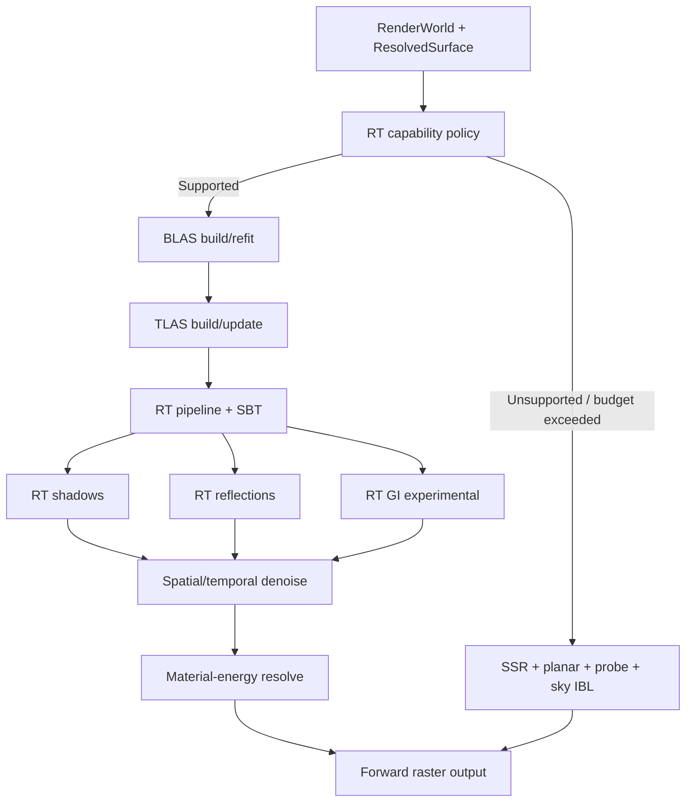

# Milestone 16 — Ray Tracing Backend Architecture

**Status:** Proposed; this milestone is released only by explicit user instruction.
**Inputs:** M15 canonical material/surface contract, ViewContext, RenderPassScheduler, RenderGraph, RHIViewTargets, reflection capture policy and raster fallback chain.
**Purpose:** add a real hardware ray-tracing backend without weakening the raster path or claiming support on devices that cannot execute it.

## 1. Product boundary

M16 owns the RT backend and its capability-safe integration:

- D3D12/Vulkan ray-tracing capability discovery and backend policy.
- BLAS/TLAS ownership, build, refit, update, retirement and completion lifetimes.
- Ray-generation, miss, closest-hit and any-hit shader stages.
- RT shadows and RT reflections first; RT GI only after material and denoising gates pass.
- ForwardPBR-compatible material evaluation, including metallic, roughness, Fresnel, normal, clearcoat and transmission flags.
- Spatial/temporal denoising, history rejection and camera/scene/material invalidation.
- A single resolve policy with raster SSR, planar reflection, local probes and sky IBL as fallbacks.

M16 does not own meshlet generation or clustered light culling; those remain in M17. M16 does own the minimal coarse RT-proxy contract needed to build a bounded BLAS. M17 autoLOD may later produce a compatible proxy, but M16 startup cannot depend on a future M17 artifact. M15 owns planar reflection and the raster reflection contracts consumed here.

## 2. Backend and pass topology

The scheduler registers independent passes: `RayTracingASBuild`, `RayTracingShadow`, `RayTracingReflection`, optional `RayTracingGI`, `RayTracingDenoise` and `RayTracingResolve`. Each pass implements `IRenderPass`; no RT work is hidden inside the legacy callback adapter after its migration checkpoint.

## 3. Ownership and lifetime

- `RTAccelerationStructureService` owns native BLAS/TLAS handles, scratch buffers, compaction state, build generations and deferred retirement.
- `RTShaderTableService` owns shader libraries, hit groups, root signatures/pipeline layouts and SBT generations.
- `RTSceneBinding` maps immutable `RenderWorld` geometry/material identities to AS instances and descriptor indices.
- `ViewContext` owns per-view RT history, reset reasons, output targets and completion token. It does not own global BLAS/TLAS.
- Every AS, SBT and output lease is retained by the frame completion token until the GPU is finished.
- Failed rebuilds keep the last-good generation and publish a diagnostic; a failed first build selects raster fallback.

## 4. Resource and graph contracts

RT resources must be represented by explicit RHI types rather than raw API handles:

- `RHIAccelerationStructure` for BLAS/TLAS and build inputs.
- `RHIRayTracingPipeline` and `RHIShaderTable` for pipeline/SBT generations.
- `RHIViewTargets` additions for RT reflection, shadow and denoised history outputs, or a dedicated `RHIRayTracingTargets` owned by the view.
- RenderGraph access states for AS build/read, shader binding table reads, storage output writes and denoiser reads/writes.
- Backend policy exposes `RayTracing`, `RayTracingRefit`, `RayTracingInline`, `MaxASInstances` and budget diagnostics independently.

The graph must reject a pass that reads an unbuilt AS generation, mixes generations, or writes a history target with an incompatible view/material generation.

## 5. Geometry and material contract

M16 consumes M15's canonical `ResolvedSurface` values. The RT hit path must use the same base color, metallic, roughness, normal, F0, clearcoat, sheen, transmission and reflection flags as ForwardPBR. Unsupported custom graph fields produce a named fallback rather than silently diverging.

Geometry updates are classified as static build, transform refit, vertex/index rebuild or material-only update. TLAS instance masks separate opaque, transparent, shadow-only and reflection-only geometry. Capture and RT recursion policies explicitly disable recursive planar/probe/SSR sampling.

### 5.1 Coarse RT proxy contract

RT BLAS geometry is selected from a budgeted proxy generation, never from an unbounded Nanite micro-triangle stream. The proxy record carries a stable source-mesh UUID, proxy generation, primitive/material-slot mapping, alpha-test/two-sided classification, positions, normals and the UV/tangent data required by the hit material contract. Proxy triangle count is selected per asset and quality tier; the RFC's 10--20% ratio is a starting heuristic, not an invariant.

Static assets are cooked or generated into a retained proxy before BLAS build. Supported deforming assets publish whether they refit, rebuild or fall back to raster; topology changes always rebuild. Proxy generation, BLAS generation and TLAS generation are independently leaseable and retain the last-good generation on failure. Shadow and reflection masks may select different proxy budgets when silhouette or leak risk requires it.

## 6. Quality tiers and fallback

- **RT Off:** raster direct lighting, planar reflection, SSR, local probe and sky IBL.
- **RT Shadows:** RT shadow visibility with raster lighting and raster reflections.
- **RT Reflections:** RT reflections with denoising and raster/probe fallback for misses.
- **RT GI:** experimental indirect lighting, gated by leak, stability and budget tests.

Unsupported hardware, invalid AS generations, shader compilation failure or budget overflow must select the strongest valid raster tier and publish a diagnostic. No authored scene data is mutated by fallback.

## 7. Acceptance boundary

M16 is accepted only when D3D12 and Vulkan-capable RT fixtures pass on declared hardware, raster fallback passes on non-RT/disabled paths, AS/SBT generations survive resize/device reset/scene replacement, material parity images pass deterministic comparison, and GPU timing/memory budgets are recorded. RT GI remains separately gated until its leak and temporal criteria pass.
