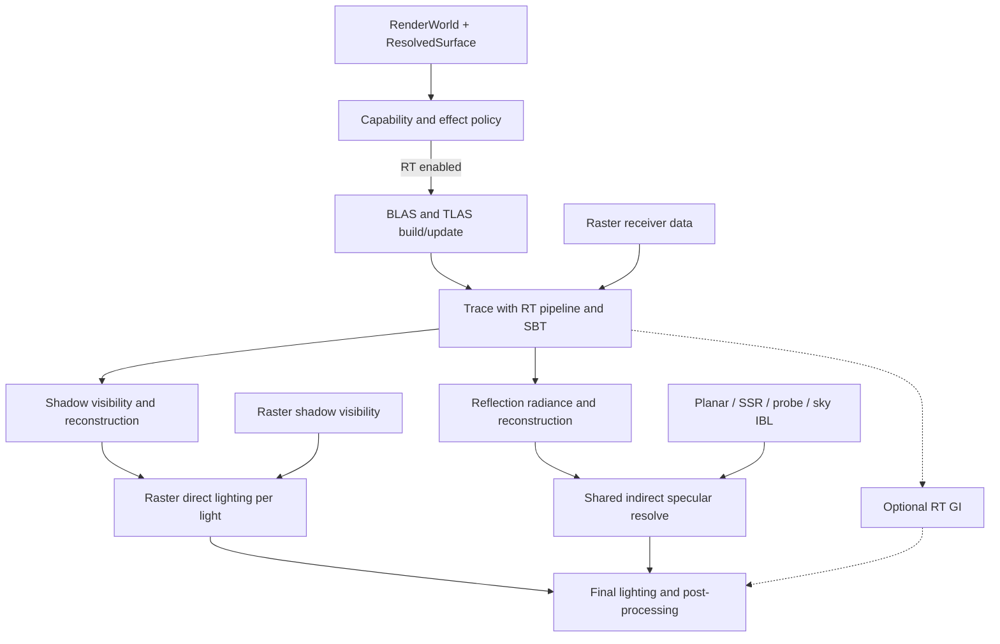

# Milestone 16 — Ray Tracing Backend Architecture

**Status** — Architecture for the packages and batches in [PLAN.md](PLAN.md).
**Inputs** — The accepted M15 U11 surface and lighting contracts, `ViewContext`, stateful `IRenderPass` scheduler, graph and transient targets, frame completion, reflection capture policy and raster fallback chain.
**Purpose** — Add hardware ray-traced shadows and reflections to the raster renderer with capability-validated execution and raster fallback.

## 1. Product boundary

M16 owns the RT backend and its capability-safe integration:

- D3D12/Vulkan ray-tracing capability discovery and backend policy.
- BLAS/TLAS ownership, build, refit, update, retirement and completion lifetimes.
- Ray-generation, miss, closest-hit and any-hit shader stages.
- RT shadows and RT reflections first; RT GI only after material and denoising gates pass.
- ForwardPBR-compatible material evaluation, including metallic, roughness, Fresnel, normal, clearcoat and transmission flags.
- Spatial/temporal denoising, history rejection and camera/scene/material invalidation.
- A single resolve policy with raster SSR, planar reflection, local probes and sky IBL as fallbacks.

M16 does not own meshlet generation or clustered light culling; those remain in M17. M16 does own the minimal coarse RT-proxy contract needed to build a bounded BLAS. M17 autoLOD may later produce a compatible proxy, but M16 startup cannot depend on a future M17 artifact. M15 owns planar reflection and the raster reflection contracts consumed here.

## 2. Backend and pass topology

The scheduler registers `RayTracingASBuild`, `RayTracingShadow`, `RayTracingReflection`, `RayTracingDenoise`, `RayTracingResolve` and optional `RayTracingGI` as stateful `IRenderPass` instances.

AS build precedes trace. Receiver inputs must be available before tracing. Filtered shadow visibility must reach the matching light before its direct lighting is evaluated. Reflections feed the shared indirect-specular resolve before post-processing. Declare each edge in the graph. Probe and planar subcaptures have explicit effect policies that prevent recursive reflection sampling.

## 3. Ownership and lifetime

- `RTAccelerationStructureService` owns engine RHI handles for BLAS/TLAS, scratch buffers, compaction state, build generations and deferred retirement. RHI owns the native objects and backend destruction.
- `RTShaderTableService` owns shader libraries, hit groups, RHI pipeline layouts and SBT generations. RHI owns their backend representation.
- `RTSceneBinding` maps immutable `RenderWorld` geometry/material identities to AS instances and descriptor indices.
- `ViewContext` owns per-view RT history, reset reasons, output targets and completion token. It does not own global BLAS/TLAS.
- Every submitted AS, SBT, target and transitive geometry, descriptor and material lease survives until frame completion. Build inputs and scratch also survive their consuming submission. Publish a replacement set only when its resources and bindings are valid and the consuming submission has the required build-to-read ordering.
- Failed rebuilds can use the last-good generation if its scene, device epoch and bindings remain compatible. A first-build failure or an incompatible replacement selects raster fallback for the affected effect. Device reset rebuilds GPU resources from retained source data in the new device epoch.

## 4. Resource and graph contracts

RT resources must be represented by explicit RHI types rather than raw API handles:

- `RHIAccelerationStructure` for BLAS/TLAS and build inputs.
- `RHIRayTracingPipeline` and `RHIShaderTable` for pipeline/SBT generations.
- `RHIViewTargets` additions for RT reflection, shadow and denoised history outputs, or a dedicated `RHIRayTracingTargets` owned by the view.
- RenderGraph access states for AS build/read, shader binding table reads, storage output writes and denoiser reads/writes.
- Backend policy exposes `RayTracing`, `RayTracingRefit`, `RayTracingInline`, `MaxASInstances` and budget diagnostics independently.

The graph must reject a pass that reads an unbuilt AS generation, mixes incompatible generations, or writes a history target with an incompatible view/material generation. History identity records the view, target, scene, compatible AS/material generation and device epoch. Distinguish slot rotation and compatible transform updates from a change that invalidates those identities. Routine object/camera motion uses reprojection and per-pixel rejection within a compatible history. The completion token and explicit graph dependencies protect the history across frames in flight.

## 5. Geometry and material contract

M16 consumes M15's canonical `ResolvedSurface` values. The RT hit path must use the same base color, metallic, roughness, normal, F0, clearcoat, sheen, transmission and reflection flags as ForwardPBR. Unsupported custom graph fields produce a named fallback rather than silently diverging.

Geometry updates are classified as static build, transform update, same-topology deformation, topology rebuild or material-only update. TLAS consumes eligible extracted scene instances, including eligible off-screen geometry. The main-camera raster draw list is view-culled for raster. TLAS classification records opaque, cutout, blended/transmissive, two-sided and effect participation, with tested shadow and reflection masks. Capture and RT recursion policies explicitly disable recursive planar/probe/SSR sampling.

### 5.1 Coarse RT proxy contract

RT BLAS geometry is selected from a budgeted proxy generation, never from an unbounded Nanite micro-triangle stream. The proxy record carries a stable source-mesh UUID, proxy generation, primitive/material-slot mapping, alpha-test/two-sided classification, positions, normals and the UV/tangent data required by the hit material contract. Proxy triangle count is selected per asset and quality tier; the RFC's 10--20% ratio is a starting heuristic, not an invariant.

Static assets are cooked or generated into a retained proxy before BLAS build. Supported deforming assets publish whether they refit, rebuild or fall back to raster; topology changes always rebuild. Proxy generation, BLAS generation and TLAS generation are independently leaseable and retain the last-good generation on failure. Shadow and reflection masks may select different proxy budgets when silhouette or leak risk requires it.

## 6. Quality tiers and fallback

- **RT Off:** raster direct lighting, planar reflection, SSR, local probe and sky IBL.
- **RT Shadows:** RT shadow visibility with raster lighting and raster reflections.
- **RT Reflections:** RT reflections with denoising and raster/probe fallback for misses.
- **RT GI:** experimental indirect lighting, gated by leak, stability and budget tests.

Resolve shadow and reflection availability independently. Shadows supply visibility for each selected light, with the existing raster visibility for unavailable RT samples or unselected lights. Reflections preserve a valid planar contribution on authored planar receivers, then use RT for the remaining confidence, followed by SSR, local probe and sky IBL as available. Resolve the receiver's indirect specular response once. The no-RT case preserves the M15 raster resolve.

Unsupported hardware, invalid AS generations, shader compilation failure or budget overflow select the applicable raster fallback and publish a diagnostic for the affected effect. Resolve the effective tier without changing authored settings. Publish the supported backends, view modes, presets and defaults with acceptance evidence.

## 7. Acceptance boundary

The [M16 acceptance matrix](PLAN.md#4-verification-and-evidence) defines the physical D3D12/Vulkan, fallback, lifetime, parity, Editor visual and performance evidence required for core acceptance at `RT-08D`. Optional RT GI has separate release and acceptance in `RT-09`.
