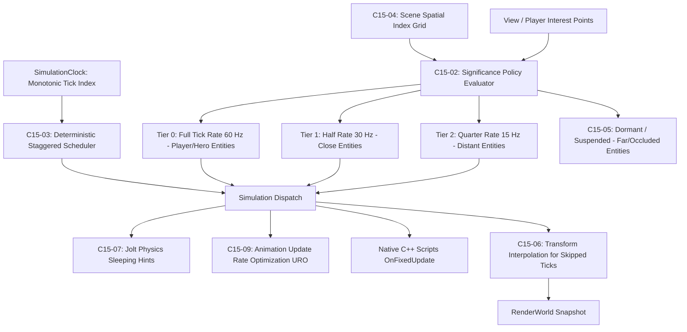

# Milestone 16 — Simulation Scale and Logic LOD Architecture

## 1. Target and Scope

Phase 04 addresses CPU-side simulation scaling for large open worlds and high-density entity counts. The objective is to decouple simulation costs from total entity population by dynamically throttling inactive or distant work while strictly preserving authoritative physics, gameplay state, and determinism.

Supporting references: [`POST_OPT10_PROGRAM_PLAN.md`](../../archive/design/deferred/POST_OPT10_PROGRAM_PLAN.md), [`POST_OPT10_FEASIBILITY.md`](../../design/POST_OPT10_FEASIBILITY.md).

---

## 2. Architecture and Subsystems

### 2.1. Monotonic Tick Identity & Significance Policy (`C15-01`, `C15-02`)
- **Monotonic Tick Index:** Standardized tick counter ensuring reliable scheduling across variable frame times.
- **Significance Tiers:** Entities are assigned dynamic tiers based on camera distance, screen-space size, velocity, and gameplay significance.
- **Hysteresis:** State transitions include hysteresis buffers to prevent rapid oscillations between tiers near boundary distances.

### 2.2. Deterministic Staggered Scheduler (`C15-03`)
- Distributes non-critical entities across modulo tick buckets (e.g. half of Tier 1 updates on even ticks, half on odd ticks).
- Prevents frame-time spikes by bounding the maximum number of simulation updates dispatched per frame.
- Enforces stable entity ordering by UUID to guarantee deterministic replayability.

### 2.3. Spatial Partitioning & Dormancy (`C15-04`, `C15-05`)
- **Spatial Grid Index:** Scene-owned loose spatial grid tracking entity locations for fast radius and frustum queries.
- **Explicit Dormancy Protocol:** Entities far beyond visual range enter a dormant state where all ticking is suspended. Wake-up triggers automatically restore active status upon player proximity or external physics impulses.

### 2.4. Visual Transform Interpolation (`C15-06`)
- Entities updated at lower tick rates (15 Hz / 30 Hz) produce smoothly interpolated transforms for rendering, ensuring visual motion remains 60+ FPS fluid without jerky steps.

### 2.5. Physics Sleeping & Animation URO (`C15-07`, `C15-09`)
- **Jolt Physics Integration:** Dormancy states provide sleep hints to Jolt body interfaces, reducing solver island computations while preserving collision contacts.
- **Animation Update Rate Optimization (URO):** Skips skeletal bone palette recalculations for distant actors, reprojecting cached joint matrices.

---

## 3. Technology and Boundaries

1. **Clean Decoupling:** Simulation logic remains completely independent from rendering; simulation never queries GPU states directly.
2. **Authoritative Authority:** Physics contacts, trigger collisions, and gameplay logic remain authoritative; interpolation is strictly visual.
3. **Deterministic Replay:** Tests verify that simulation runs with identical initial states yield identical end results regardless of frame rate.
