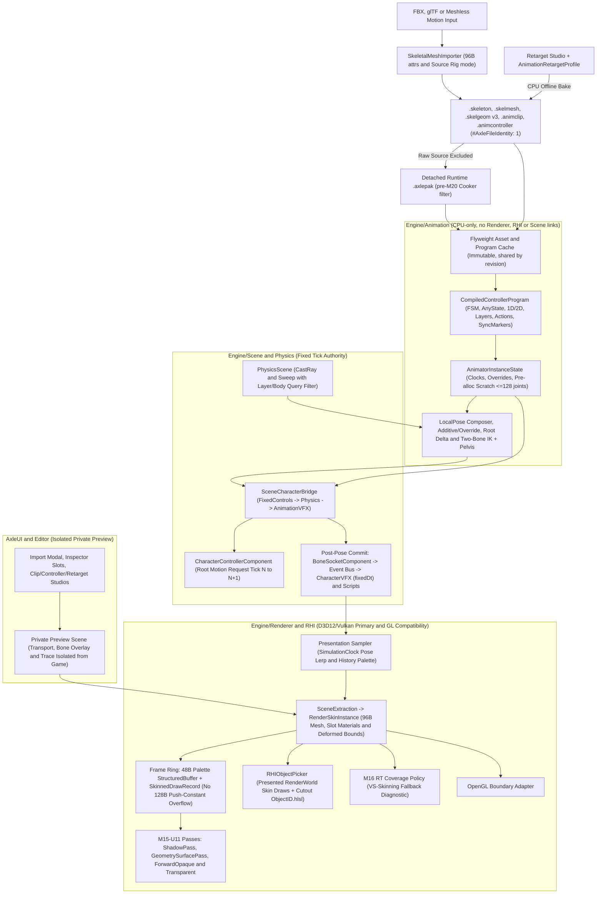

# Milestone 17 — Skeletal Animation Architecture

**Status** — Proposed target for Phase 46. Align render integration with the accepted **M15 U11** stateful `IRenderPass` / descriptor-ring architecture (`GeometrySurfacePass`, `ForwardOpaquePass`, `TransparentAndRefractionPass`, `ShadowPass`, `SurfaceLightingCommon.hlsli`) and **M16 core (`RT-08D`)** before implementation. [Execution and acceptance](PLAN.md).

## 1. Product boundary and ownership

M17 delivers a complete, production-grade skeletal animation system across import, runtime evaluation, native D3D12/Vulkan rendering, Studio tooling, gameplay systems and cross-rig retargeting. The current entry source contains early foundation prototypes (deep-cloned state machines, OpenGL-coupled CPU meshes, 64-byte skeletal vertices without tangents/colors, ECS-bypassing object picking, missing sockets/IK/actions/retargeting and missing Editor panels). M17 is explicitly authorized to refactor or replace incompatible prototype code across `Animation`, `Asset`, `Scene`, `Physics`, `Renderer` and `UI` rather than preserving temporary scaffolding.

The reference character moves over a step using foot IK and optional pelvis adjustment while playing an upper-body reload, emits the authored gameplay event once, keeps the prop attached to the posed hand and can use opt-in root locomotion in another state. Two actors can share the same assets while playing different motions. The final feature unit reuses a source motion on a second, differently proportioned rig through a baked target-native clip.

| Owner | Owns | Publishes |
| --- | --- | --- |
| Project asset services | Source ingestion, canonical references, AF-01 embedded identity (`# AxleFileIdentity: 1`), import transactions, discovery, reference rewrite (`*Ref` and scene paths) and dependency enumeration | Validated native asset revisions and their dependency closure |
| Animation | Rig and clip math, controller compilation, immutable compiled programs, lightweight per-instance state, motion sampling, pose composition and CPU IK solvers | Evaluation results with pose, event occurrences and optional root delta |
| Scene | ECS bindings, instance lifecycle, fixed tick, commands, movement ownership, physics query filters, attachment transforms, post-socket character VFX cadence and event delivery | Committed poses, finalized transforms, event dispatches and render extraction inputs |
| Renderer | 96-byte skinned geometry upload, material-slot submeshes, frame-owned palette/instance storage, U11 pass variants, per-view history, captures, presented picking and GPU lifetime | View outputs, presented picking identity and effective render support |
| Editor tooling | Import workflow dispatch, Inspector slot/parameter bindings, clip/controller/retarget working copies, document transactions, Dear ImGui Studio panels and private Preview | Authored candidates and explicit saves through the project asset services |

The Animation library runs without a window or graphics device. It has no dependency on Renderer, RHI, Scene, physics services or editor UI: sever `Axle::Renderer` from `Engine/Animation/CMakeLists.txt`, update `scripts/architecture_rules.json` (`Animation` excludes `Renderer`; `UI` may add `Axle::Animation` if Studio panels link it directly and pass `check_architecture.py`), remove `VertexArray` from `SkeletalMesh`, remove `SkinningPipeline`/`Shader` from `Animator`, and enforce a standalone `Axle::Animation`-only CPU test target without `Axle::Scene`. Scene adapts Animation outputs to the immutable renderer contract. Renderer types do not enter the evaluator or asset codecs. Existing pure document transactions are reusable in tooling. The legacy OpenGL draw adapter lives at the render boundary and consumes the same evaluated output.

### Scope after M17

M17 includes clip/1D/2D blend nodes, flat-per-layer state machines with `AnyState` and grouped (`OR`-of-`AND`) transitions, ordered masked override and additive layers with avatar joint masks, one-shot action slots, sync markers, gameplay markers, bone sockets, opt-in root motion, scene-backed two-bone foot IK with bounded pelvis adjustment, and [offline retargeting with authored profiles](#24-offline-retargeting). Hierarchical sub-state machines, broader full-body IK rig graphs (aim/look-at/FABRIK), clip custom float curves, morph targets, live runtime retargeting, cloth/physics-ragdoll blending, motion matching, compute-skinned BLAS deformation and network synchronization are post-M17 work. To keep M17 extensible without rewrites, keep `EvaluationResult`/`PoseSolveInputs` structs additive-friendly, avoid fixed 128-bit bitsets in masks/codecs, keep draw routing cleanly separable for future Compute Skinning (`PreDeformed_StaticVB`) and optional Morph Delta buffers, and treat 128 joints as a validation cap rather than a rigid format limit. M20 owns general dependency traversal and cooker policy. M21 owns derived skeletal geometry and meshlets. M22 owns significance-based pose cadence and bone LOD. M16 owns RT acceleration structures and raster fallback policy.

## 2. Authored assets and publication

### 2.1 Identity and schema

| Product | Authored contract |
| --- | --- |
| Rig | AF-01 embedded asset UUID (`# AxleFileIdentity: 1`), stable joint IDs and source keys, labels, parent relationships, explicit signed local bind TRS and inverse binds. A supported rig has a parent-before-child order and one effective root. A synthetic root is permissible under a repeatable import policy. |
| Skeletal mesh | Rig reference and compatibility signature, versioned binary geometry reference (`SkeletalGeometryCodec` v3 matching 96-byte `RHISkinnedVertex3D`: `Position`, `Normal`, `Tangent` `vec4` with handedness `w`, `TexCoord`, `Color` `vec4`, `JointIndices` `uvec4`, `JointWeights` `vec4`), source provenance, indexed submesh ranges and structured material slots (`SlotID`, label, optional default material asset reference). Bindings override slots by `SlotID`. |
| Clip | Stable identity and rig reference/signature, duration and key times in seconds, sparse local TRS tracks, optional locomotion root config (locomotion joint ID and extraction axes), gameplay markers (`Events`) and separate `SyncMarkers`. Store sampling, snap and provenance metadata separately from key times. |
| Controller | Rig reference and compatibility signature with stable IDs for states, transitions (`AnyState`, multi-group `ConditionGroups`), parameters (`Float`, `Int`, `Bool`, `Trigger`), 1D/2D `BlendPoints`, `AvatarMasks`, ordered `Layers` (base, override, additive) and named one-shot `Actions`. Persist the entry state, motion references, typed defaults and conditions, composition rules, marker authority and graph layout. Layout is editor data and must not alter compiled semantic revision. |
| Retarget profile | Editor-native asset (`AssetType::AnimationRetargetProfile` / `AssetKind::AnimationRetargetProfile` registered in `AssetMetadataSerializer`) with source and target rig references/signatures, joint mappings, reference poses, chain topology policy, scale/translation strictness and root translation scaling. Its baked output is a normal clip bound to the target rig. |
| Scene and assembly binding | Mesh and controller selection, per-slot material overrides (`SlotID -> MaterialRef`), parameter overrides, playback policy, socket, opt-in root motion and IK config, and an **explicitly opt-in** inline fallback (normal saves never auto-serialize hex-encoded `RigFallbackData` or `InlineFallbackData`). Persist authored configuration. Clocks, active actions, triggers, contacts, queues and render handles are transient. |

An asset UUID routes references to a native file or a committed imported member using the repository AF-01 `# AxleFileIdentity: 1` envelope (without `.meta` or `.uid` sidecars). A local ID identifies an element within that asset. A revision identifies an immutable content version. A rig signature guards ordered joint mapping, hierarchy, bind TRS and inverse binds for sampling and skinning. Labels are display data. Prototype v2 64-byte skeletal geometry (`SkeletalGeometryCodec` v2) and legacy prototype formats require no backward-compatible migration reader once fixtures re-import under v3. Imported joint, clip and slot identities survive renaming or reordering where stable source keys or explicit remaps establish correspondence. When reimport cannot establish that correspondence, report the affected references before publication.

Resolve normalized references once through the project asset/VFS services, and extend `AssetManager` path/identity rewrite helpers so asset rename/move updates both scene path properties and `AssetDSL` `*Ref` properties (`skeletonRef`, `geometryRef`, `motionAssetRef`, `clipRef`, `sourceImportPath`, retarget refs). Owner-relative forms resolve through the declared owner. Report ambiguous root/owner interpretations and reject escapes from the allowed content roots. Dependency edges carry the owning field, target kind and identity, and requiredness. Enumerate Scene/assembly -> mesh/controller/slot-materials, mesh -> rig/geometry/slot-defaults, controller -> rig/clips/masks and clip -> rig where referenced. Source provenance is stored separately from the compiled Runtime dependencies.

### 2.2 Import and reimport transaction

1. Resolve the source and dependencies, including external glTF buffers. Import CPU candidates using one source-to-engine conversion for mesh basis, winding, tangent frame generation and bitangent handedness `w`, vertex colors (default `{1,1,1,1}` when absent), node transforms, bind and inverse-bind data and clip samples. Preserve animated helper ancestry. Diagnose unsupported skin selection, shear and invalid or non-invertible bind data.
2. Validate counts and ranges before allocating. Merge repeated influences, retain the strongest four with stable ties, and normalize. Use the declared root-weight fallback for wholly unweighted vertices only where the source/geometry contract permits it. Canonicalize zero-weight lanes to index `0` (`uvec4` unsigned joint indices). Validate material slot ranges and reject rigs above the supported 128 joints.
3. Preserve glTF STEP, LINEAR and CUBICSPLINE, including tangent timing and quaternion normalization. Keep the existing FBX exact key boundaries, STEP/STEP-next and sampled bake policies. Preserve mandatory source boundaries and reject collapsed source times, duplicate active keys and unsafe bake budgets.
4. Write and read back a complete native generation in staging. The published skeletal asset records the committed rig, v3 geometry and clip member revisions and their stable identities. Discovery indexes the committed member set from that asset. Staged and retired revisions are outside ordinary discovery. Validate the full closure before atomically replacing the published record and updating the in-memory index. Keep publication under the asset owner, and reject stale import results.
5. Retain the last ready generation when import, validation or publication fails. Keep old generations available while a Scene binding, Preview or export snapshot retains them. Export freezes the resolved native revisions and emits their package locators and dependency edges. Runtime resolves that closure through the mounted VFS with raw source files and editor-only profiles absent. Until M20 implements dependency-filtered cooking, `AssetCooker` excludes raw source formats (`.fbx`, `.gltf`, `.glb`, `.obj`, `.blend`) and `AnimationRetargetProfile` assets from shipping `.axlepak` archives so detached Runtime packages never bundle authoring source inputs accidentally.

Use native embedded identities and the existing asset kinds for Runtime products. Preserve imported source bytes and keep generated caches outside authored content discovery. A consumer can make an editable copy of an imported clip as an independent native asset.

The project import route also accepts FBX/glTF animation without usable mesh geometry (updating `SkeletalMeshImporter` so valid meshless hierarchies are accepted rather than rejected on `meshes.empty()`):
- **Attach to existing compatible rig:** The user selects an existing compatible rig and a take. Import uses the same basis, sampling and validation contracts as character import, checks joint mapping and source bind/reference data against the selected rig, and diagnoses incompatible or ambiguous tracks before publishing the clip and its provenance.
- **Publish source rig when compatible reference hierarchy exists:** When the meshless FBX/glTF supplies a complete valid reference skeleton hierarchy and bind/reference transforms (such as standalone mocap/source clips intended for retargeting onto another character), the same route can publish the validated source `Skeleton` alongside the imported `AnimationClip` rather than requiring a dummy mesh. If the hierarchy or reference pose is incomplete, diagnose the exact missing joints/transforms and fail cleanly. Reimport retains asset identity and preserves the last ready generation on failure.

### 2.3 Binding and replacement

Scene loading, direct assembly instantiation, assembly editing, Preview and Runtime use the same binding and validation rules. Shared references resolve to eligible revisions. Make Unique creates a detached authored definition and preserves compatible overrides by stable ID. Inline fallback serialization (`RigFallbackData`, `InlineFallbackData`) in `SceneSerializer` and `AssemblySerializer` is strictly opt-in rather than automatic on normal saves; an explicitly saved inline fallback applies only to the documented missing-reference case. A missing required mesh or missing asset without an explicit inline opt-in keeps its editable reference, produces no draw and fails negative validation cleanly. A valid mesh with no compatible controller displays the rig bind pose and reports the failing controller field.

Resolve and validate the entire replacement before swapping the binding at the Scene commit boundary. If a replacement fails, keep the last ready compatible binding and report the requested revision and owner. On successful rebind, preserve compatible authored values by ID (parameter overrides, slot material overrides, sockets and IK settings) and reset transient playback, events, root requests, contacts and pose history. Duplicating an actor and entering Play both allocate isolated runtime instances without cloning shared immutable clip/skeleton/program assets. Canceling a draft, closing a Scene or unloading a package releases only that consumer's leases.

### 2.4 Offline retargeting

The Editor selects a native source clip and a target rig, edits or reuses an `AnimationRetargetProfile` asset, compares source and target Preview poses, and explicitly bakes a new target clip. One profile can be reused for several clips on the same source rig. Both previews use isolated instances of the production evaluator. The retarget computation runs on CPU against frozen source, rig and profile revisions.

- **Mapping and reference poses.** Store source and target rig references and compatibility signatures, stable source/target joint ID pairs, required chains, root roles and authored transform policies. Use authored reference poses in the same character-space convention. The bind pose can supply a reference. Compare required chain topology with the rig definitions. Reject ambiguous mappings, duplicate target joints, incompatible revisions and missing required joints. Optional unmapped target joints keep their reference local TRS. The first supported profile maps corresponding limb chains across rigs with different joint axes, rest poses and proportions. A profile is explicit about unsupported topology or scale.
- **Pose transfer.** Sample source local TRS and compute each mapped joint's global rotation delta `D = Rs(t) * inverse(RsRef)`. Express that delta in the target character basis and apply it to the target reference orientation as `Rt(t) = B * D * inverse(B) * RtRef`, where `B` is the proper rotation between source and target character bases. Recover each target joint's local orientation `inv(Gt_parent(t)) * Rt(t)` in parent-before-child order. Preserve target local offsets and scales. The supported route requires positive uniform scales along mapped chains and **rejects** animated non-uniform, zero or negative scale on those chains. For animated non-root local translations on mapped chains, apply the profile's declared mode: either **reject** (`StrictRotationOnly`) or **omit non-root translations to preserve target bone lengths while emitting a per-joint diagnostic** (`PreserveTargetOffsets`). For in-place motion remove designated planar displacement and yaw from the root. For root locomotion transfer those channels in the target basis with an authored positive translation scale (or proportional reference root height ratio). Runtime root compensation, movement ownership and foot IK use the existing target-rig contracts.
- **Baking and recoverability.** Bake target local tracks with the validated sample and work budgets, retaining duration, exact mandatory interval boundaries and terminal samples. Preserve STEP/STEP-next behavior, gameplay marker IDs/times/payloads and sync markers. Remap declared joint references in payloads or diagnose an unmapped required joint. Read back and validate the candidate with the target rig before publication. Keep the source assets untouched. Explicit rebake preserves the output clip UUID, advances its revision and retains the last ready output on invalid, failed or stale work. An editable copy can have independent keys and identity.
- **Runtime and dependencies.** The baked result is an ordinary target-rig clip accepted by the same controller, layer and action paths as other native clips. Source clip, source rig, profile and bake settings are authoring provenance and rebake dependencies. The target clip and its target rig are Runtime dependencies. Publish distinct requiredness for those edges and prove that the target still animates from the detached package with the source rig, source clip, retarget profile and raw inputs absent.

## 3. Controller program and pose evaluation

### 3.1 Compilation and instance state

Compilation (`AnimationControllerCompiler`) resolves rig, clips (including `Events`, `SyncMarkers` and `RootMotionConfig`), typed parameters, 1D/2D blend spaces, avatar masks, ordered layers, grouped conditions, `AnyState` edges and named one-shot actions into immutable shared tables (`CompiledControllerProgram`). The state machine owns state selection and transitions. A state points to a compiled motion program that samples a clip or blends child samples. A controller owns ordered layer composition over the base motion. Motion data uses a validated acyclic dependency order, with bounded node, pose-buffer and transition budgets. The state graph may loop through legal playback transitions. Reject instant cycles that cannot progress or apply the runtime work bound with a diagnostic when eligibility is data-dependent.

The same compiled evaluator serves Preview, Scene and Runtime through an asset flyweight/program cache keyed by asset UUID and semantic revision. Actors referencing the same compatible revision share the compiled program, `Skeleton` and decoded `AnimationClip` tables (replacing the current per-instance `Skeleton` copy in `Animator` and deep clip/blendspace copy in `AnimationStateMachine::Clone`). An actor `AnimatorInstanceState` stores only parameter values, parameter damping/smoothing filters if authored, trigger latches, independent source and target cursors, layer/action state, event cursors and fixed-capacity pre-allocated pose/matrix scratch buffers sized for <= 128 joints (zero steady-state per-tick heap allocation). A structural change recompiles; an Editor layout-only change preserves the compiled semantic revision.

Separate sampling, progression and publication. Sampling a specified time creates a result without clock or gameplay effects. An executed simulation tick advances one instance from a frozen input snapshot. A commit validates the owning instance generation before publishing the result. Draw, picking and repeated Preview captures read results without stepping the evaluator.

### 3.2 Sampling, clocks and transitions

- Seed sparse tracks from local bind TRS. Loop samples wrap and explicit nonloop samples clamp. Seek/scrub at an explicit terminal key can sample the exact end. Preserve authored STEP and cubic semantics, use shortest-path normalized quaternion interpolation for linear tracks and blend local TRS before deriving final matrices.
- Keep an unwrapped normalized phase per advancing state and a separate real-time fade clock. Derive phase advancement from the selected effective duration and authored speed. A parameter change may change future advancement and leaf weights while preserving the current phase (applying optional authored Float parameter smoothing deterministically on fixed ticks). Map phase back to each clip's native time. Source and target each advance with their own duration and speed.
- Evaluate grouped typed conditions without side effects. All conditions inside a `ConditionGroup` must match (`AND`), and a transition passes when any authored group matches (`OR`-of-`AND` in authored order). Evaluate explicit state transitions and `AnyState` transitions (with retrigger guard unless self-transition is opted in) by highest eligible priority, breaking ties by stable authored order. Consume the winning group's required Trigger values only after transition commit. Check exit phase over the elapsed interval, including phase zero, wrap and multiple cycles. Define zero-duration transitions and advance residual time after a transition completes. Unless interruption is explicitly enabled on a higher-priority transition, a running base crossfade completes before another base transition starts.
- Clamp 1D to ordered endpoints and interpolate its enclosing points. For 2D, compile deterministic triangulation (Delaunay / convex-hull triangulation) and reject duplicate coordinates. Use barycentric weights inside the hull and closest-edge projection outside it. Treat one point as constant and project collinear data onto a stable ordered line. Use finite, nonnegative normalized weights and a stable dominant quaternion for hemisphere selection.
- Sync markers are optional motion metadata. Use an authored sequence of corresponding marker IDs with explicit wrap segments. Map phase within a shared marker segment when compatible sequences exist. Fall back to normalized phase when a motion has no compatible marker sequence. Marker alignment influences sample time without dispatching gameplay events.

### 3.3 Composition and one-shot actions

Compose base pose first, then layers in stored order. A layer has a stable joint mask, a finite weight source (constant or typed Float parameter), a motion source and a mode. Multiply layer weight by the per-joint mask. Override blends the current composed local TRS toward the layer pose. Additive applies translation difference, quaternion delta and scale ratio from a declared compatible reference pose. Zero weight preserves the incoming pose. Reject invalid masks, reference poses and sign-changing additive scale ratios. For a near-singular blend, use a defined finite fallback with a scoped diagnostic.

A one-shot action owns one playback slot on its assigned layer. A named action identifies its motion, layer, priority and fade-in/out. Gameplay queues play or cancel commands for a specific instance. Scene publishes the command result when applying it, with a playback handle scoped to that instance generation on acceptance. A higher-priority action can interrupt an active action. Equal or lower priority requests report rejection while that action is active. Same-tick commands are applied in owner sequence and failed commands leave the active action intact. Cancellation, interruption and completion are distinct results. Fade an interrupted contribution from its current blended pose using bounded per-layer scratch, and fade an exiting action back to the underlying contribution. A canceled or interrupted playback stops emitting new marker occurrences. The base locomotion clock continues while an upper-body action is active.

### 3.4 Gameplay markers and delivery

Gameplay markers have stable IDs, authored time, event type and validated authored payload. Sync markers are available to the sampler and do not dispatch gameplay callbacks. Use the half-open traversal interval `(old, new]` for forward playback. A nonloop terminal event fires once. At a loop seam, process outgoing terminal markers before incoming time-zero markers in stable order. An explicit play can emit time-zero markers once through its first committed tick. Pause, seek, scrub, zero-time evaluation and render produce no gameplay occurrences.

Derive event authority from the authored participation policy. The base layer emits from one dominant clip player during crossfade or blend. For each marker occurrence, evaluate effective clip weights at its traversal offset from the frozen parameters and the fade clock. Break ties with authored order. An occurrence on a state or action boundary uses the player set for the traversal segment that reached that boundary. Each overlay or action opts in explicitly and uses the same arbitration for its own motion. One occurrence is identified by instance generation, playback identity, loop index and marker ID. Preserve distinct events from separately opted-in layers. Discard occurrences from players without authority as their cursors advance. Bound interval splits and queued events per tick. Report overflow, advance past undispatched occurrences and retain a finite pose.

Scene collects committed occurrences, orders them by tick, traversal offset and stable entity/lane/marker order, then publishes after final world and socket transforms. Route dispatched events through the Scene event bus to registered VFX triggers and script consumers (an ABI-safe `ScriptableEntity` hook such as `OnAnimationEvent` or a per-entity committed event buffer cleared each fixed tick so `AxleScripts.dll` hot-reload compatibility is preserved). Handlers see committed state and enqueue mutations through the next allowed Scene command boundary. Pause clears undelivered occurrences and preserves the playback cursor. Teardown, reset and rebind invalidate queued work from the old generation. Preview exposes a local event trace for authoring and does not dispatch events to the editing or Play scene.

## 4. Simulation, physics and presentation

### 4.1 Scene tick and result publication

Use the shared Scene fixed tick as the authority. The ordering below covers pose-dependent consumers inside the existing phases. Migrate legacy `CharacterVFXComponent` updates out of `SceneCharacterBridge::OnPostStepSync` (where they currently run before `Animator` updates and hardcode `Timestep(0.016f)`) into the post-socket stage below using the actual `fixedDt`.

| Stage | Operation |
| --- | --- |
| FixedControls | Apply queued commands and freeze typed parameter inputs. The supported movement owner consumes at most one compatible root request from the preceding tick. |
| Physics and PostStepSync | Step physics, synchronize world transforms and capture character motion and contact query inputs for this tick. |
| AnimationVFX | Evaluate base motion and layers, extract root delta and compensate, execute query-filtered IK contacts and solve poses, and derive final joint transforms. Publish compatible results at the Scene barrier. |
| After pose commit | Resolve sockets and refresh attachment world transforms. Publish committed events and update `CharacterVFXComponent` and pose-dependent emitters from those finalized transforms using `fixedDt`. |
| Extraction and presentation | Read committed results and retain immutable resources. A presentation frame can observe several ticks or none. |

Scene owns job submission and provides immutable inputs. A worker never accesses mutable ECS or physics objects. A Scene-managed physics query step can run between pose composition and IK. The solver consumes resolved contacts as data. Jobs write isolated results, and Scene drops results for stale entities or generations before the commit. Publish instance and rig generation, tick, pose revision, discontinuity reason, final local TRS and compatible joint matrices. Scene also retains the corresponding entity world sample and attachment identities.

### 4.2 Root motion, IK and sockets

**Root motion.** The authored rig identifies the locomotion joint and the rig-local axes for planar translation and yaw. The base motion supplies these channels. Derive relative planar transforms over sampled intervals, split at loop and crossfade boundaries, and preserve unwrapped yaw from the clip motion track. Blend interval deltas in a common character-local frame using the motion weights at the interval midpoint, then compose them in traversal order. Deriving deltas from each source before blending avoids jumps caused by absolute offsets between clips. Compensate the designated locomotion channels in the visual pose. Override/additive layers can affect visual pose detail without reintroducing displacement along the extracted axes.

In-place is the default. When enabled, a post-physics tick `N` can queue a request for `FixedControls N+1` with its source tick and instance generation (an intentional deterministic 1-fixed-tick pipeline relative to controller evaluation). The movement owner converts the request to the character's movement space, arbitrates explicit input and applies collision constraints. Vertical motion and gravity remain with physics. Pause, stop, reset, teleport, rebind and conflicting ownership immediately purge pending requests. If the sole supported movement owner (`CharacterControllerComponent`) is unavailable, preserve in-place behavior and report why.

**IK.** Extend `PhysicsScene` ray/sweep queries with explicit query filter support (collision layer mask and ignored body/character collider IDs) so IK traces ignore the actor's own capsule and ragdoll parts. Resolve contact against post-step Scene geometry with an authored two-bone chain, ankle/sole offset, pole reference, query filter, max reach, allowed slope and optional bounded pelvis vertical offset (shifting the visual root vertically within max step height/depth budgets so step-over poses bend naturally without floating or hyperextending the downhill leg). Scene supplies query results and the CPU solver computes a finite pose in consistent coordinates. Clamp unreachable targets, retain bend direction near singularities and fade toward the base pose when airborne or missing contact. Reset cached contacts on discontinuity. Foot IK and pelvis offset affect the visual skeletal pose only; movement and collision shapes remain owned by `CharacterControllerComponent` and Physics.

**Sockets.** Resolve after final joint transforms. The attachment transform is `WorldFromEntity * ObjectFromJoint * JointFromSocket * SocketFromAttachment`. Persist a socket ID, joint ID, local transform and attachment offset (`BoneSocketComponent` / entity attachment contract). Reject cross-scene bindings, cycles and ownership conflicts. On an unresolved joint or missing owner, retain a valid transform and report the scoped binding issue. Socket queries used by gameplay and emitter origins use the committed tick pose.

### 4.3 Presentation samples and history

For compatible consecutive commits, derive a presentation sample by interpolating final local TRS and the matching entity transform. Live views use the interpolation fraction supplied by the Scene's simulation clock. Recompute the joint hierarchy and skin matrices from that sample. A visible attachment follows the same presentation sample and its authored offset. When continuity is absent or a transform cannot interpolate safely, use the latest compatible sample and invalidate incompatible view history. Preview can request an exact sample for seek, pause and stepping. Presentation interpolation does not feed gameplay, move physics bodies or produce event occurrences. [Simulation clock](../../../Engine/Scene/include/Axle/SimulationClock.hpp).

Use the same presentation pose for every participating pass in a live view. History for motion vectors uses the previous successfully submitted compatible presentation sample for that view and instance. Track world and camera matrices with the corresponding palette. Rebase on first use, camera cut, skipped continuity, seek, teleport, rebind, resize, material route incompatibility or device change. Keep actual presented-frame pick identity separate from motion history. Planar and probe captures retain the chosen sample for their capture generation.

## 5. Native skinning and render extraction

### 5.1 Geometry, deformation and lifetime

Scene extraction publishes immutable draw inputs containing entity/instance identity (`EntityID`, `InstanceUUID`, revision tokens), mesh/rig/pose generations, current and previous world transforms, per-slot material bindings, participation flags and conservative deformed bounds (`RenderSkinInstance` refactored off `GLMesh` VAO ownership). Renderer caches immutable GPU geometry (`RHISkinnedMesh` or parameterized `RHIMesh` carrying vertex stride 96 bytes and `MaterialSlot` per `RHISubmesh`) by asset/geometry revision and device epoch. Pass recording consumes extracted inputs and renderer resources under M15-U11's `SceneDrawListBuilder` and stateful `IRenderPass` scheduling. A render thread does not resolve live Scene state or create OpenGL resources through the Animation asset.

Use the existing 96-byte `RHISkinnedVertex3D` stride. `BLENDINDICES` is four unsigned 32-bit values at byte 64 and `BLENDWEIGHT` is four floats at byte 80. Verify DXIL semantics and SPIR-V locations 5/6. Retain authored indexed submeshes, UV, color (`vec4`), tangent (`vec4` with bitangent sign `w`) and material slot mapping.

Use column-vector math. Local `L = T * R * S`, global `G[j] = G[parent] * L[j]` (root `G = L`) and skin `P[j] = G[j] * InverseBind[j]`. Apply the entity world transform once after skinning. CPU and GPU fixtures compare bind vertices and posed tangent frames. Compute weighted affine deformation, use the inverse transpose of the combined linear transform for normals, re-orthogonalize the tangent, and retain reflected tangent handedness. A near-singular transform uses the agreed finite fallback. Compute a conservative posed bound from per-joint influence AABBs transformed by the current skinning palette (`G[j]` / `P[j]`) and merged into a conservative entity/mesh bound so M15-U11 frustum culling and shadow-caster culling never clip animated extremities outside bind AABB. Use a widened bound or skip culling where no certified bound exists.

Pack palettes as three explicit `float4` affine rows per joint in a frame-owned `StructuredBuffer` with 48-byte element stride. Because hardware root/push constants (`RHIObjectPushConstants` in Forward/Normals/Shadows and `RHIVelocityObjectConstants` `CurrModel`+`PrevModel` in `Velocity.hlsl`) already consume the full **128-byte** limit, skinned draws must **not** append palette offsets into `b0, space0`. Instead, pass per-draw skinning metadata (`SkinnedDrawRecord { uint CurrPaletteOffset; uint PrevPaletteOffset; uint JointCount; uint Flags; }`) via a frame-owned `StructuredBuffer` (or U11 pass instance buffer / dedicated skinned constant binding) bound in a register space isolated from `space0` (`b0..b5`), `space1` material textures, and `MaterialSurface.hlsl` spaces (`b2/space0`, `space2..space5`). Current and previous palette base offsets are element indices into the selected palette buffer, bounded by allocated capacity, with joint count independently capped at 128. Validate `base + count`, buffer alignment and all active indices before recording. Leases for geometry, palette slices and descriptors allocate from M15-U11's frame-in-flight descriptor rings, survive overlapping GPU submissions and retire against completion tokens. Surface allocation or recording failures and reuse a ready generation only when its compatibility and lifetime still hold.

### 5.2 Consumer contract

| Consumer | Required behavior |
| --- | --- |
| Main and Preview color | Draw native indexed LOD0 through U11's `ForwardOpaquePass`, `TransparentAndRefractionPass` and shared `SurfaceLightingCommon.hlsli` lighting/deformation variants. Use per-slot built-in PBR with opaque, cutout and blended Forward coverage. Route unsupported material variants to a declared compatible skinned material or diagnose a scoped draw failure. |
| Surface and shadows | U11's `GeometrySurfacePass` (depth, normals, velocity) and `ShadowPass` (cascaded and local) agree on posed positions, winding and supported alpha coverage. Camera visibility and each light's caster selection use deformed conservative bounds and masks. |
| Motion vectors | Use matching current and previous submitted presentation data (`PrevWorldTransform` + `PrevPaletteOffset`) with explicit validity. Apply neither world movement nor skeletal movement twice. |
| Editor picking | Refactor `RHIObjectPicker` off its `registry.view<TransformComponent, MeshInstance3D>()` ECS bypass to consume immutable extracted/presented `RenderWorld` draws, native skinned geometry, active palette slices and alpha-cutout policy in `ObjectID.hlsl`. Validate the scene/entity generation and reject stale readbacks after resize, scene change or ID reuse. Bone overlay selection uses the same Preview sample. |
| Planar and probe captures | Update `RenderContracts::FilterCaptureWorld` to apply `CaptureEntity` exclusion and surface-mask filtering to `Skins`. Use the selected pose and the view's recursion, light-mask and participation policies. Retain one capture generation across scheduled faces of a dynamic probe. Invalidation abandons the candidate and keeps the prior ready result under the capture policy. Declare DDGI and any other capture participation explicitly. |
| M16 RT effects | M17 performs skinning in the Vertex Shader and therefore classifies skinned instances as unsupported for M16 hardware RT BLAS refit until M16/M21 introduces optional Compute Skinning to deformed vertex buffers. Publish deforming omission coverage and explicit unsupported reasons to the M16 effect policy so supported RT views exercise the declared raster shadow/reflection fallback without false miss artifacts. |
| OpenGL compatibility | Preserve the supported color and raster shadow route using the boundary adapter and the same CPU evaluator. Remove the blanket `!prepared.Skins.empty()` error blocker in `RenderService` for supported native backends, keeping capability diagnostics honest per route. |

Use a common skinned draw preparation path and declare palette reads through the accepted RenderGraph and lifetime contracts. Capability and view results report effective skinned draws and omissions per backend. A successful empty submission cannot establish skeletal render support.

## 6. Studio, diagnostics and implementation path

### 6.1 Authoring and Preview

Upgrade `EditorLayer`'s import modal (currently static `.axle`/`.axlebin` mesh only) to dispatch full character/skeleton/clip and standalone motion FBX/glTF imports cleanly. Content Browser imports a character or standalone motion, creates or opens native clip/controller/retarget documents, and exposes the profile-based retarget workflow. Extend `EntityInspector` (`SkeletalMeshComponent` slot material overrides + `AnimatorComponent` controller/parameter controls) and `AssemblyEditorPanel` with the shared binding rules, and add dedicated Dear ImGui `AxleUI` Studio panels (Clip Studio with Dope Sheet/Timeline, Controller Studio with State/Blend Graph & Layers, Retarget Studio). A dirty document is independent of entity selection and retains its working copy until save, discard or cancel.

Clip Studio includes joint hierarchy, posed bone overlay, transport and Dope Sheet tracks for per-joint TRS, gameplay markers and sync markers. Keys support range/box selection, snapped or free move, insert/value edit, delete and compatible copy/paste. Treat one drag as one transaction. Preserve authored data on invalid edits, failed save and failed reload.

Controller Studio authors states (`Clip`, `BlendSpace1D`, `BlendSpace2D`), `AnyState` and normal transitions, multi-group typed conditions, 1D/2D points, ordered avatar masks and layers, and named one-shot actions. Persist canvas layout and expose live state, phase, fade, weights, action state and markers in Preview. Use the production compiler and CPU evaluator for every playable candidate. A failed compile retains the last playable candidate and identifies the invalid field.

Preview owns a private scene and view, per-instance transport, parameters and cameras, with no shared mutable runtime state. Play, Pause, Step, loop and exact seek act only on the Preview instance. Save, Save As, Reload, undo/redo, close, project switch and application exit follow the document dirty guard. Update the saved revision only after successful atomic persistence. Retire Preview resources through the backend completion path.

### 6.2 Diagnostics and scale

Asset errors name the owner, field and failing identity or revision. Evaluation traces include phase, active layer/action, event ordering, root request decisions and pose resets. Render diagnostics include view, backend, device epoch, mesh/pose revision, draw count, palette pressure and rejected routes. Scope repeated diagnostics to the failing revision or instance. Measure representative one, 32 and 128 actor workloads, recording steady-state scratch allocations, evaluation cost, palette bytes and native raster cost separately from cold compile and upload.

### 6.3 Refactor and handoffs

Reuse validated importers, codecs, pose math and transactional document behavior only where they meet these contracts; explicitly replace prototype bottlenecks that block production quality:
1. Decouple `Engine/Animation` from `Axle::Renderer` / OpenGL `VertexArray` (`SkeletalMesh::m_VAO`) and `Animator::UploadToPipeline`, enforcing pure CPU compilation via `AxleAnimationUnitTests` without `Axle::Scene`.
2. Upgrade `SkeletalVertex` + `SkeletalGeometryCodec` v3 to full 96-byte attribute parity (`Tangent` with sign + `Color`) and structured `MaterialSlots` (`SlotID` + default material).
3. Replace deep-cloned clips/skeletons in `Animator` / `AnimationStateMachine::Clone()` with shared immutable compiled flyweights and zero-allocation per-instance state.
4. Make inline fallback serialization opt-in in `SceneSerializer` / `AssemblySerializer` / `CaptureAnimationBinding`, wire `AssetManager` `*Ref` path/UUID rewriting, register `AnimationRetargetProfile`, and exclude raw FBX/glTF/retarget inputs from pre-M20 `AssetCooker` packages.
5. Migrate `CharacterVFXComponent` out of `OnPostStepSync` (`0.016f`) to post-socket `AnimationVFX` (`fixedDt`), add `PhysicsScene` IK query filters, and add ABI-safe event dispatch.
6. Refactor `RHIObjectPicker` off its `MeshInstance3D` ECS bypass onto `RenderWorld`, update `RenderContracts::FilterCaptureWorld` for `Skins`, lift the `RenderService` native skin block, and align all skinned passes with M15-U11 stateful `IRenderPass` & descriptor rings.

Freeze a native two-actor fixture early and export that same fixture before building out Studio. Use the final playable character for integrated product acceptance.

M18 receives the event and attachment publication contract for pose-dependent VFX. M20 receives typed dependency edges and the detached VFS fixture, including the distinction between retarget bake provenance and the target clip's Runtime dependencies. M21 receives native LOD0 96-byte geometry, palette and bound contracts plus surface, motion, picking evidence and optional Compute Skinning upgrade hook. M22 receives tick, pose identity, staleness and dependency rules for URO. The [plan](PLAN.md) assigns each required behavior and acceptance gate to a checkpoint.
