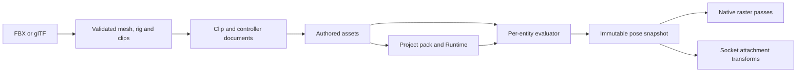

# Milestone 17 — Skeletal Animation Architecture

## 1. Ownership and data flow

| Owner | State and product boundary |
| --- | --- |
| Animation | Source import, validated immutable mesh/rig/clip/controller definitions, codecs, document transactions and runtime pose math. |
| Scene and shared simulation | Per-entity controller parameters, time, transitions, instance overrides, root motion requests, physics queries and socket consumers. Scene/assembly codecs resolve authored asset references. |
| Renderer and RHI | Extracted mesh and pose generations, layouts, palette uploads, pass variants, per-view history and GPU retirement. |
| Editor | Resource selection, Timeline, controller graph, inspector, diagnostic display and isolated preview state. |

## 2. Canonical skeletal product

- Use existing animation assets and codecs. Resolve embedded identity for native data and canonical root-relative paths for imported source. Keep display labels separate from stable controller, parameter, state, joint and socket identities. Declare schema/rig signatures and asset dependencies for future M20 traversal.
- Validate hierarchy, basis, finite TRS, index and weight bounds, matching inverse binds and segment ordering before publishing. Convert source basis once. Keep sign and interpolation semantics where supported, bind component values for sparse tracks and existing importer diagnostics for unsupported source combinations. Publish a complete immutable product or retain the previous usable generation.
- Preserve submesh material slots and joint/weight attribute conventions in the immutable mesh. Carry a conservative deforming bound or explicit non-cullable result. M21 derives LODs and selects levels. M22 applies significance-based pose update policy through the evaluator's explicit tick/pose boundary.

## 3. Simulation and pose semantics

Resolve the active state and typed parameters, sample normalized phase and transition poses in local TRS, compose additive deltas against a documented reference pose and apply opted-in IK before final world-space socket evaluation. Use normalized, hemisphere-consistent rotation interpolation. Define deterministic defaults, transition priority and trigger consumption. Describe the blend space 2D topology and stable tie rules, use clamped edge projection outside its hull, and produce a deterministic 1D or single-point result for degenerate inputs.

Per-instance state owns clocks, transition progress, trigger state, mutable parameters and current/previous pose. Clip and rig data may be shared. Extract elapsed root deltas from the declared track across loop boundaries and pass them to the simulation locomotion owner once per fixed tick. Opt-out preserves in-place behavior. Ground IK consumes bounded Scene/Physics raycast results, blends toward valid contacts and clears cached contacts on discontinuities. Validate singular or unreachable chains and keep the finite input pose when a solve fails. Sockets use evaluated joint transforms plus authored socket-local transforms. Missing sockets produce an unresolved attachment diagnostic and leave the base entity transform valid.

## 4. Rendering and preview

Publish a `RenderWorld` skeletal record with immutable mesh generation, material slots, instance transform/ID, bound, current and previous pose generations and discontinuity flags. Define mesh-local skin matrices from evaluated joint transforms and inverse binds, then apply the entity world transform once. Map the palette layout explicitly to shader reflection. Enforce the 128-joint native palette limit at publication with a diagnostic and reject unsafe indices. Palette offsets and generation leases remain valid through frame completion across views and uploads.

Use the same sampled pose for supported color, depth/normal/motion, shadow, ID/picking and declared raster captures. Reset motion history on rig/instance discontinuities and document capture or shadow feature limitations. Retain supported OpenGL compatibility and expose effective backend/capability diagnostics. Preserve the M16 RT coverage contract and make unsupported deforming ray-tracing coverage explicit. Extending skinned BLAS and proxy policy is a separate render scope.

The Editor owns clip/controller working copies, undo/redo and a private preview scene with isolated mutable animator state. Render that scene through the shared RenderService using a preview view/target lifetime. Accept validated transactions, retain clean revision identity across undo branches, save atomically and keep failed candidates out of shared runtime caches. Close/invalidate preview independently from the live scene and defer GPU resource retirement to completion.
