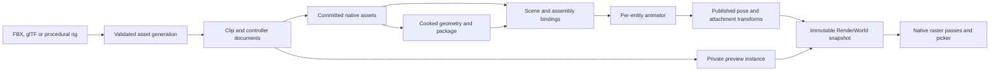

# Milestone 17 — Skeletal Animation Architecture

**Status** — Proposed contract. Establish the released source and reconcile the implementation seams against accepted M16 core before the first checkpoint.
**Execution and evidence** — [M17 plan](PLAN.md).

## 1. Product boundary and current source

The target workflow imports a skinned character and motions, edits a clip and controller, assigns them in a scene or assembly, and reproduces the same authored behavior in the native viewport and standalone packaged Runtime. A rig can be shared across independently playing instances. Authoring covers clip keys, a visual state machine, 1D/2D blends, sockets, masked additive layers, two-bone foot IK and opt-in root motion.

| Area | Reuse on entry | Work that M17 owns |
| --- | --- | --- |
| Import and assets | [Skeletal importer](../../../Engine/Animation/src/SkeletalMeshImporter.cpp), [asset codec](../../../Engine/Animation/src/AnimationAssetCodec.cpp), [geometry codec](../../../Engine/Animation/src/SkeletalGeometryCodec.cpp), [resource resolution](../../../Engine/Animation/src/AnimationResources.cpp) | Project import/reimport, validated complete product generations, versioned new fields, dependency enumeration and source-free cooked loading. |
| CPU evaluation | [AnimationPose](../../../Engine/Animation/src/AnimationPose.cpp), [controller compiler](../../../Engine/Animation/src/AnimationControllerCompiler.cpp), [state machine](../../../Engine/Animation/src/AnimationStateMachine.cpp) and 1D sampling | Explicit definition/instance separation, validated transitions, 2D data and evaluation, pose publication, attachments, root motion and IK. The current node enum includes 2D, while the compiler rejects that runtime case. |
| Scene and Runtime | [AnimationSceneBinding](../../../Engine/Scene/src/AnimationSceneBinding.cpp), [scene phases](../../../Engine/Scene/src/Scene.cpp), [character bridge](../../../Engine/Scene/src/SceneCharacterBridge.cpp) | Shared Scene, assembly and Runtime binding behavior, fixed-tick pose history, instance isolation, and publication order for animation, physics and socket consumers. |
| Rendering | [Scene extraction](../../../Engine/Scene/src/SceneExtraction.cpp), [RenderWorld](../../../Engine/Renderer/include/Axle/RenderWorld.hpp), [native layout](../../../Engine/RHI/include/Axle/RHI/RHIVertexLayout.hpp), [backend capabilities](../../../Engine/Renderer/src/RenderCapabilities.cpp) | Native mesh upload, palette streaming and all declared raster consumers. The existing extracted record carries an OpenGL mesh and CPU matrices, and the D3D12/Vulkan capability flags currently disable skinning. |
| Editor | [Clip document](../../../Engine/Animation/include/Axle/AnimationEditorDocument.hpp), [controller document](../../../Engine/Animation/include/Axle/AnimatorEditorDocument.hpp), [asset preview](../../../Engine/UI/src/AssetPreviewPanel.cpp) | Content Browser and Inspector integration, document host, isolated preview, Dope Sheet, bone selection and visual state/transition authoring. |

Animation owns CPU-only asset data and evaluation. Scene owns ECS, physics interaction, per-entity instances and world transforms. Renderer owns extracted draw data and GPU generations. Editor owns the working copy and input. Keep UI/RHI out of the asset codec and runtime evaluator. Isolate the existing OpenGL palette adapter at the render boundary and preserve its supported callers.

## 2. Identity, import, serialization and reload

### 2.1 Canonical products

| Product | Required contract |
| --- | --- |
| Skeleton | A parent-before-child table, exactly one effective root for a supported rig, stable source joint keys, displayed labels, explicit local bind TRS and inverse binds. A synthetic root is allowed only when produced consistently across import/reimport and covered by a fixture. |
| Skeletal mesh | Rig reference and compatibility signature, versioned geometry reference, provenance of source import, vertex attributes, four joint/weight slots, contiguous indexed submeshes and stable material slot mapping. Preserve the existing skeletal geometry codec and evolve it by version where necessary. |
| Clip | Stable clip identity, rig reference/signature, duration and key times in seconds, sampling/snap metadata, sparse local TRS channels and current marker data. Key density or UI frame rate does not change authored time. |
| Controller | Stable definition, state, transition, parameter and point identities. Store entry state, typed defaults, typed condition sets, clip references, transitions and blend data. Persist graph layout with authoring data and exclude it from the compiled graph's semantic content key. |
| Scene and assembly binding | References to the chosen mesh, rig and controller, optional explicit inline payload, material/parameter overrides and authored playback policy. Socket and IK configuration carry stable joint/socket references. Save authored choices and leave playhead, triggers, queued deltas, contacts and GPU handles transient. |

Use the existing `.axleasset` kinds for native products and embedded file identity under the project asset policy. A file UUID addresses the asset, a local ID addresses an element inside that asset, and a rig signature guards compatibility. Keep the rig signature based on the validated ordered mapping, parentage, bind and inverse-bind data. Preserve compatibility for currently supported canonical files. Where a new joint/point key is required, translate existing valid bindings at the codec boundary and document the schema defaults. Reject ambiguous remaps and verify joint identity across reimport. Automatic retargeting belongs to a separate asset workflow.

### 2.2 Import and reimport transaction

1. Resolve the chosen source and its dependencies within the project content rules, including external glTF buffers. Import to CPU candidates. Use one source-to-engine conversion for mesh basis, winding/tangent handedness, inverse binds, node transforms and animation samples. Preserve animated helper ancestry. Report a source and path-specific error for an unsupported mesh/skin selection, shear or non-invertible bind. Preserve supported signed-scale data.
2. Validate source ranges and counts before allocation. Remap joint indices after topological ordering, merge repeated influences, retain the strongest four with stable ties and normalize. A wholly unweighted vertex follows the documented root-weight default only when allowed by the source/geometry contract. Reject invalid references and nonfinite data. Require material ranges to cover geometry with valid slots. Reject rigs above 128 joints on publication. Avoid silent trimming.
3. Preserve native glTF STEP, LINEAR and CUBICSPLINE semantics, including tangent timing and quaternion normalization. Keep the existing FBX exact boundary/STEP/STEP-next and sampled bake policies. Preserve mandatory source boundaries and reject incompatible float-time collisions, unsafe budgets and duplicate active clip times. Historical tolerance reports describe sampled FBX results and are not a guarantee between arbitrary sample points.
4. Build and read back a complete product candidate before publishing a new generation. Stage dependent files and their references together. On partial failure or stale reimport, retain the prior usable asset generation and an actionable diagnostic. Update source/resource metadata only after publication. Async work may prepare CPU data, while the owning asset service performs publication. Renderer uploads are a later step with their own lifetime.

### 2.3 Binding, cache and package rules

Normalize references once through the project asset/VFS services. For supported owner-relative animation references, resolve against the declared owner and normalize to a project asset identity. Detect ambiguity where owner-relative and root interpretations disagree on new authoring. Reject root escapes. Preserve the owning field in diagnostics and dependency edges. Scene, assembly instance, assembly editor, and Runtime resolve through one binding contract.

A shared reference follows a validated compatible asset generation. Make Unique creates a detached authored definition. An explicitly persisted supported inline snapshot is usable when the selected reference is missing under its documented fallback policy. A malformed or incompatible replacement on reload retains a compatible already-published binding and reports the failure. On cold load, a valid mesh with no compatible controller can display the rig bind pose. A missing or incompatible mesh has no draw and keeps the authored reference editable. No implicit procedural substitute is published for an arbitrary character.

Provide dependency enumeration for scene → assembly/mesh/controller, mesh → rig/geometry/materials, controller → rig/clips, and clips → rig when referenced. Record file UUID or canonical path, owning field and requiredness. Mark source provenance separately from cooked Runtime requirements. With the current broad-scan exporter, M17 proves source-free loading of the required native products through the existing VFS and hands edge enumeration to [M20](../MILESTONE_20_COOKER/PLAN.md).

## 3. CPU evaluator and fixed-tick integration

### 3.1 Definition, state and published pose

Compile validated assets into read-only rig, clip and controller generations. Per-instance state owns typed values, triggers, clocks, source/target transition cursors, root/IK state and sampled pose. Default and instance overrides are applied by stable parameter ID and checked against the declaration. Entity duplication, Play scene creation and Preview each build independent runtime state. Scene operations and commands validate the entity generation before applying results. Shared resources may be read from worker jobs, with immutable inputs and one commit barrier before render extraction. No worker writes another entity's animator or the live context.

A published pose includes instance identity and generation, compatible mesh/rig generation, simulation tick, a pose revision, mesh-local joint matrices and discontinuity reason. Use the shared Scene fixed-tick dispatch to identify executed steps even when a presentation frame runs several or none. A normal tick advances once even when rendered into several views. A paused or restarted instance publishes a stable sample. Rebind preserves only compatible authored parameters by ID. Reset transient clocks, pending movement and contact state at the binding boundary.

### 3.2 Sampling, transition arbitration and blend spaces

- Seed local TRS with bind values, then evaluate independently keyed translation, rotation and scale. Sample nonloops at clamped time and loops at a wrapped phase. Preserve the terminal key for explicit nonloop and scrub samples. Use shortest-path normalized quaternion interpolation for linear tracks, and preserve the declared cubic/step semantics for other tracks. Never linearly blend complete skin matrices.
- Evaluate conditions without side effects. Select eligible transitions using declared priority and stable authored ordering for ties. Consume every required Trigger only after the winner commits. Test exit phase by crossings in the elapsed interval, including wrap and large steps. Resolve zero-duration transitions without division by zero, bound transition work per tick, and retain defined source/target clocks during fades. Reject or diagnose a state graph that cannot progress within that bound.
- A 1D sample interpolates between ordered coordinates with clamped endpoints. The 2D schema stores a stable point ID, finite X/Y and clip reference. Compile deterministic triangulation for noncollinear points, using stable ties for equivalent triangulations. Reject duplicate coordinates before building the graph. Interpolate via barycentric weights inside the hull and closest-edge projection outside. Empty samples are invalid, one point is constant, and collinear/two-point sets project onto a deterministic ordered line. Normalize finite nonnegative weights and use a stable dominant quaternion as the hemisphere reference for N-way rotation blending.
- Advance state phase using the selected blend duration without resetting phase when a parameter changes. Preserve source and target phase independently during transitions. Use native clip durations to map normalized phase back to the leaf clips. Test moves across blend cells or duration changes as a trace, not just one static pose.
- Preserve existing authored clip marker fields across editing, compatible reimport and persistence. Sampling and scrubbing treat markers as data. A gameplay event interface has a separate Scene delivery boundary.

### 3.3 Composition, sockets, root motion and IK

Apply base/controller blending, then additive layers in stored order, then resolve root motion and visual IK. Use translation difference, quaternion delta and scale ratio relative to a declared compatible local reference pose. Apply the weight combined with the authored per-joint mask. A weight of zero keeps the base joint, and a masked-out joint's base local TRS is unchanged. Reject invalid reference transforms or sign-changing additive scale ratios. Resolve the final joint hierarchy before evaluating sockets. A socket uses `WorldFromEntity * ObjectFromJoint * JointFromSocket`, with the attached entity's optional offset applied afterward. Preserve attachment limits and hierarchy constraints, and retain a valid entity transform with a diagnostic when a socket cannot resolve.

The current shared order is FixedControls → Physics → PostStepSync → AnimationVFX → extraction/presentation. M17 keeps the animator as a post-physics evaluator. An opted-in instance measures root movement over tick N, including loop and fade boundaries, removes the exported locomotion components from the rendered root and queues a request tagged with tick and instance generation for FixedControls at N+1. Only the supported character movement owner consumes it once. The first tick after reset has no queued movement. A valid request supplies desired ground-plane translation and yaw for the opted-in tick. Explicit movement-owner commands may override it, and collision constraints may clip it. Vertical movement and gravity stay with the movement/physics owner. Unsupported or conflicting movement ownership disables root motion with a diagnostic. Reset pending motion on pause/stop, teleport, rebind or scene/instance destruction. Verify the one-tick relationship in a fixed trace and keep the default in-place policy.

Foot IK uses Scene-owned queries against post-step geometry. Author a two-bone chain, ankle/sole offset, pole or bend reference, collision filter, contact distance, slope limit and weight. Solve in a consistent space and blend rotations into the local pose. Clamp unreachable targets to the feasible chain range, retain the authored bend near singularities and clear the contact on explicit discontinuity. Fade toward the base pose on misses or when airborne. If the rig or physics service is unavailable, keep a finite base pose and a scoped diagnostic. Solving only affects the visual pose. Evaluate sockets after IK and refresh attachment world transforms before updating emitters that use those transforms. Reconcile affected consumers in the existing Scene character/particle phase ownership.

## 4. Native rendering contract

### 4.1 Geometry and palette ABI

Use the existing 96-byte `RHISkinnedVertex3D` stride with `BLENDINDICES` at byte 64 as four unsigned 32-bit integers and `BLENDWEIGHT` at byte 80 as four 32-bit floats. Validate reflected D3D12 semantics and Vulkan locations 5/6. Preserve position, normal, tangent/handedness, UV and color. Prepare a render-owned immutable mesh generation containing buffers, submesh ranges, material slots, rig signature and bound data. Cache by asset/geometry generation and device epoch. Two instances of the same product share immutable mesh data.

With column-vector semantics, compute `L[j] = T * R * S`, `G[j] = G[parent] * L[j]`, and `P[j] = G[j] * InverseBind[j]`. For the root, `G[root] = L[root]`. `P` maps bind mesh-local positions into posed mesh-local space. Apply the entity world transform once after skinning. Reuse the existing pose math. Require the imported bind pose fixture to reproduce bind vertices. When parameters or input samples are invalid, keep a finite compatible sample or select the declared fallback before recording.

The native path uses an affine `StructuredBuffer` palette with three explicitly packed `float4` rows per joint (48-byte stride) and aligned frame-owned upload slices. Explicit packing avoids C++/HLSL matrix layout assumptions. Draw data carries current/previous base offsets and joint count, each bounded by 128. Verify shader reflection, range checks and descriptor compatibility on both native backends. Zero-weight slots have a valid canonical index. Validate reusable and overflow behavior before submission. Keep current/previous storage alive through all relevant completion tokens.

A shared shader deformation function emits posed position and a consistent tangent frame. Compute the weighted affine transform. Use the inverse transpose of its combined linear transform for normals when nonsingular and re-orthogonalize the transformed tangent. Preserve reflected handedness and define a finite fallback for near-singular blends. Validate signed and nonuniform scale, normal-map orientation and zero-weight lanes on CPU/GPU fixtures. Derive a conservative posed bound using transformed joint influence boxes or an equivalent proven bound. Widen or disable view culling when an asset has no certified bound. Bind-pose-only culling of a moving silhouette is unsafe.

### 4.2 Draw preparation and consumer coverage

Scene extraction publishes skin instances with render identity/generation, entity selection key, shared mesh and material generations, world transforms, pose revision/leases, conservative bounds and participation flags. Keep one canonical skinned draw preparation entry shared between supported consumers. Resolve materials by submesh using the existing surface policy. Select the skinned vertex variant with the existing surface policy. Prepare uploads and descriptors up front, declare palette reads and transitions through the accepted renderer/RenderGraph contract, and retain device-epoch and completion validation. Avoid processing the mutable Scene registry during render recording.

| Consumer | Required behavior |
| --- | --- |
| Main render and Preview | Native indexed LOD0 and built-in PBR with per-slot material. Prove opaque, alpha-cutout and blended Forward coverage. Use the same classification and deformation for each participating pass. Unsupported shader variants take a declared compatible **skinned** material route or surface an explicit draw failure. |
| Geometry surface and raster shadows | Depth, normals and shadow depth agree on posed positions, winding and alpha-test where eligible. Exercise cascaded and local shadows, including an off-camera caster. Keep visibility and camera-frustum culling distinct from light/view-specific caster selection. |
| Motion vectors | Use the same current pose as depth and the previous **submitted** compatible sample for that view/instance, with matching world and view transforms. Reset on camera cut, seek, teleport, rig/material-route incompatibility, device change and missing history. Same-pose draws across views do not advance simulation. |
| Editor picker | Use the posed mesh, alpha policy, projection/viewport transform and scene/entity generation that produced the presented view. Reject stale readbacks after scene switch or ID reuse. Picking samples the visible entity silhouette and does not update the animator. Bone overlay hits use the posed joint geometry in the isolated Preview. |
| Planar and probe captures | Honor supported view flags, recursion policy, light masks and the captured pose generation. A multi-face dynamic probe uses one retained pose snapshot across scheduled faces. Ordinary animation advances the live pose while that capture continues. Scene or resource invalidation aborts the candidate and retains the last ready generation under the capture policy. Declare DDGI or other capture participation explicitly and diagnose unsupported coverage. |
| M16 RT integration | Publish effective deforming coverage to M16's shadow/reflection policy. Use the declared raster fallback for unavailable coverage, with explicit reason. M16 owns AS/proxy policy, and M21 owns optional geometry-derived proxies. |

When staging or command recording fails, retain resources until their last consumer completes, abandon the invalid submission and surface the failing view/instance. An upload or reload failure may reuse only a compatible ready generation under the declared policy. Preserve the existing OpenGL raster skinning and shadow workflow as a compatibility gate. Geometry layout and pose contracts support [M21 LOD](../MILESTONE_21_GEOMETRY_VISIBILITY/ARCHITECTURE.md). [M22 URO](../MILESTONE_22_SIMULATION_SCALE/PLAN.md) owns cadence reduction and bone LOD while respecting sockets, tick identity and gameplay dependencies.

## 5. Editor and document lifecycle

### 5.1 Entry points and preview isolation

Content Browser exposes Import and create/open native clip/controller. Inspector assigns mesh, rig and controller with compatibility results, editable overrides and explicit link/Make Unique actions. Scene and assembly editor share validation. A workspace opens an actual document and a private scene instance, synthetic lighting/camera and relevant draft generation. Editor document resource selection does not alter active scene selection or bindings. Preview has independent transport, timeline clock, local parameters and a separate view identity. Seek samples directly at the requested time. Stepping or looping advances only preview state. Changing the selected entity does not close a dirty asset document.

### 5.2 Transactions and user interaction

- Dope Sheet has per-bone TRS tracks, key/range selection, box-select, snap toggle, insert/move/edit/delete and clip-local copy/paste. Keys keep stable document-side identity while moving. If persisted key IDs are required, use an explicit compatible codec extension. Normalize quaternion edits, validate rig/time/track identity on paste and explain conflicting destination times. Drag is one undoable transaction. An invalid edit preserves the prior pose and does not create a history revision.
- Bone hierarchy and overlays use stable joint identity. A hit in the viewport reveals the track and synchronizes selection. Maintain tool focus and avoid stealing scene transform/gizmo input. Keep overlay leases valid through Preview close and resize.
- The controller canvas stores positions independent of graph semantics, exposes typed parameter/state/condition editors and 1D/2D point grids, and shows active state, fade and sampled weights as diagnostics. Preview parameter changes are transient until the user explicitly changes a document default. Revalidate state/transition and compatibility on mutation. A failed compile keeps the previous usable preview generation and points to the invalid node or field.
- Open/New/Reload/Close, project switch and application exit use the dirty document guard. A canceled action leaves the working copy and selection intact. Save replaces the authored asset atomically, retains the dirty revision on error and marks clean only on success. Reload, import/reimport and late jobs publish via version checks. Undo/redo compares to saved revision identity, including branches and no-ops. GL and native Preview resources release under their backend lifetime rules.

## 6. Diagnostics and handoff

Asset/document errors carry stable code, source asset or file, field or node/joint ID, and recoverable action. Runtime draw diagnostics include entity/instance, pose/mesh/device generation, view, active backend and effective route. Expose per-frame skinned instance/draw counts, current/previous palette bytes, upload capacity and reset reasons. On CPU, record evaluation, blend/sample and palette build costs for representative actors and joints. Avoid logging the same scoped error each frame.

M20 receives the dependency edge examples and source-free VFS fixture. M21 receives native LOD0 geometry/palette, bounds, surface/motion and picking contracts, and a CPU deformation reference. M22 receives explicit evaluator tick, immutable pose identity, staleness/reset and dependency rules for URO. The [plan](PLAN.md) defines the evidence required for each consumer before M17 acceptance.
