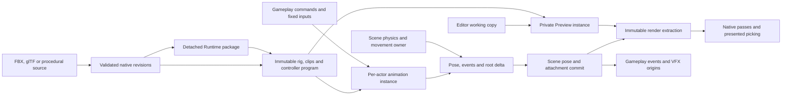

# Milestone 17 — Skeletal Animation Architecture

**Status** — Proposed target for Phase 46. Reconcile the render integration with accepted M16 core before implementation. [Execution and acceptance](PLAN.md).

## 1. Product boundary and ownership

M17 delivers the complete workflow for a playable skeletal character. Import and reimport a rig, mesh and clips, build a controller, author layers and gameplay markers, attach a prop, preview the authored character and run it in a detached package. The reference character moves over a step while playing an upper-body reload, emits the authored gameplay event once, keeps the prop attached to the posed hand and can use opt-in root locomotion in another state. Two actors can share the same assets while playing different motions.

The entry source has CPU import, rig/clip evaluation, mutable controller instances, document transactions and an OpenGL drawing path. M17 reuses the validated CPU and authoring behavior and adds the native draw path. The [execution plan](PLAN.md#1-product-outcome-and-baseline) records the entry capabilities and establishes the accepted renderer topology.

| Owner | Owns | Publishes |
| --- | --- | --- |
| Project asset services | Source ingestion, canonical references, import transactions, discovery and dependency enumeration | Validated native asset revisions and their dependency closure |
| Animation | Rig and clip math, controller compilation, typed instance state, motion sampling, pose composition and CPU IK solvers | Evaluation results with pose, event occurrences and optional root delta |
| Scene | ECS bindings, instance lifecycle, fixed tick, commands, movement ownership, physics query inputs, attachment transforms and event delivery | Committed poses, finalized transforms and render extraction inputs |
| Renderer | Skinned geometry upload, palette storage, draw preparation, per-view history and GPU lifetime | View outputs, presented picking identity and effective render support |
| Editor tooling | Clip/controller working copies, document transactions, authoring UI and private Preview | Authored candidates and explicit saves through the project asset services |

The Animation library runs without a window or graphics device. It has no dependency on Renderer, RHI, Scene, physics services or editor UI. Scene adapts Animation outputs to the immutable renderer contract. Renderer types do not enter the evaluator or asset codecs. Existing pure document transactions are reusable in tooling. The legacy OpenGL draw adapter lives at the render boundary and uses the same evaluated output.

### Scope after M17

The first controller supports clip nodes, 1D/2D blend nodes, state transitions, ordered masked override and additive layers, and one-shot actions. Automatic retargeting and cross-rig retarget profiles, broader IK constraints, motion matching and network synchronization are separate work. Stable joint identity and a CPU pose program provide extension points for those systems. M20 owns general dependency traversal and cooker policy. M21 owns derived skeletal geometry and meshlets. M22 owns significance-based pose cadence and bone LOD. M16 owns RT acceleration structures and fallback policy.

## 2. Authored assets and publication

### 2.1 Identity and schema

| Product | Authored contract |
| --- | --- |
| Rig | Embedded asset UUID, stable joint IDs and source keys, labels, parent relationships, explicit signed local bind TRS and inverse binds. A supported rig has a parent-before-child order and one effective root. A synthetic root is permissible under a repeatable import policy. |
| Skeletal mesh | Rig reference and compatibility signature, versioned geometry reference, source provenance, indexed submesh ranges and stable material slot IDs. Each slot has a label and an optional default material asset reference. Bindings override slots by ID. |
| Clip | Stable identity and rig reference/signature, duration and key times in seconds, sparse local TRS tracks, optional locomotion root data, gameplay markers and sync markers. Store sampling and snap metadata separately from key times. |
| Controller | Rig reference and compatibility signature with stable IDs for states, transitions, parameters, blend points, layers and actions. Persist the entry state, motion references, typed defaults and conditions, masks, composition rules, marker authority and graph layout. Layout is editor data. |
| Scene and assembly binding | Mesh and controller selection, slot/parameter overrides, playback policy, socket and IK config, and an explicitly declared inline fallback where supported. Persist authored configuration. Clocks, active actions, triggers, contacts, queues and render handles are transient. |

An asset UUID routes references to a native file or a committed imported member. A local ID identifies an element within that asset. A revision identifies an immutable content version. A rig signature guards ordered joint mapping, hierarchy, bind TRS and inverse binds for sampling and skinning. Labels are display data. Convert supported canonical name/index references at the codec boundary when the mapping is unambiguous. Imported joint, clip and slot identities survive renaming or reordering where stable source keys or explicit remaps establish correspondence. When reimport cannot establish that correspondence, report the affected references before publication.

Resolve normalized references once through the project asset/VFS services. Owner-relative forms resolve through the declared owner. Report ambiguous root/owner interpretations and reject escapes from the allowed content roots. Dependency edges carry the owning field, target kind and identity, and requiredness. Enumerate Scene/assembly → mesh/controller, mesh → rig/geometry/materials, controller → rig/clips and clip → rig where referenced. Source provenance is stored separately from the compiled Runtime dependencies.

### 2.2 Import and reimport transaction

1. Resolve the source and dependencies, including external glTF buffers. Import CPU candidates using one source-to-engine conversion for mesh basis, winding, tangent handedness, node transforms, bind and inverse-bind data and clip samples. Preserve animated helper ancestry. Diagnose unsupported skin selection, shear and invalid or non-invertible bind data.
2. Validate counts and ranges before allocating. Merge repeated influences, retain the strongest four with stable ties, and normalize. Use the declared root-weight fallback for wholly unweighted vertices only where the source/geometry contract permits it. Canonicalize zero-weight lanes to a legal index. Validate material ranges and reject rigs above the supported 128 joints.
3. Preserve glTF STEP, LINEAR and CUBICSPLINE, including tangent timing and quaternion normalization. Keep the existing FBX exact key boundaries, STEP/STEP-next and sampled bake policies. Preserve mandatory source boundaries and reject collapsed source times, duplicate active keys and unsafe bake budgets.
4. Write and read back a complete native generation in staging. The published skeletal asset records the committed rig, geometry and clip member revisions and their stable identities. Discovery indexes the committed member set from that asset. Staged and retired revisions are outside ordinary discovery. Validate the full closure before atomically replacing the published record and updating the in-memory index. Keep publication under the asset owner, and reject stale import results.
5. Retain the last ready generation when import, validation or publication fails. Keep old generations available while a Scene binding, Preview or export snapshot retains them. Export freezes the resolved native revisions and emits their package locators and dependency edges. Runtime resolves that closure through the mounted VFS with the source files absent.

Use native embedded identities and the existing asset kinds. Preserve imported source bytes and keep generated caches outside authored content discovery. A consumer can make an editable copy of an imported clip as an independent native asset.

### 2.3 Binding and replacement

Scene loading, direct assembly instantiation, assembly editing, Preview and Runtime use the same binding and validation rules. Shared references resolve to eligible revisions. Make Unique creates a detached authored definition and preserves compatible overrides by stable ID. An explicitly saved inline fallback applies to the documented missing-reference case. A missing mesh keeps its editable reference and produces no draw. A valid mesh with no compatible controller displays the rig bind pose and reports the failing controller field.

Resolve and validate the entire replacement before swapping the binding at the Scene commit boundary. If a replacement fails, keep the last ready compatible binding and report the requested revision and owner. On successful rebind, preserve compatible authored values by ID and reset transient playback, events, root requests, contacts and pose history. Duplicating an actor and entering Play both allocate fresh instances. Canceling a draft, closing a Scene or unloading a package releases only that consumer's leases.

## 3. Controller program and pose evaluation

### 3.1 Compilation and instance state

Compilation resolves rig, clips, typed parameters and masks into immutable tables. The state machine owns state selection and transitions. A state points to a compiled motion program that samples a clip or blends child samples. A controller owns the ordered layer composition over the base motion. Motion data uses a validated acyclic dependency order, with bounded node, pose-buffer and transition budgets. The state graph may loop through legal playback transitions. Reject instant cycles that cannot progress or apply the runtime work bound with a diagnostic when eligibility is data-dependent.

The same compiled evaluator serves Preview, Scene and Runtime. An actor instance stores parameter values, trigger latches, independent source and target cursors, layer/action state, event cursors and reusable pose scratch. Actors referencing the same compatible revision share compiled definitions and decoded clip data. A structural change recompiles. An Editor layout-only change preserves the semantic program revision. Avoid deep-copying the graph and clips per actor and allocating scratch arrays in steady-state evaluation.

Separate sampling, progression and publication. Sampling a specified time creates a result without clock or gameplay effects. An executed simulation tick advances one instance from a frozen input snapshot. A commit validates the owning instance generation before publishing the result. Draw, picking and repeated Preview captures read results without stepping the evaluator.

### 3.2 Sampling, clocks and transitions

- Seed sparse tracks from local bind TRS. Loop samples wrap and explicit nonloop samples clamp. Seek/scrub at an explicit terminal key can sample the exact end. Preserve authored STEP and cubic semantics, use shortest-path normalized quaternion interpolation for linear tracks and blend local TRS before deriving final matrices.
- Keep an unwrapped normalized phase per advancing state and a separate real-time fade clock. Derive phase advancement from the selected effective duration and authored speed. A parameter change may change future advancement and leaf weights while preserving the current phase. Map phase back to each clip's native time. Source and target each advance with their own duration and speed.
- Evaluate grouped typed conditions without side effects. All conditions in a group must match. A transition with multiple groups may use the first matching group in authored order. Select the highest eligible priority and break ties with stable authored order. Consume the winning group's required Trigger values only after transition commit. Check exit phase over the elapsed interval, including phase zero, wrap and multiple cycles. Define zero-duration transitions and advance residual time after a transition completes. A running base crossfade completes before another base transition starts.
- Clamp 1D to ordered endpoints and interpolate its enclosing points. For 2D, compile deterministic triangulation and reject duplicate coordinates. Use barycentric weights inside the hull and closest-edge projection outside it. Treat one point as constant and project collinear data onto a stable ordered line. Use finite, nonnegative normalized weights and a stable dominant quaternion for hemisphere selection.
- Sync markers are optional motion metadata. Use an authored sequence of corresponding marker IDs with explicit wrap segments. Map phase within a shared marker segment when compatible sequences exist. Fall back to normalized phase when a motion has no compatible marker sequence. Marker alignment influences sample time without dispatching gameplay events.

### 3.3 Composition and one-shot actions

Compose base pose first, then layers in stored order. A layer has a stable joint mask, a finite weight source (constant or typed Float parameter), a motion source and a mode. Multiply layer weight by the per-joint mask. Override blends the current composed local TRS toward the layer pose. Additive applies translation difference, quaternion delta and scale ratio from a declared compatible reference pose. Zero weight preserves the incoming pose. Reject invalid masks, reference poses and sign-changing additive scale ratios. For a near-singular blend, use a defined finite fallback with a scoped diagnostic.

A one-shot action owns one playback slot on its assigned layer. A named action identifies its motion, layer, priority and fade-in/out. Gameplay queues play or cancel commands for a specific instance. Scene publishes the command result when applying it, with a playback handle scoped to that instance generation on acceptance. A higher-priority action can interrupt an active action. Equal or lower priority requests report rejection while that action is active. Same-tick commands are applied in owner sequence and failed commands leave the active action intact. Cancellation, interruption and completion are distinct results. Fade an interrupted contribution from its current blended pose using bounded per-layer scratch, and fade an exiting action back to the underlying contribution. A canceled or interrupted playback stops emitting new marker occurrences. The base locomotion clock continues while an upper-body action is active.

### 3.4 Gameplay markers and delivery

Gameplay markers have stable IDs, authored time, event type and validated authored payload. Sync markers are available to the sampler and do not dispatch gameplay callbacks. Use the half-open traversal interval `(old, new]` for forward playback. A nonloop terminal event fires once. At a loop seam, process outgoing terminal markers before incoming time-zero markers in stable order. An explicit play can emit time-zero markers once through its first committed tick. Pause, seek, scrub, zero-time evaluation and render produce no gameplay occurrences.

Derive event authority from the authored participation policy. The base layer emits from one dominant clip player during crossfade or blend. For each marker occurrence, evaluate effective clip weights at its traversal offset from the frozen parameters and the fade clock. Break ties with authored order. An occurrence on a state or action boundary uses the player set for the traversal segment that reached that boundary. Each overlay or action opts in explicitly and uses the same arbitration for its own motion. One occurrence is identified by instance generation, playback identity, loop index and marker ID. Preserve distinct events from separately opted-in layers. Discard occurrences from players without authority as their cursors advance. Bound interval splits and queued events per tick. Report overflow, advance past undispatched occurrences and retain a finite pose.

Scene collects committed occurrences, orders them by tick, traversal offset and stable entity/lane/marker order, then publishes after final world and socket transforms. Handlers see committed state and enqueue mutations through the next allowed Scene command boundary. Pause clears undelivered occurrences and preserves the playback cursor. Teardown, reset and rebind invalidate queued work from the old generation. Preview exposes a local event trace for authoring and does not dispatch events to the editing or Play scene.

## 4. Simulation, physics and presentation

### 4.1 Scene tick and result publication

Use the shared Scene fixed tick as the authority. The ordering below covers pose-dependent consumers inside the existing phases.

| Stage | Operation |
| --- | --- |
| FixedControls | Apply queued commands and freeze typed parameter inputs. The supported movement owner consumes at most one compatible root request from the preceding tick. |
| Physics and PostStepSync | Step physics, synchronize world transforms and capture character motion and contact query inputs for this tick. |
| AnimationVFX | Evaluate base motion and layers, extract root delta and compensate, resolve IK from Scene-owned queries, and derive final joint transforms. Publish compatible results at the Scene barrier. |
| After pose commit | Resolve sockets and refresh attachment world transforms. Publish committed events and update pose-dependent character VFX and emitters from those transforms. |
| Extraction and presentation | Read committed results and retain immutable resources. A presentation frame can observe several ticks or none. |

Scene owns job submission and provides immutable inputs. A worker never accesses mutable ECS or physics objects. A Scene-managed physics query step can run between pose composition and IK. The solver consumes resolved contacts as data. Jobs write isolated results, and Scene drops results for stale entities or generations before the commit. Publish instance and rig generation, tick, pose revision, discontinuity reason, final local TRS and compatible joint matrices. Scene also retains the corresponding entity world sample and attachment identities.

### 4.2 Root motion, IK and sockets

**Root motion.** The authored rig identifies the locomotion joint and the rig-local axes for planar translation and yaw. The base motion supplies these channels. Derive relative planar transforms over sampled intervals, split at loop and crossfade boundaries, and preserve unwrapped yaw from the clip motion track. Blend interval deltas in a common character-local frame using the motion weights at the interval midpoint, then compose them in traversal order. Deriving deltas from each source before blending avoids jumps caused by absolute offsets between clips. Compensate the designated locomotion channels in the visual pose. Override/additive layers can affect visual pose detail without reintroducing displacement along the extracted axes.

In-place is the default. When enabled, a post-physics tick N can queue a request for FixedControls N+1 with its source tick and instance generation. The movement owner converts the request to the character's movement space, arbitrates explicit input and applies collision constraints. Vertical motion and gravity remain with physics. Pause, stop, teleport, rebind and conflicting ownership invalidate pending requests. If the sole supported movement owner is unavailable, preserve in-place behavior and report why.

**IK.** Resolve contact against post-step Scene geometry with an authored two-bone chain, ankle/sole offset, pole reference, query filter, max reach and allowed slope. Scene supplies query results and the CPU solver computes a finite pose in consistent coordinates. Clamp unreachable targets, retain bend direction near singularities and fade toward the base pose when airborne or missing contact. Reset cached contacts on discontinuity. Foot IK affects the visual pose only. Movement and collision shapes remain owned by the Scene/physics integration.

**Sockets.** Resolve after final joint transforms. The attachment transform is `WorldFromEntity * ObjectFromJoint * JointFromSocket * SocketFromAttachment`. Persist a socket ID, joint ID, local transform and attachment offset. Reject cross-scene bindings, cycles and ownership conflicts. On an unresolved joint or missing owner, retain a valid transform and report the scoped binding issue. Socket queries used by gameplay and emitter origins use the committed tick pose.

### 4.3 Presentation samples and history

For compatible consecutive commits, derive a presentation sample by interpolating final local TRS and the matching entity transform. Live views use the interpolation fraction supplied by the Scene's simulation clock. Recompute the joint hierarchy and skin matrices from that sample. A visible attachment follows the same presentation sample and its authored offset. When continuity is absent or a transform cannot interpolate safely, use the latest compatible sample and invalidate incompatible view history. Preview can request an exact sample for seek, pause and stepping. Presentation interpolation does not feed gameplay, move physics bodies or produce event occurrences. [Simulation clock](../../../Engine/Scene/include/Axle/SimulationClock.hpp).

Use the same presentation pose for every participating pass in a live view. History for motion vectors uses the previous successfully submitted compatible presentation sample for that view and instance. Track world and camera matrices with the corresponding palette. Rebase on first use, camera cut, skipped continuity, seek, teleport, rebind, resize, material route incompatibility or device change. Keep actual presented-frame pick identity separate from motion history. Planar and probe captures retain the chosen sample for their capture generation.

## 5. Native skinning and render extraction

### 5.1 Geometry, deformation and lifetime

Scene extraction publishes immutable draw inputs containing entity/instance identity, mesh/rig/pose generations, world and selection transforms, material slot identities, participation flags and conservative bounds. Renderer caches immutable GPU geometry by asset/geometry revision and device epoch. Pass recording consumes extracted inputs and renderer resources. A render thread does not resolve live Scene state or create OpenGL resources through the Animation asset.

Use the existing 96-byte `RHISkinnedVertex3D` stride. `BLENDINDICES` is four unsigned 32-bit values at byte 64 and `BLENDWEIGHT` is four floats at byte 80. Verify DXIL semantics and SPIR-V locations 5/6. Retain authored indexed submeshes, UV, color, tangent and material slot mapping.

Use column-vector math. Local `L = T * R * S`, global `G[j] = G[parent] * L[j]` (root `G = L`) and skin `P[j] = G[j] * InverseBind[j]`. Apply the entity world transform once after skinning. CPU and GPU fixtures compare bind vertices and posed tangent frames. Compute weighted affine deformation, use the inverse transpose of the combined linear transform for normals, re-orthogonalize the tangent, and retain reflected tangent handedness. A near-singular transform uses the agreed finite fallback. Compute a conservative posed bound from joint influence boxes transformed by the palette or an equivalent proven method. Use a widened bound or skip culling where no certified bound exists.

Pack palettes as three explicit `float4` affine rows per joint in a `StructuredBuffer` with 48-byte element stride. Current and previous base offsets are element indices into the selected buffer and are bounded by allocated capacity. The joint count is independently bounded by 128. Validate `base + count`, buffer alignment and all active indices before recording. Leases for geometry, palette slices and descriptors survive overlapping GPU submissions and retire against completion tokens. Surface allocation or recording failures and reuse a ready generation only when its compatibility and lifetime still hold.

### 5.2 Consumer contract

| Consumer | Required behavior |
| --- | --- |
| Main and Preview color | Draw native indexed LOD0 through the same deformation code. Use per-slot built-in PBR with opaque, cutout and blended Forward coverage. Route unsupported material variants to a declared compatible skinned material or diagnose a scoped draw failure. |
| Surface and shadows | Depth, normals, cascaded and local shadows agree on posed positions, winding and supported alpha coverage. Camera visibility and each light's caster selection use their own bounds and masks. |
| Motion vectors | Use matching current and previous submitted presentation data with explicit validity. Apply neither world movement nor skeletal movement twice. |
| Editor picking | Select against the actual presented pose, geometry, material policy and viewport transform. Validate the scene/entity generation and reject stale readbacks after resize, scene change or ID reuse. Bone overlay selection uses the same Preview sample. |
| Planar and probe captures | Use the selected pose and the view's recursion, light-mask and participation policies. Retain one capture generation across scheduled faces of a dynamic probe. Invalidation abandons the candidate and keeps the prior ready result under the capture policy. Declare DDGI and any other capture participation explicitly. |
| M16 RT effects | Publish required deforming coverage and explicit unsupported reasons to the M16 effect policy. Exercise the declared raster fallback for unavailable ray shadow or reflection coverage. Supported deforming RT uses the same effective pose and masks. |
| OpenGL compatibility | Preserve the supported color and raster shadow route using the boundary adapter and the same CPU evaluator. Record supported behavior separately from the native matrix. |

Use a common skinned draw preparation path and declare palette reads through the accepted RenderGraph and lifetime contracts. Capability and view results report effective skinned draws and omissions per backend. A successful empty submission cannot establish skeletal render support.

## 6. Studio, diagnostics and implementation path

### 6.1 Authoring and Preview

Content Browser imports a character and creates or opens native clip/controller documents. Inspector assigns compatible assets, exposes typed overrides and offers Make Unique. Scene and Assembly Editor use the same binding. A dirty document is independent of entity selection and retains its working copy until save, discard or cancel.

Clip Studio includes joint hierarchy, posed bone overlay, transport and Dope Sheet tracks for per-joint TRS, gameplay markers and sync markers. Keys support range/box selection, snapped or free move, insert/value edit, delete and compatible copy/paste. Treat one drag as one transaction. Preserve authored data on invalid edits, failed save and failed reload.

Controller Studio authors states and transitions, typed condition groups, 1D/2D points, ordered masks and layers, and named actions. Persist canvas layout and expose live state, phase, fade, weights, action state and markers in Preview. Use the production compiler and CPU evaluator for every playable candidate. A failed compile retains the last playable candidate and identifies the invalid field.

Preview owns a private scene and view, per-instance transport, parameters and cameras, with no shared mutable runtime state. Play, Pause, Step, loop and exact seek act only on the Preview instance. Save, Save As, Reload, undo/redo, close, project switch and application exit follow the document dirty guard. Update the saved revision only after successful atomic persistence. Retire Preview resources through the backend completion path.

### 6.2 Diagnostics and scale

Asset errors name the owner, field and failing identity or revision. Evaluation traces include phase, active layer/action, event ordering, root request decisions and pose resets. Render diagnostics include view, backend, device epoch, mesh/pose revision, draw count, palette pressure and rejected routes. Scope repeated diagnostics to the failing revision or instance. Measure representative one, 32 and 128 actor workloads, recording steady-state scratch allocations, evaluation cost, palette bytes and native raster cost separately from cold compile and upload.

### 6.3 Refactor and handoffs

Reuse validated importers, codecs, pose math and transactional document behavior where they meet these contracts. Replace the shared mutable controller execution model and lazy OpenGL ownership on the CPU mesh with the explicit boundaries above. Rebind current Scene, assembly, Preview and Runtime callers through the new production paths before retiring superseded paths. Freeze a native two-actor fixture early and export that same fixture before building out Studio. Use the final playable character for integrated product acceptance.

M18 receives the event and attachment publication contract for pose-dependent VFX. M20 receives typed dependency edges and the detached VFS fixture. M21 receives native LOD0 geometry, palette and bound contracts plus surface, motion and picking evidence. M22 receives tick, pose identity, staleness and dependency rules for URO. The [plan](PLAN.md) assigns each required behavior and acceptance gate to a checkpoint.
