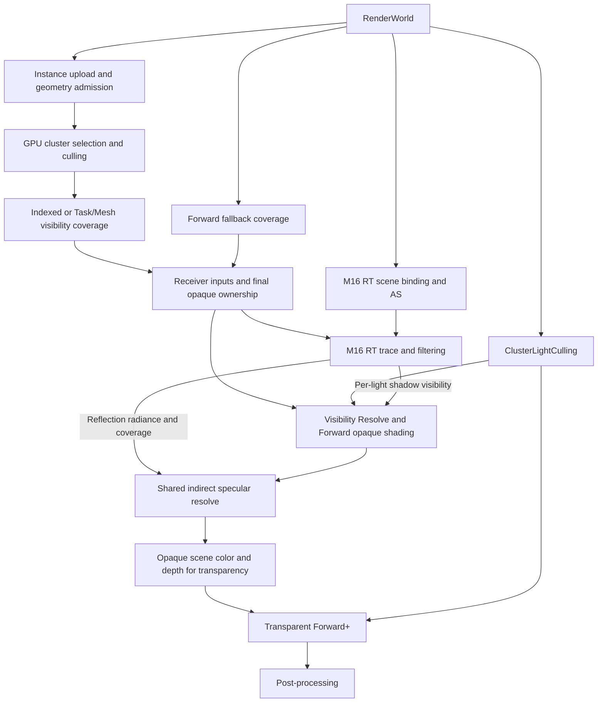

# Milestone 17 — Scalable Geometry and Virtual Geometry Architecture

**Status** — Proposed architecture for the checkpoints in [PLAN.md](PLAN.md).
**Inputs** — Accepted M15 U11-E renderer contracts and M16 core at RT-08D.

## 1. Ownership and reference routes

| Owner | Contract |
|---|---|
| Asset import and cooker | Derived static and skeletal LODs, flat meshlets, cluster hierarchy, cache provenance and validated packaged payloads. |
| Renderer | Immutable RenderWorld consumers, frame-owned instance/material streams, view-local culling and lighting, visibility raster/resolve and effective route policy. |
| RHI | Native feature/limit discovery, compiled shader layouts, indexed indirect and Task/Mesh commands, barriers, descriptor generations and completion ownership. |
| M15 | Shared surface/lighting evaluation, view and capture policies, raster reflection chain, pass scheduling, frame lifetime and transient resources. |
| M16 | Backend-neutral feature matrix, RT acceleration structures and shader tables, proxy eligibility, receiver inputs, shadow visibility, reflection radiance and coverage policy. |

CPU indexed Forward is the geometry reference. Fixed-slot ForwardPBR with the same material, light set and selected LOD is the shading reference. Flat indexed meshlets are the first visibility route. The hierarchy adds selectable cluster cuts to that route. Task/Mesh consumes the same selected cut and produces the same identities.

## 2. Cooked geometry and LOD selection

Import and package cooking call the same derived-geometry builder. Key generated data by canonical source identity, revision or content, cook profile, schema and meshoptimizer version. Keep derived data under the existing generated-cache and package conventions. Store authored settings in the existing authored asset where applicable and load runtime payloads through the usual mesh binary or skeletal codec. Validate section bounds, counts, indices and material mapping before publishing the product. A valid base product provides LOD0 when optional sections are absent or incompatible. Mounted packages use the same decode path and remain read-only.

LOD ratios of 100/50/25/10 percent are cook targets. Preserve attribute discontinuities and material boundaries, and retain the last valid level if geometry or attribute error prevents further simplification. Record actual counts, bounds, error and reason. Skeletal LODs preserve source material slots and joint/weight contracts and use conservative bounds for supported deformation.

Evaluate projected coverage per view against conservative bounds. Use history with hysteresis, a stable transition seed and consistent coverage for participating raster passes. Reset on incompatible view, geometry or device generations and camera cuts. Define how blended surfaces transition while preserving depth sorting and opacity. Shadow depth selection uses light-space coverage and caster silhouette error independently of camera selection, including casters outside the main frustum.

Flat meshlets retain stable identity within a geometry generation, source triangle and material correspondence, bounds, normal cones and seam metadata. The default profile caps meshlets at 64 vertices and 126 triangles. The indexed representation maps the same triangles to the same identities. The later cluster DAG preserves locked shared boundary loops and monotonically conservative geometric error.

Admit complete cooked geometry generations within a declared GPU memory budget. Account for vertex/index, meshlet and hierarchy data, the available fallback and temporarily overlapping generations. Track staging in its memory domain. Preflight an indexed fallback before admitting an optional product. Publish a replacement only after upload readiness. Retain the exact old generation while submissions still reference it. When an asset exceeds its allocation, use an admitted compatible generation or a budgeted discrete LOD and report why that asset took the fallback. On-demand page streaming has its own feature scope.

An optional M17-produced RT proxy carries the M16 source linkage, proxy generation, vertex attributes, material/alpha mapping and triangle-budget contract. M16 can use its own proxy and continues to own proxy selection and AS lifetime. TLAS classification consumes eligible whole-scene instances, including off-camera casters and reflection hits. The view-culled raster working set is a separate consumer of the same snapshot.

## 3. GPU instance data and culling

`GPUInstanceData` is a packed renderer record derived from immutable `RenderWorld`. It holds stable instance identity and generation, current and previous transforms, conservative bounds, geometry and material references, meshlet/LOD ranges and flags. Keep the C++ and shader layouts explicitly tested. Frame-owned upload slices and draw metadata retain the exact geometry, material and descriptor generations until completion. State carried between views or frames is keyed by its compatible identity. Publish replacements only after their inputs are valid.

Emit indexed indirect commands by compatible geometry binding, index type and pipeline. Define how draw metadata and instance indices identify the packed record for nonzero index, vertex and instance bases on each backend. Test bounded fixed-range commands and GPU draw count where available. Establish capacity from a conservative upper bound before recording or select a complete bounded route on the GPU before consumption. Use asynchronous diagnostic readback for telemetry. Missing, unsupported or over-capacity work selects the complete applicable fallback for that scope.

Use frustum bounds first. Apply meshlet normal-cone rejection only when the transform and material provide a conservative cone. Disable it for unsupported cases such as two-sided surfaces or unproven transformed bounds.

Traverse the admitted cluster DAG on the GPU per view against a projected error bound. Use a CPU reference for deterministic cut and limit fixtures. The GPU publishes one complete compatible cluster cut consumed by indexed and Task/Mesh rasterization. Bound traversal and output by view and frame. Invalid metadata or exhausted work selects a valid coarser cut or a discrete LOD for the affected scope before raster reads the result. Expose selected cluster counts, effective routes and fallback reasons for fixture and Editor diagnosis.

For the engine's forward depth convention of near 0 and far 1, the occlusion pyramid stores the farthest relevant depth over each represented footprint. Its reduction uses `max()` or an equivalent conservative representation with empty/uncertain coverage treated as potentially visible. Reuse the M15 Hi-Z allocation and odd-edge handling where compatible. Preserve the separate nearest-depth `min()` semantics used by SSR.

1. Use compatible previous view depth to defer candidates that may be occluded. Record first-phase depth from eligible occluders with current projection, clipping and coverage that remains valid for final rasterization. If an occluder changes LOD or route and invalidates that coverage, retest affected work or keep it visible. Grids and history are view-local, including same-size views.
2. Build the current occlusion pyramid and retest deferred work before final coverage. Draw recovered candidates in the same frame. Near-plane intersections, invalid history and unproven occlusion retain candidates. Camera cuts, resize, incompatible scene/geometry changes and device epochs invalidate history. Compare against an occlusion-disabled reference with the same geometry and camera.

## 4. Coverage, clustered shading and RT integration

### 4.1 Pass dependencies

The ordered scheduler hosts stateful passes with explicit graph edges. Each arrow represents a resource or ordering dependency. Route-specific producers contribute to the same view contract.

When RT is active, produce the required receiver depth, normal, material terms and motion before their individual consumers. Each effect declares its inputs from effective settings, including when TAA, SSR or planar reflections are off. Use M16's visibility for the matching light before direct shading. Pass reflection radiance and coverage to the shared indirect-specular resolve and apply the receiver response once. Keep M16's coverage diagnostics and raster fallback for incomplete RT effects. Camera-frustum light lists are valid for raster receivers, while off-screen reflection hits use the M16 hit-lighting policy. Preview, planar and probe captures follow their declared view and recursion policies.

### 4.2 Visibility identity and resolve

Freeze the integer attachment and depth formats, background sentinel, instance/cluster/primitive encoding, partitioning, sample count, maximum capacities and overflow route before implementing the shaders. Visibility entries refer to frame-retained instance and geometry tables. A multi-draw partition or repeated asset instance must still decode to one unambiguous primitive. Treat integer overflow and invalid generation lookups as explicit fallback conditions.

Start with supported opaque, single-sample views. Route cutout, blended and incompatible graph/view combinations to their applicable Forward path. In mixed views, arbitrate final opaque pixel ownership with a shared depth rule and a coverage marker or an equivalent graph-validated mechanism. A nearer Forward surface suppresses any older visible ID at that pixel. Preserve sky/background, picking and the normal/motion/depth data expected downstream.

`VisBufferResolvePass` reconstructs perspective-correct barycentrics, position, material attributes and texture gradients. Derivative reconstruction uses data from the same primitive, including at silhouettes, UV seams and tile boundaries. It consumes the shared surface and lighting evaluation and writes scene-linear HDR. Inspect native attribute and image evidence for clipped triangles, oblique/minified normal-mapped surfaces and mixed coverage before adding specialized variants.

Use typed texture/sampler tables on a validated descriptor-indexing tier. Define table index domains, generation checks, defaults and retirement for transitive resources. Validate DXIL and SPIR-V reflection and nonuniform access. Supported generated Material Graphs can emit dynamically indexed bindings under the same contract. Their compatible fixed-slot Forward programs provide the fallback and the material parity reference. Select effective routes per view and material without changing authored settings.

### 4.3 Clustered Forward+

Build the grid from the view frustum and frozen tile dimensions, logarithmic depth slices, clip range and projection conventions. Reuse equivalent M15 froxel projection math and allocate the cluster grid with its own identity and budgets. Use conservative light bounds and stable light identities from `RenderWorld`. Classify directional, point, spot and rect lights explicitly. Keep global light handling and shadow-map allocation distinct from local cluster list capacity.

`ClusterLightCulling` emits deterministic offsets and indices and publishes overflow counters. Define a total and per-cluster budget with a documented deterministic fallback, such as a bounded view list selected by a stable policy. Report the effective limit and reason. Opaque Forward, Visibility Resolve and transparent Forward+ read one compatible grid generation per view and evaluate the same light once. Transparent shading selects its cluster with the fragment's own depth.

Begin with the generic material resolve as the reference. Add measured tile/material bins and a capped set of built-in PBR shader families. Same-material waves can use a common-key fast path. Mixed waves, unsupported features and bin overflow use the generic path. Promotion requires both output parity and a measured cost improvement under the published workload.

## 5. Effective renderer routes

| Condition | Effective route |
|---|---|
| Task/Mesh and visibility supported | Mesh rasterization of the selected cluster cut and shared visibility resolve. |
| Task/Mesh unavailable, visibility supported | Indexed indirect visibility with the same cut and ID contract. |
| Meshlet product unavailable, indirect supported | GPU-culled indexed discrete LODs with compatible Forward shading. |
| Visibility format, resolve, descriptor tier, sample count or material unsupported | Compatible fixed-slot Forward shading. Use indexed indirect and clustered lighting independently where eligible. |
| GPU culling or indirect unavailable | CPU indexed Forward with the applicable LOD and lighting policy. |
| OpenGL 4.5 compatibility | Existing Forward raster with supported autoLOD and effective-feature diagnostics. |
| RT unavailable or coverage insufficient | M16's effect-specific raster shadows or planar/SSR/probe/sky reflection policy. |

Preflight selects routes with complete resource and capability inputs. Resolve bounded overflow at the declared scope. If an unexpected recording failure prevents a complete result, use the frame transaction to discard invalid work and select the recoverable route. Preserve authored settings and report effective backend, route and fallback reason.

## 6. Graph resources and completion

Declare the physical usages, lifetime and generation for instance uploads, candidate and command buffers, indirect count, depth pyramids, visibility attachments, cluster lists, material tables and diagnostics/readbacks. Prepare declares access before recording. Validate producer/consumer order, buffer and texture usage, compatible view identity and descriptor transitive resources. Record and verify storage-to-indirect and storage-to-shader barriers on the native backends.

Frame completion owns in-flight slices, descriptors and all referenced resource generations. Imported history and published products remain usable while their exact generation is retained. Keep per-view history and resize/reset behavior explicit. Use M15 transient allocation for eligible frame-local resources and M16 graph states for RT producers. The M17 baseline uses explicit ordered scheduling, with acceptance independent of new async queues or a general graph scheduler.

## 7. Acceptance

Use the [batch and final evidence matrix](PLAN.md#4-verification-and-evidence) for native and product testing. Verify semantic parity at identical LOD or cluster cut, then measure quality bounds separately for LOD transitions, overflow and proxy approximation. Archive backend-specific GPU arguments and IDs, cluster/overflow readbacks, deterministic images and motion sequences, effective routes, resource lifetime and dense-scene scorecards.

Historical context is available in the [hybrid rendering RFC review](../../reviews/M16_M17_HYBRID_RENDERING_RFC_REVIEW.md), [post-OPT-10 program plan](../../archive/design/deferred/POST_OPT10_PROGRAM_PLAN.md) and [feasibility review](../../archive/design/deferred/POST_OPT10_FEASIBILITY.md).
