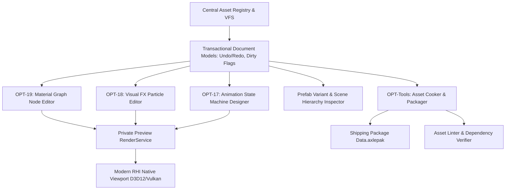

# Milestone 18 — Content Authoring Studios & Tooling Architecture

## 1. Target and Scope

Phase 05 establishes a unified, crash-resilient content authoring pipeline across AxleEditor and the standalone Runtime. It guarantees that artist-facing authoring tools (Material Graph Editor, Visual FX Studio, Animation State Machine Designer, and Prefab Workflows) consume the exact same underlying asset and rendering contracts as the standalone Runtime, eliminating visual divergence between Editor viewports and shipping games.

Supporting references: [`POST_OPT10_PROGRAM_PLAN.md`](../../archive/design/deferred/POST_OPT10_PROGRAM_PLAN.md), [`ANIMATION_PHASE_40_COMPLETION_PLAN.md`](../../archive/design/deferred/ANIMATION_PHASE_40_COMPLETION_PLAN.md), [`VFX_PHASE_39_COMPLETION_PLAN.md`](../../archive/design/deferred/VFX_PHASE_39_COMPLETION_PLAN.md).

---

## 2. Architecture and Subsystems

### 2.1. Transactional Document Architecture
- Authoring tools operate on explicit document models with structured undo/redo command stacks.
- Modification marks documents dirty; saving writes canonical UTF-8 text formats (`.axleasset`, `.axlemat`, `.axlevfx`, `.axlescene`).
- Asset reloads use last-known-good fallback caching to ensure invalid edits never crash the editor.

### 2.2. Isolated Preview Viewports
- Asset previewers (Material Inspector, VFX Studio, Animation Player) create isolated, private `RenderWorld` instances with dedicated preview cameras and authored lighting rigs.
- Preview rendering completely avoids mutating the active editing scene or sharing global state.

### 2.3. Animation Studio & Runtime Bridge (`OPT-17`)
- **Animation Evaluator:** Decoupled skeletal evaluation streaming final 128-bone matrix palettes into GPU Structured Buffers. Supports 1D/2D blend spaces with phase continuity, state machine crossfades, and procedural root motion.
- **IK & Sockets:** Analytical 2-bone Foot IK raymarching against ground collision; socket transforms attached to animated bone hierarchies.

### 2.4. VFX Studio & Particle Bridge (`OPT-18`)
- **Particle Simulation:** High-performance particle simulation (SoA layout) with compute-driven particle sorting and GPU instanced billboard, ribbon/trail, and 3D mesh rendering.
- **GPU Particle Graph:** Compute shader simulation pipelines dispatched via indirect draw commands (`ExecuteIndirect` / `vkCmdDrawIndirect`).

### 2.5. Material Graph Visual Authoring (`OPT-19`)
- Interactive node-based graph canvas with real-time shader recompilation via DXC.
- Immediate visual reflection of parameter changes (Albedo, Roughness, Normal, Clearcoat, Refraction) with integrated DXC shader error reporting.

### 2.6. Asset Cooker & Packaging Pipeline (`OPT-Tools`)
- Dependency tree traversal, BCn texture compression, offline shader cache compilation, and packaging into monolithic `Data.axlepak` containers.

---

## 3. Technology and Boundaries

1. **Decoupled UI Layer:** ImGui functions purely as an input/presentation client. No engine rendering logic or asset persistence logic is embedded inside UI code.
2. **Runtime Parity:** Any shader, particle effect, or animation configured in the Editor must render byte-identically in `AxleRuntime.exe`.
3. **Thread Safety:** Asset loading, baking, and thumbnail generation execute on background worker threads via enkiTS without stalling the main UI loop.
