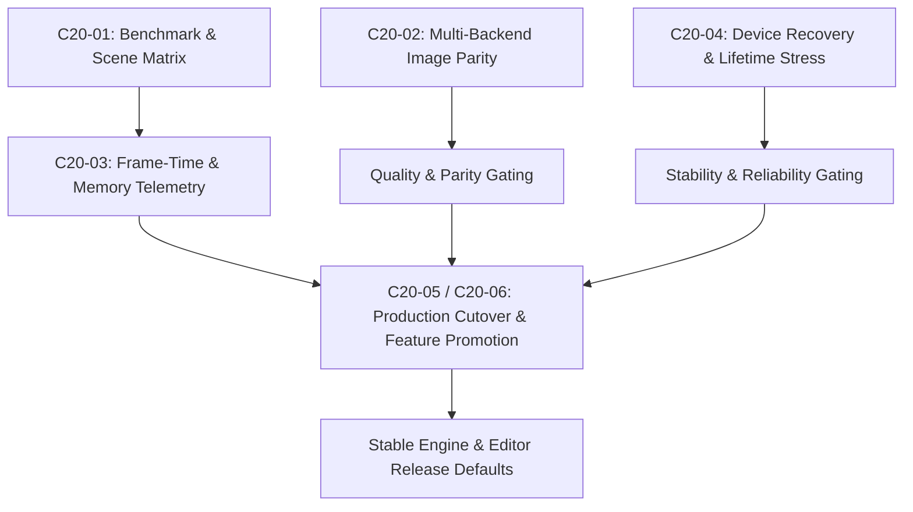

# Milestone 18 — Performance and Rollout Architecture

## 1. Target and Scope

Phase 06 serves as the final qualification, stabilization, and release gating layer of AxleEngine. Its primary objective is to convert verified experimental features (such as modern RHI pipelines, GPU culling, simulation LOD, and advanced shading) into stable, production-grade engine defaults without introducing regressions in image quality, fallback behavior, resource lifetimes, or application startup.

Rollout is an authoritative architectural decision layer: features are promoted based on reproducible, empirical measurements across supported hardware tiers, rather than arbitrary assumptions.

---

## 2. Architecture and Subsystem Boundaries

### 2.1. Telemetry and Benchmarking Framework (`C20-01`, `C20-03`)
- **Standardized Scene Matrix:** Benchmarking executes against reproducible reference scenes (`MaterialReference`, `CarTest`, `OffRoadTrack`, and synthetic dense geometry fixtures).
- **Deterministic Camera Paths:** Automated flying camera splines ensure identical viewpoint sequences across runs, eliminating human interaction variance.
- **Percentile Frame Metrics:** Measurements capture minimum, median (p50), 95th percentile (p95), 99th percentile (p99), and maximum frame times for both CPU main thread, worker threads, and GPU execution.
- **Hardware-Isolated Profiling:** GPU timings use native NRI timestamp queries calibrated against `CommandQueue::GetTimestampFrequency()`. CPU profiling uses monotonic `std::chrono::steady_clock` with nanosecond precision.
- **Memory Tracking:** Tracks VRAM commit/reservation, transient heap aliasing efficiency, and host heap allocations per frame.

### 2.2. Multi-Backend Image Parity (`C20-02`)
- **Cross-Backend Golden Comparison:** Renders identical scenes on Direct3D 12, Vulkan 1.3, and legacy OpenGL 4.5.
- **Automated Differential Analysis:**
  - Peak Signal-to-Noise Ratio (PSNR): $\text{PSNR} \ge 40.0\text{ dB}$ for equivalent PBR lighting passes.
  - Structural Similarity Index (SSIM): $\text{SSIM} \ge 0.985$.
  - Exact maximum channel error thresholds ($\Delta \text{RGB} \le 4/255$) to distinguish precision differences from functional bugs.
- **Fallback Verification:** Validates that when hardware features (e.g. Mesh Shaders, Local Shadow Atlas) are unsupported, the engine falls back gracefully to classical indexed draws or analytical lighting with visible diagnostics.

### 2.3. Reliability, Device Recovery, and Stress (`C20-04`)
- **Window and Presentation Stress:** High-frequency viewport resize sweeps, rapid window minimization/restoration, and multi-monitor DPI transitions.
- **Simulated Device Loss:** Injects `DXGI_ERROR_DEVICE_RESET` / `VK_ERROR_DEVICE_LOST` to verify that `RHIDevice` tears down transient command pools, re-allocates pipelines, and restores scene rendering without fatal process termination.
- **Lifetime & Resource Leaks:** Validates zero dangling GPU descriptor handles, leak-free shutdown via MSVC CRT debug heap checks, and zero NRI/Vulkan Validation Layer errors.

### 2.4. Production Cutover and Promotion Policy (`C20-05`, `C20-06`)
- **Tiered Promotion Matrix:**
  - *Tier A (Production Default):* Tested on $\ge 2$ GPU vendors, passes full CTest suite, zero validation errors, 99% frame time $\le 16.6\text{ ms}$ (60 FPS) in benchmark scenes.
  - *Tier B (Opt-In / Experimental):* High-end features (e.g. Meshlet DAGs, real-time DDGI) accessible via explicit project settings or command-line flags (`--enable-mesh-shaders`).
  - *Tier C (Deprecated / Fallback):* Legacy paths maintained strictly for compatibility (e.g. OpenGL Forward renderer), emitting clear diagnostics.

---

## 3. Technology and Constraints

1. **Hardware Calibration:** Every published measurement must record GPU model, driver version, VRAM capacity, CPU model, OS build, resolution, and compilation profile (`Debug` vs `Release`).
2. **Deterministic CI/CD Integration:** Performance regression suites must run in headless test environments with fixed execution boundaries to prevent flaky CI results.
3. **No Phantom Optimizations:** Micro-optimizations that degrade readability without measurable frame-time reduction ($\ge 0.2\text{ ms}$) are rejected.
