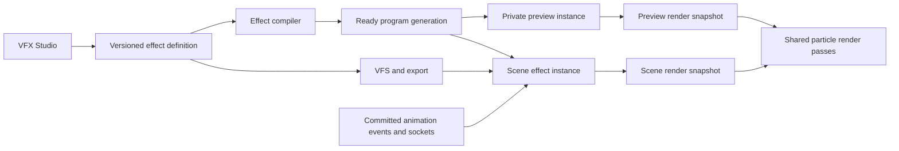

# Milestone 18 — Visual FX Studio and Particle Architecture

This document defines the target for [M18](PLAN.md). The plan owns implementation order and acceptance evidence.

## 1. Ownership and data flow

| Owner | Owns | Publishes |
| --- | --- | --- |
| **Asset and VFS** | Native UUID resolution, schema validation, dependency edges and immutable definition revisions. | Validated definitions and resolved resource identities for loose and mounted content. |
| **VFX compiler and evaluators** | Parameter sampling, effect programs, playback semantics, CPU/GPU module execution and route validation. | Ready program generations, simulation results and diagnostics. |
| **Scene VFX service** | Authored ECS bindings, independent effect instances, fixed ticks, commands, physics queries, event delivery and pooled lifetimes. | Committed event traces and render snapshots. |
| **VFX Studio** | Working documents, authoring transactions, preview transport and inspection. | Draft revisions and validated save/apply operations. Its preview instance has private runtime state. |
| **Renderer and RHI** | Per-view draw preparation, native resource leases, barriers and command submission. | Draw results and rendering diagnostics. |

A1 cuts over the primary `Config/System` aliases, stack state and per-entry-point tick behavior. An ECS binding stores authored inputs and a runtime handle. An instance owns its clock, seed, overrides, pools, transform history and pending events. A definition carries data suitable for serialization and sharing across instances. Runtime-only fields such as collision callbacks, loaded mesh samplers and GPU buffers belong to the execution or resource layer. Scene cloning and Play entry create fresh instances. Character and plugin entry points that remain supported issue lifecycle and spawn commands through the same service.

## 2. Asset identity, publication and Studio

Use a versioned native `.axleasset` with `ParticleEmitter` kind, embedded file UUID, stable emitter and parameter IDs, and explicit resource references. Persist seeds, local emitter transforms, enabled and trigger-only settings. Use canonical asset-root-relative paths for raw resources and UUIDs for native assets. Preserve the embedded UUID on save and move. Save As to a new asset creates a new UUID. Discover identities directly from native assets into the in-memory registry and reuse the identity contract in export and mounted Runtime.

Use a shared binding codec for Scene and Assembly. A reference binding stores the asset UUID and typed overrides, and an inline binding stores its own authored definition. Make Unique explicitly converts a reference into an inline copy. Apply commits the working copy to an inline binding or applies compatible instance overrides to a reference. Saving changes to a shared definition is an explicit asset operation. Unresolved or rejected references report the owner, UUID and failing field. An already running instance can retain a compatible ready generation after a failed reload. Initial load requires a resolvable, valid definition. Preserve supported current authoring through the cutover and record how each existing entry point is handled.

Resolve reads through the mounted VFS or loose asset root using the same codecs. Use one dependency view for load validation, Editor diagnostics and export. Include authored texture/atlas, normal map, material and its dependencies, Mesh Surface source, rendered geometry and child effect references wherever supported. Preserve values of disabled modules in the definition and determine required shipping inputs from the routes and variants being exported. Validate transitive references, then compare the required closure to the produced package. M18 uses the current exporter and provides M20 with the typed dependency and runtime artifact inventory.

Studio edits a detached working copy with transaction-based undo/redo, a saved revision and dirty guards. Validate assets before atomic save and publish scene-bound changes as one commit. The shared evaluator runs Studio, Edit viewport, Play and Runtime instances. Studio may use matching scene collision inputs or an isolated fixture. Preview uses private clocks, pools, events and GPU allocations, and scrubbing exposes a local trace. Editing, scrubbing or closing Studio leaves the active Scene's instance state and event delivery intact.

## 3. Fixed-tick simulation and gameplay

### Transport and parameters

- Process authored changes and gameplay commands at a simulation boundary. Give `Play`, `Pause`, `Resume`, `Stop Emitting`, `Stop and Clear` and reset explicit semantics shared across contexts. A paused instance preserves playback state. Stop Emitting lets existing particles finish. Clear or reset invalidates prior particle handles and queued work. Treat visibility and culling as presentation or declared scalability inputs.
- Seek by replaying bounded fixed steps from a reproducible starting state. Rewind and prewarm use the same step rules as playback and suppress external gameplay delivery. Surface pending seek when it spans frames. Consume finalized transforms in the fixed tick and publish at most one simulation result per logical tick regardless of view count.
- Derive random samples from the instance seed, stable emitter ID, particle spawn identity and stable parameter or event ID. Use a distinct domain for emitter-level scheduling and burst samples. Store a birth-sampled random fraction for a two-curve parameter and evaluate its curves over the declared time domain. Validate units, normalized domains and values. Track particle identity independently of its current dense pool slot.
- Persist public input defaults and instance overrides by stable parameter ID and type. Validate updates before committing them to the instance. Retain compatible overrides when a new program generation is installed. Report invalidated overrides and resolve to the authored default.
- Keep previous and current emitter transforms and the rate-over-distance remainder across fixed steps. Emit at positions along the movement segment, with a defined teleport/reset rule that avoids bridging the discontinuity. Define start-delay, loop seam, prewarm and remainder behavior. Convert local/world positions and velocities explicitly. Separate emitter motion inheritance from values inherited from a sub-emitter event.

### Physics and events

- Scene owns a bounded collision query service. Select floor, authored planes/boxes or scene-geometry queries by the authored collision mode. Declare query filters, per-instance and scene caps, and missing-service behavior. Carry collision space and hit data through explicit inputs and outputs. Measure dropped queries and verify the same selection for every emitter.
- Within an effect, route child links by stable emitter ID, validate the link graph and reject cycles on publication. Collect Birth, Collision and Death records with instance/emitter/particle identity, position, normal when available and inheritable values. Apply the declared stable order using tick, instance, emitter and spawn identities and event sequence. Bound query, event, spawn and nesting work, and report rejected or dropped work. Drain at the documented commit point so repeat views cannot create new events.
- Expose game-side spawn at a world transform or socket, typed overrides, event injection, transport commands and subscriptions through generation-safe handles. Observe the [M17 publication contract](../MILESTONE_17_ANIMATION/ARCHITECTURE.md#4-simulation-physics-and-presentation) for marker and final socket transforms. Deliver external callbacks after Scene commits the tick. Callbacks request mutations through the Scene command boundary. Invalidate retired events and listeners on removal, reset, replacement, scene shutdown or pool return.
- Route emitters that own authoritative physics queries or gameplay events to CPU. Mixed effects may pass declared CPU-authored spawn commands to cosmetic GPU emitters. Validate supported cross-route event edges before publication. Frame visibility and quality changes leave authoritative gameplay semantics intact.

## 4. Draw snapshots, materials and views

Publish compact immutable CPU draw data for live particles or a ready GPU generation with frame lifetime. This contract carries a stable effect/emitter identity, conservative bounds, draw mode, transforms, material/resource generations and the renderer attributes needed by the mode. A draw snapshot can serve several views. Each view owns any culling, depth keys and draw data that depend on that view. Lease all native inputs through submission retirement.

- **Billboards.** Preserve camera-facing, axial and velocity alignment and declared alpha, additive, multiply and cutout modes. Use the native material adapter for authored particle inputs.
- **Ribbons.** Build camera-facing strips from bounded history keyed by stable particle identity and instance generation. Include width, history length and conservative bounds. Define sampling, stretch/wrap UVs, death retirement and reset so a reused dense slot starts with fresh history.
- **Meshes.** Use indexed instancing with mesh/material leases, per-particle scale and orientation, conservative bounds and per-view transparent depth keys. Specify the compatible native material route for each blend and lighting mode. Mesh Surface is a spawn shape with its own geometry dependency.
- **Flipbook.** Keep current frame, adjacent frame and blend weight. Define wrap/clamp and atlas boundaries, and blend shader samples in linear space. Document compatible material settings and any feature fallback.
- **View integration.** Define sort layers and back-to-front depth ordering for order-dependent particles, including overlapping emitters and stable ID ties. Document boundaries with scene transparency, and only reuse a sorted result across views that have equivalent ordering. Use a compatible scene depth view for soft particles and report the effective behavior for MSAA and other unsupported views. Verify particle participation in declared fog, temporal/reactive and capture modes.

## 5. Scalability and diagnostics

Use authored conservative bounds to drive frustum and distance culling. Define quality tiers and a stable priority rule for cosmetic instance admission, spawn scaling, update frequency and renderer cost. An offscreen cosmetic instance may continue, throttle or suspend according to its tier. Document how its clock, history and bounds behave when it returns. Authoritative CPU simulation continues according to its gameplay contract, with its own query/event limits.

Bound live particles, instance counts, pool memory, ribbon segments, work queues, per-view sort scratch and GPU dispatch sizes at instance and scene levels. Keep reusable allocations within those limits and invalidate handles when recycling an instance. Surface requested/effective route, backend, revision, culling reason, particle and instance counts, rejected spawns, queries/events dropped and CPU/GPU timings in Studio and Scene/Runtime diagnostics. Scope repeated diagnostics to the responsible instance, generation or route.

## 6. GPU simulation and the shared indirect contract

Use an effect-independent compute-to-indexed-indirect fixture as the native reference. Verify the ABI, layout/stride/offsets, count buffer limits, zero draws, declared compute-to-argument transitions and overlapping frames on D3D12 and Vulkan. When hardware lacks count-buffer support, a fixed-count mode submits a known bounded range with safe arguments and zero instance counts for unused draws. M21 consumes this contract and fixture and adds geometry-specific policies.

Queue simulation work by logical tick and instance. GPU spawn/update, live/dead management, compaction and argument generation execute independently of view rendering. Run view-dependent sorting after the simulation generation is ready. Alpha routes require a bounded sort with stable ties and safe padding; additive work may skip sorting. Declare compute/graphics and inter-frame dependencies in RenderGraph. Reuse buffers only after their last relevant submission retires. Publish ready generations with resource leases and device-epoch identity. Reset, resize, replacement and shutdown independently retire Preview and Scene work. Shipping frames submit from GPU-authored buffers without synchronous readback.

| Route | Required M18 support |
| --- | --- |
| **D3D12/Vulkan CPU** | Full planned CPU modules, authored and scene collision, authoritative gameplay events, and billboard/ribbon/indexed mesh output. Validate the renderer/material/quality combinations exposed in Studio. |
| **D3D12/Vulkan GPU** | Bounded rate and burst, lifetime, point and sphere emission, transform and initial velocity, constant acceleration, normalized lifetime curves for size and speed, color/alpha gradients, flipbook, additive and sorted alpha billboards, compaction and indirect submission. |
| **OpenGL CPU compatibility** | The declared CPU billboard route and its tested module, material, blend and depth subset. Diagnostics identify unsupported output requests. |

Resolve the effective route using the requested mode, compiled feature requirements and native capability. Automatic CPU fallback requires a validated implementation with matching authoring semantics. A GPU-required route or an unsupported renderer reports a clear failure when capabilities are missing. Keep the mapping by backend, module, output, blend and view in the plan evidence and expose the same decision in Studio and Runtime.

## 7. Graph compilation and publication

Graph authoring stores versioned topology, stable node/pin IDs, typed values, exposed inputs, resource references and editor layout. Module and graph authoring feed the same validated effect program. Compile declared spawn, initialization, update and output stages, with acyclic typed data flow and supported-route checks. The initial node set can express each feature in the GPU billboard tier above. Graph diagnostics name the revision, node or field and applicable route.

A compiler job consumes immutable authoring inputs. It may publish only if its document and revision are still current and all required artifacts are ready. Finalize device-bound resources on the renderer's owning thread. Failed or obsolete results leave the most recent compatible ready generation available. A successful revision replacement swaps at a commit boundary and applies the documented parameter/instance reset policy. Closing Studio invalidates pending preview publication.

Export validated runtime programs and required resources for the supported package routes. Detached Runtime resolves them using the same UUIDs, bindings and declared capability policy. Verify that preview recompilation, a missing package dependency and an unsupported route each produce their own observable result.

The final [M18 evidence matrix](PLAN.md#5-fixture-and-evidence-matrix) exercises these boundaries from Editor authoring through detached Runtime on the supported backends.
