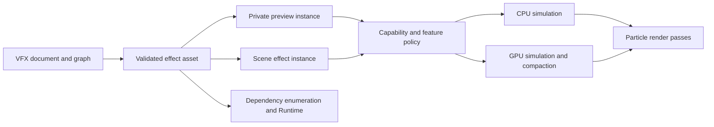

# Milestone 18 — Visual FX Studio and Particle Architecture

## 1. Product boundaries

The versioned effect definition and optional graph are authored data. Scene entities and the Editor preview each own independent clocks, seeds, particle pools and child-emitter queues. Render extraction publishes bounded immutable draw data or a frame-scoped GPU simulation generation. The Editor is a client of the shared effect definition, not the owner of scene simulation or serialization policy.

## 2. Document and CPU simulation

- Preserve canonical effect identity, stable emitter IDs, seed, transforms, resource references, trigger-only state and disabled module values. Maintain a validated effect dependency view for texture, material, imported mesh and child effects where supported. Atomic save and detached working copies protect committed assets and live instances. Validate and explicitly copy when applying to the scene.
- Sample random parameter values from stable per-instance, emitter, particle and parameter identities. Define when a value is sampled versus evaluated from normalized age. Keep spawn position and rate-over-distance remainder across fixed steps; explicitly handle teleport, restart, looping, start delay and bounded prewarm. Use world/local conversion through instance transforms and separate emitter inheritance from sub-emitter inheritance.
- Physics uses Scene-owned collision services with bounded requests. An ordered event queue carries the emitter and generation, position, normal and inherited values for Birth, Collision and Death. Define event, spawn and nesting limits and a stable overflow policy. Dispatch after simulation work has published its results. External subscriptions must be invalidatable on removal, shutdown and generation change.

## 3. Draw data and render passes

Billboards, ribbons and instanced meshes have explicit draw modes and reflected layouts. Keep source Mesh Surface sampling independent from rendered mesh output. Ribbon history is bounded by per-effect limits and keyed by a generation-safe handle. Mesh draws carry validated mesh/material generations, per-particle orientation and scale, conservative bounds and per-view depth sorting where blending requires it. Use scene depth for soft particles only when a compatible depth view exists. Define linear blend and frame addressing for sub-frame flipbook output.

Particle views consume the shared render service and RenderGraph. Resolve resource leases to frame completion. Establish independent sorting or validated reuse for each applicable view and stable sorting ties. A preview has its own resources and simulation state even when render services are shared. Declare draw support by backend, renderer, blend mode and view.

## 4. Native indirect contract and GPU subset

The shared RHI fixture covers compute-to-indexed-indirect layout, stride, offsets, count buffer use, zero draws, caps, declared graph transitions and overlapping frames. A fixed-count fallback must use known safe argument contents and zero unused draws. M21 adds geometry-specific culling/count policies and validates them with the existing fixture plus production geometry cases.

GPU passes own spawn/update, live/dead allocation and compaction, optional sort and indirect draw argument generation. Run compute dispatch and graphics indirect draw as separate operations with explicit generation leases and barriers. Publish only a ready, complete generation. GPU budgets bound particles, dispatch sizes, sorting scratch and event traffic. Expose counters for live, rejected, dropped and drawn work. Avoid synchronous readback in the shipping frame loop. Interactive preview and scene simulation can each reset, recompile, resize and shut down without altering the other instance.

The visual graph is versioned with typed pins, stable node IDs, a validated acyclic evaluation structure and a documented set of supported CPU and GPU modules. A compiler job consumes an immutable graph revision and publishes only a current, valid generation. Keep error diagnostics with node IDs and the last usable output. Features that require authoritative gameplay or physics use the supported CPU route unless their semantics and readback policy have an explicit equivalent. Effective-route telemetry identifies unsupported features, capacity policy and fallback. OpenGL uses the declared CPU subset.
