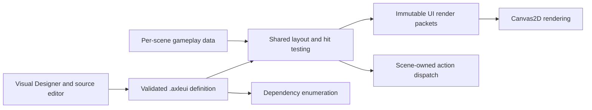

# Milestone 19 — Canvas2D and In-Game UI Architecture

## 1. Product boundaries

| Layer | Responsibility |
| --- | --- |
| Canvas assets | Declarative `.axleui` tree, stable node IDs, style/layout properties, native asset identity, binding and action declarations. |
| Document and layout | Validate authored input, construct an immutable definition, resolve logical rectangles, clips, draw order and hit regions. |
| Runtime instance | Instance data values, evaluated UI state, focus/capture, action routing and scene attachment. |
| Canvas2D renderer | Draw from an immutable frame packet with referenced font/texture resources. Handle DPI, color/blend state and render-target lifetimes. |
| Canvas Designer | Typed Editor transactions, hierarchy/Inspector, visual handles, source view, resource pickers and an isolated preview instance. |

## 2. Authoring and persistence

Reuse `UIDocument`/`UIParser` and the existing identity and file replacement helpers. Model IDs, parent-child order and typed fields independently of widget pointers or array indices. Validate finite layout inputs, unique IDs, bounded nesting and supported kinds before replacing the preview or publishing a Runtime generation. Represent selection by stable ID. A visual edit updates the working model within a transaction; direct source edits are a separate candidate until parsed and validated. Committed revision, working revision and selected node survive undo branching and supported reloads. A failed save retains the last committed bytes and preserves the dirty working copy.

Expose font, image and any supported nested document references via typed dependency enumeration. Native assets resolve through embedded asset identity, raw resources through canonical project-root-relative paths. Avoid persisting computed rectangles, pointer capture, sample values or other preview-only state. Keep schema migration diagnostics with exact document/node context.

## 3. Layout and coordinates

Use logical units within the canvas rectangle. Apply explicit parent-relative anchors, offset and size constraints before child flow. Define ordering for content measurement, arrangement and clipping and use that same result for hits and drawing. Maintain determinism for stable sibling order and equal hit priorities. Convert logical coordinates at viewport/render-target/input boundaries and account for the target's DPI, aspect ratio and screen origin once. A clipped or hidden node cannot receive a pointer hit. Bound invalid, empty or over-constrained geometry deterministically and surface a usable diagnostic for authored failures.

## 4. Runtime binding, input and actions

Runtime owns per-instance evaluated values. Gameplay publishes typed values through the established data context; the UI evaluates bindings with documented conversions, update ordering and defaults for missing values. Action names resolve through a scene-owned registry scoped to the active Runtime. Dispatch validates the scene and generation and runs on the defined simulation/UI boundary after collecting an event. Capture and focus reset on hide, remove, reload, Play/Stop or scene teardown. Pointer and keyboard routing use canvas sort order, transformed coordinates and focus ownership. Define which screen-space and texture-space input modes are supported. A Designer preview uses local sample data and isolated actions.

## 5. Renderer and diagnostics

Generate the same semantic draw packet for the comparable Editor and Runtime paths. Include clip rectangles, draw order, premultiplied or straight-alpha convention, DPI scaling and generation-safe font/image leases. Draw through the existing Canvas2D backend with a compatible offscreen target for preview and render-to-texture. Use fallback resources only where the documented policy marks the reference optional, with an actionable warning. Resolve GPU lifetimes through completion. The shipping Canvas and scripting contracts remain independent of Editor widgets and ImGui context ownership.
