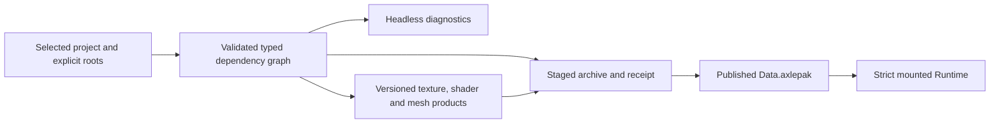

# Milestone 20 — Asset Cooking, Linting and Packaging Architecture

## 1. Pipeline ownership

| Layer | Responsibility |
| --- | --- |
| Project and content collectors | Immutable project snapshot, selected scene/plugin roots, shader and platform settings and declared dynamic references. |
| Domain codecs | Parse their own authored assets and enumerate typed dependencies, requiredness, stable identity and owning field context. |
| Cooker and linter | Share graph construction, normalization, validation and diagnostics. The cooker adds derived outputs and package publication. |
| Package and VFS | Versioned read/write, checked archive lookup and integrity, mount in standalone Runtime and expose the existing read interface. |
| Editor/CLI | Report progress and diagnostics and select existing product workflows. Runtime consumes published metadata and assets through normal decode paths. |

## 2. Discovery, identity and dependency validation

Resolve UUID-bearing authored assets through the existing embedded identity and raw files through canonical root-relative paths. Rediscover content indexes through established asset services. Preserve the metadata-free policy for raw files. Use typed edges from production codecs instead of searching source text. Each edge carries owning asset and field, target and kind, and requiredness; explicit root declarations cover dynamic references that static traversal cannot infer. Required missing assets fail the selected cook. Optional references have a defined fallback and diagnostic. Treat repeated graph edges as deduplicated work while validating schema-specific forbidden cycles and limits on depth/resources.

Normalize identity and paths before scheduling. Reject an input that escapes roots, aliases another normalized archive key, supplies conflicting identity or violates link policy. Keep deterministic ordering independent of filesystem enumeration and worker timing. Report root-to-error provenance and surface issues through the same diagnostic model in the linter and export workflow. Preserve the validated plugin snapshot and product isolation boundaries from OPT-09.

## 3. Derived asset and cache contract

A product key combines input identity, source and relevant transitive content revision, schema, settings/profile, backend or target format and producer/tool version. Store derived artifacts through existing generated-cache and package conventions. Validate bounded sizes, compatibility and payload section integrity before reuse. A worker produces a complete temporary output and publishes it only for the matching snapshot after validation. Missing or corrupt cache entries can rebuild from the source snapshot. Optional incompatible runtime payloads fall back through their domain decoder to a valid base product, with a diagnostic. M21 uses this interface for imported and packaged mesh derivatives.

Texture recipes record format, color space, channel interpretation, size and mip policy. Bake color mips in the correct color domain and renormalize normal mips. Keep explicit policies for unsupported source/target combinations and require mandatory assets to have a valid target product. Shader keys incorporate backend/format, shader model, compiler identity, source and transitive includes, defines, feature/layout schema and relevant options. Portable bytecode is separate from device/driver-specific pipeline cache records. Runtime accepts a compatible cooked entry or follows its declared fallback with a recorded reason.

## 4. Archive, integrity and rollback

Extend package capabilities via header/entry schema, explicit codec identifiers and compressed and uncompressed bounds. Preserve safe reading of the established uncompressed baseline. Validate table ranges, arithmetic, decompression limits and integrity before exposing a requested entry. Treat strict packaged launch as its own mode with assets resolved from the package and declared bundled resources. Continue to use shared codecs to interpret mounted content. Receipts record source snapshot, selected Runtime, backends/targets, graph, product keys, sizes and artifact hashes.

Stage the archive, project and shipping companions together. Verify payloads and receipt before publishing a complete generation. A failed or canceled cook leaves the prior valid generation usable. Separate CPU validation and staging from the UI thread, with cancellation at bounded checkpoints and a single publication owner. Protect cache writes from partial or concurrent publication. Preserve actionable failure output from the CLI and Editor.
