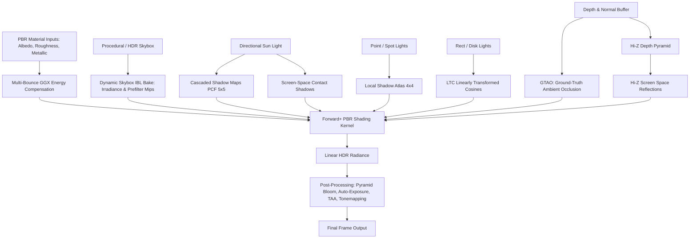

# Phase 02 — Lighting and Material Fidelity Architecture

## 1. Target and Scope

Phase 02 elevates AxleEngine's lighting, shading, and material systems from foundational Cook-Torrance Forward+ PBR to cinematic-grade photorealism (AAA fidelity). All geometry receives physically coherent direct lighting, energy-conserving indirect environment reflection (IBL), tight contact occlusion, and seamless fallback across modern RHI (Direct3D 12, Vulkan) and legacy OpenGL compatibility paths.

Supporting detailed roadmap reference: [`docs/archive/design/deferred/ADVANCED_MATERIAL_FIDELITY_ROADMAP.md`](../../archive/design/deferred/ADVANCED_MATERIAL_FIDELITY_ROADMAP.md).

---

## 2. Architectural Layers and Algorithms

### 2.1. Energy-Conserving BRDF & Material Models
- **Multi-Bounce GGX (Kulla-Conty):** Standard single-scatter GGX loses $20\% - 40\%$ energy at high roughness. Phase 02 integrates the Kulla-Conty multi-scattering compensation term:
  $$f_{\text{add}} = \frac{(1 - E_{\text{ss}})(1 - E_{\text{ss}, v})}{\pi (1 - E_{\text{avg}})} \cdot \frac{F_{\text{avg}}}{1 - F_{\text{avg}} (1 - E_{\text{avg}})}$$
  restoring luster to rough metals (satin aluminum, rough gold, cast iron).
- **Subsurface Scattering (Screen-Space SSS):** Separable Gaussian diffusion profile for skin, wax, jade, and translucent plastics.
- **Cloth and Sheen BRDF (Charlie Model):** Simulates micro-fiber grazing retro-reflection for velvet, silk, and suede.
- **Volumetric Absorption (Beer-Lambert):** Physical light extinction $T = e^{-\sigma_a \cdot d}$ for thick colored glass and liquids.

### 2.2. Multi-Tier Reflection System
- **Tier 1 (Hi-Z Screen-Space Reflections):** Raymarching across hierarchical depth mip chains with roughness cone tracing, providing local reflections of floors, walls, and neighbor meshes.
- **Tier 2 (Parallax-Corrected Reflection Probes):** Local box/sphere cubemaps capturing interior environments, providing seamless fallback when SSR rays miss or leave screen bounds.
- **Tier 3 (Dynamic Atmospheric IBL):** Renders the procedural atmospheric sky dome to a dynamic $128 \times 128 \times 6$ cubemap, generating real-time Irradiance and Prefilter LODs so metallic materials naturally mirror the sky without requiring external HDR files.

### 2.3. Micro-Shadowing & Contact Occlusion
- **GTAO (Ground-Truth Ambient Occlusion):** Horizon-based hemispherical integration with edge-preserving spatial bilateral filtering, grounding geometry firmly to floors.
- **Screen-Space Contact Shadows:** Raymarching short depth screen rays toward the sun, eliminating shadow acne and Peter Panning at ground-contact seams.

### 2.4. Realistic Area Lights (LTC)
- **Linearly Transformed Cosines:** Replaces idealized zero-dimension punctual lights with physical Rectangular and Disk area lights, producing authentic softbox studio reflections.
- **Sun Angular Diameter:** Muzzle expansion of direct directional sun specular lobes based on the actual solar angular size ($0.53^\circ$).

### 2.5. Cinematic Post-Processing Pipeline
- **Physically Based Pyramid Bloom:** Dual Kawase / Gaussian downsample-upsample pyramid producing natural lens flare and specular glow.
- **Histogram-Based Auto-Exposure:** Compute shader log-luminance histogram ($64 - 256$ bins) modeling human eye dark/light adaptation.
- **Temporal Anti-Aliasing (TAA):** Sub-pixel jittering with neighborhood clamping (YCoCg), completely eliminating specular flicker on metallic silhouettes.

---

## 3. Technology and Compatibility Limits

1. **RHI Ownership:** Direct3D 12 and Vulkan via NRI serve as the primary backends for advanced compute/graphics passes (GTAO, Hi-Z SSR, TAA).
2. **OpenGL Fallback Policy:** OpenGL 4.5 retains functional compatibility via analytical ambient and punctual lights, explicitly reporting when compute-driven features (SSR, GTAO) are bypassed.
3. **Hardware Independence:** High-end features remain scalable via quality presets (`Low`, `Medium`, `High`, `Ultra`).
