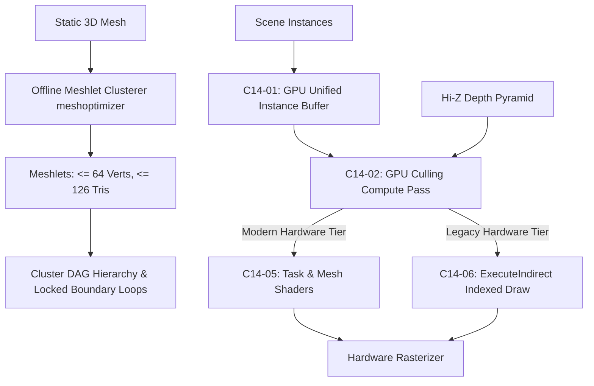

# Phase 03 — Geometry and Visibility Architecture

## 1. Target and Scope

Phase 03 establishes scalable, high-throughput geometry rendering for AxleEngine. The core goal is to render dense scenes containing tens of millions of polygons and tens of thousands of instances with zero CPU bottleneck. This is achieved via modern GPU-driven culling, meshlet clustering, cluster hierarchy (Nanite-style DAG), and hardware Task/Mesh Shaders, while guaranteeing 100% correct fallback to indexed draws on older hardware.

Supporting references: [`POST_OPT10_PROGRAM_PLAN.md`](../../archive/design/deferred/POST_OPT10_PROGRAM_PLAN.md), [`POST_OPT10_FEASIBILITY.md`](../../design/POST_OPT10_FEASIBILITY.md).

---

## 2. Architecture and Pipeline

### 2.1. Unified GPU Instance Data (`C14-01`)
- Consolidates world transforms, bounding spheres, axis-aligned bounding boxes (AABBs), material indices, and visual flags into a single structured buffer on VRAM.
- Eliminates per-instance CPU traversal and individual uniform buffer updates.

### 2.2. GPU-Driven Culling & Hi-Z Occlusion (`C14-02`)
- **Frustum Culling:** Fast sphere-frustum intersection in compute shaders.
- **Orientation & Cone Culling:** Normal cone rejection for backfacing clusters before rasterization.
- **Two-Phase Hi-Z Occlusion Culling:** Tests bounding boxes against a hierarchical depth buffer (Hi-Z pyramid). Objects occluded by walls, mountains, or foreground structures are discarded immediately on the GPU.
- **Indirect Argument Generation:** Compute shaders write directly to `ExecuteIndirect` (D3D12) / `vkCmdDrawIndexedIndirect` (Vulkan) argument buffers.

### 2.3. Meshlet Asset Pipeline (`C14-03`)
- Uses `meshoptimizer` (`meshopt_buildMeshlets`) to divide meshes into bounded clusters: $\le 64$ vertices, $\le 126$ triangles per cluster.
- Computes tight bounding spheres and cone apex/axis for early culling.
- Binary asset caching into `.axlebin` for zero-cost runtime loading.

### 2.4. Cluster DAG Continuous LOD (`C14-04`)
- Organizes clusters into a Directed Acyclic Graph (DAG) for continuous Level-of-Detail (LOD).
- **Locked Boundary Loops:** Shared borders between adjacent clusters are locked during decimation, guaranteeing 100% watertight transitions with zero visual cracking.

### 2.5. Hardware Task & Mesh Shaders (`C14-05`)
- **Task Shader (Amplification):** Evaluates projected screen-space error per cluster to select continuous LOD levels dynamically, issuing mesh shader threadgroups.
- **Mesh Shader:** Directly emits primitives to the rasterizer, completely bypassing legacy input assembler and vertex fetch bottlenecks.

### 2.6. Capability Gate & Indexed Fallback (`C14-06`)
- Strict runtime feature detection: GPUs without Task/Mesh Shader support automatically use GPU-culled indirect indexed draws with discrete LODs, ensuring 100% functional parity.

---

## 3. Technology and Constraints

1. **Hardware Requirements:** Task/Mesh Shaders require D3D12 Ultimate (Feature Level 12_2) or Vulkan 1.3 with `VK_EXT_mesh_shader`.
2. **Watertight Verification:** Cluster LOD transitions must pass automated crack-detection test fixtures verifying zero pixel leakage along shared edges.
3. **Reproducible Benchmarks:** Dense scene scale claims must identify instance counts, polygon counts, target resolutions, and hardware configurations.
